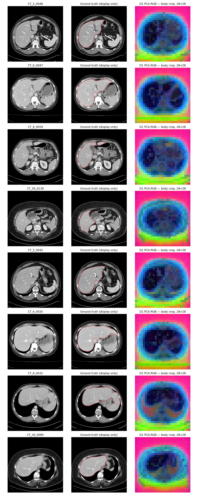

# Local frozen DINO CT liver experiment

All parameters fixed before scoring in `PROTOCOL.json`; producer commands in `commands.txt`. CPU only, no gradient training, downloads, installs or edits outside audit/dino. Each number below is produced by `extract.py`, `fit_score.py`, `pair_affinities.py`, `pair_score.py`, or `report.py`, unless explicitly copied from IMPROVE/SELECTIVITY.

## Local weights

| Requested model | Status | Path / bytes | SHA256 |
|---|---|---|---|
| DINO_v1_ViT_B8 | FOUND | /Users/navneetbavineni/.cache/torch/hub/checkpoints/dino_vitbase8_pretrain.pth / 343279349 | 575f0efc4838938314afa09897a62ed2b87919928b5edcd133abb907328995eb |
| DINO_v1_ViT_B16 | MISSING — skipped if declared | — | — |
| DINO_v1_ViT_S8 | FOUND | /Users/navneetbavineni/.cache/torch/hub/checkpoints/dino_deitsmall8_pretrain.pth / 86728949 | 55c8b267f479b614ec20858947ce361ba804846c193e20be74263a096bb6d75e |
| DINO_v1_ViT_S8 | FOUND | /Users/navneetbavineni/.cache/torch/hub/checkpoints/dino_deitsmall8_300ep_pretrain.pth / 86728949 | 10fee18a0e7714de9005f9d56975ca8993d5fb87dab867868e528132d2be176c |
| DINOv2_ViT_B14 | MISSING — skipped if declared | — | — |
| DINOv2_ViT_L14 | FOUND | /Users/navneetbavineni/.cache/torch/hub/checkpoints/dinov2_vitl14_pretrain.pth / 1217586395 | d5383ea8f4877b2472eb973e0fd72d557c7da5d3611bd527ceeb1d7162cbf428 |

Search scope: project, ~/.cache/torch, ~/.cache/huggingface, ~/Downloads, ~/Documents completed. A broader hidden-home enumeration was interrupted without additional results; global absence outside these searched locations is UNVERIFIED. DINO S/8 and DINOv2 L/14 are inventoried only, not substituted for missing D2/D3. The generic `models/model_epoch_0720_iter_085000.pth` could not be parsed: `PytorchStreamReader failed reading zip archive: failed finding central directory`; its identity is UNVERIFIED.

## Preprocessing and fixed protocol

Existing native512 uint16 CT derivatives: HU[-150,250], linear[0,1], quantized through round(65535*x). Native orientation unchanged; no physical resampling. Same label-free body crop as B2: intensity>0.05, largest8-connected component, holes filled, square with5% margin on each side, zero padding. Resize bilinear antialias to224 for D1; grayscale replicated3 channels; ImageNet mean(0.485,0.456,0.406), std(0.229,0.224,0.225) exactly once. D1 final-block LayerNorm tokens, CLS excluded, per-token L2, uncentered,28×28×768. D2 planned448/B16 and D3 planned392/B14 are unexecuted because weights were not found.

KMeans uses all2341 slices/20 patients without labels, K8/K2, seeds0/1/2, k-means++, n_init3, max_iter100, tol1e-4, Lloyd, float32. Other19 patient labels choose a mapping; heldout labels score only. K8 strict majority (>50%, ties background) and exhaustive256 subsets for IoU optimum; K2 one-to-one Hungarian maximizing confusion count. Pixels outside body crop are always background and never mapped as a cluster. Native nearest upsample/inverse crop;224 primary nearest-resizes native predictions. Mapping is fitted separately at each scoring resolution, matching IMPROVE. No post-processing.

Patient IoU/Dice pool pixels across slices. Average seed metrics within each patient, then report equally weighted20-patient mean, sample SD, min/max. Every fold/subset and per-seed confusion matrix is in `D1_k*_s*_scores.json`; per-seed aggregate rows in `summary.json`.

## Segmentation (%)

| Arm | Grid | K | Mapping | Scoring resolution | IoU mean ± SD [min–max] | Dice mean ± SD [min–max] | Same-image AUC |
|---|---|---:|---|---:|---:|---:|---:|
| D1 | 28×28 | 8 | majority | 224 | 46.037 ± 4.873 [31.695–53.252] | 62.898 ± 4.752 [48.134–69.494] | 0.9316439752389252 |
| D1 | 28×28 | 8 | optimal | 224 | 46.037 ± 4.873 [31.695–53.252] | 62.898 ± 4.752 [48.134–69.494] | 0.9316439752389252 |
| D1 | 28×28 | 8 | majority | 512 | 46.043 ± 4.894 [31.618–53.290] | 62.902 ± 4.773 [48.045–69.526] | 0.9316439752389252 |
| D1 | 28×28 | 8 | optimal | 512 | 46.043 ± 4.894 [31.618–53.290] | 62.902 ± 4.773 [48.045–69.526] | 0.9316439752389252 |
| D1 | 28×28 | 2 | Hungarian | 224 | 0.000 ± 0.000 [0.000–0.001] | 0.000 ± 0.000 [0.000–0.002] | 0.9316439752389252 |
| D1 | 28×28 | 2 | Hungarian | 512 | 0.000 ± 0.000 [0.000–0.001] | 0.000 ± 0.000 [0.000–0.002] | 0.9316439752389252 |
| B0 (historical) | 14×14 | 8 | majority | 224 | 62.872 ± 2.604 [59.044–68.096] | 77.172 ± 1.959 [74.246–81.020] | 0.9460493160776361 |
| B0 (historical) | 14×14 | 8 | optimal | 224 | 62.872 ± 2.604 [59.044–68.096] | 77.172 ± 1.959 [74.246–81.020] | 0.9460493160776361 |
| B0 (historical) | 14×14 | 8 | majority | 512 | 62.733 ± 2.636 [58.909–68.221] | 77.066 ± 1.986 [74.138–81.108] | 0.9460493160776361 |
| B0 (historical) | 14×14 | 8 | optimal | 512 | 62.733 ± 2.636 [58.909–68.221] | 77.066 ± 1.986 [74.138–81.108] | 0.9460493160776361 |
| B2_448 (historical) | 28×28 | 8 | majority | 224 | 69.784 ± 2.959 [61.498–74.452] | 82.168 ± 2.089 [76.159–85.355] | 0.9683638434450452 |
| B2_448 (historical) | 28×28 | 8 | optimal | 224 | 69.784 ± 2.959 [61.498–74.452] | 82.168 ± 2.089 [76.159–85.355] | 0.9683638434450452 |
| B2_448 (historical) | 28×28 | 8 | majority | 512 | 69.801 ± 2.956 [61.565–74.539] | 82.180 ± 2.087 [76.211–85.412] | 0.9683638434450452 |
| B2_448 (historical) | 28×28 | 8 | optimal | 512 | 69.801 ± 2.956 [61.565–74.539] | 82.180 ± 2.087 [76.211–85.412] | 0.9683638434450452 |
| B6 (historical) | 16×16 | 8 | majority | 224 | 0.000 ± 0.000 [0.000–0.000] | 0.000 ± 0.000 [0.000–0.000] | UNVERIFIED |
| B6 (historical) | 16×16 | 8 | optimal | 224 | 29.608 ± 4.265 [22.467–41.877] | 45.482 ± 4.982 [36.646–59.032] | UNVERIFIED |
| B6 (historical) | 16×16 | 8 | majority | 512 | 0.000 ± 0.000 [0.000–0.000] | 0.000 ± 0.000 [0.000–0.000] | UNVERIFIED |
| B6 (historical) | 16×16 | 8 | optimal | 512 | 29.599 ± 4.260 [22.453–41.879] | 45.471 ± 4.977 [36.628–59.034] | UNVERIFIED |

Reference rows copied (no reruns) from `audit/improve/{B0,B2_448,B6}_s{0,1,2}_scores.json`. B6 is DINOv2 ViT-L/14 at224, grid16; it is not declared D3. B0 AUC is the historical SELECTIVITY14-grid full-frame measurement, not the matched28-grid body-crop AUC. B6 AUC was never established and is UNVERIFIED.

## Pair selectivity

Only472 validation slices/4 patients. Replay SELECTIVITY batch16/last8, seeds20260930,7 passes,11×11 random coordinates,2048 fixed pair positions. Project loss.forward and helper execute restored-global-mean centering; no copied affinity formula. Scores/quantile thresholds fixed before masks are read. Actual PAIRS nearest-label sampler uses common28×28 majority labels from body-cropped nearest448 masks (16×16 majority, ties background). Shared labels and coordinates for D1 and BiomedCLIP B2-448. Label use is diagnostic only. AUC/AP concern liver-anchor targets; attraction budgets concern all pairs. Includes self/same-token pairs as the original declared SELECTIVITY baseline did. This changes geometry from historical full-frame14-grid SELECTIVITY, explicitly for a matched B2 comparison.

| Source | AUC | AP | Liver-target base rate | Overall attraction | Threshold | Liver-target precision | Liver-pair recall |
|---|---:|---:|---:|---:|---:|---:|---:|
| D1 | 0.931644 | 0.762417 | 13.162% | 5.000% | 0.753457 | 94.299% | 23.880% |
| D1 | 0.931644 | 0.762417 | 13.162% | 10.000% | 0.616533 | 88.167% | 41.037% |
| D1 | 0.931644 | 0.762417 | 13.162% | 20.000% | 0.425878 | 68.799% | 69.073% |
| BiomedCLIP_B2_448 | 0.968364 | 0.857743 | 13.162% | 5.000% | 0.914159 | 86.314% | 65.656% |
| BiomedCLIP_B2_448 | 0.968364 | 0.857743 | 13.162% | 10.000% | 0.866341 | 79.324% | 75.710% |
| BiomedCLIP_B2_448 | 0.968364 | 0.857743 | 13.162% | 20.000% | 0.795405 | 67.267% | 86.617% |

## Every D1 seed (%)

| K | Seed | Mapping | Resolution | IoU mean ± SD [min–max] | Dice mean ± SD [min–max] |
|---:|---:|---|---:|---:|---:|
| 8 | 0 | majority | 224 | 45.968 ± 4.827 [31.798–52.851] | 62.836 ± 4.707 [48.253–69.154] |
| 8 | 1 | majority | 224 | 45.969 ± 4.827 [31.798–52.851] | 62.837 ± 4.707 [48.253–69.154] |
| 8 | 2 | majority | 224 | 46.174 ± 4.978 [31.489–54.053] | 63.020 ± 4.853 [47.896–70.175] |
| 8 | 0 | optimal | 224 | 45.968 ± 4.827 [31.798–52.851] | 62.836 ± 4.707 [48.253–69.154] |
| 8 | 1 | optimal | 224 | 45.969 ± 4.827 [31.798–52.851] | 62.837 ± 4.707 [48.253–69.154] |
| 8 | 2 | optimal | 224 | 46.174 ± 4.978 [31.489–54.053] | 63.020 ± 4.853 [47.896–70.175] |
| 8 | 0 | majority | 512 | 45.975 ± 4.846 [31.723–52.889] | 62.841 ± 4.726 [48.167–69.186] |
| 8 | 1 | majority | 512 | 45.975 ± 4.846 [31.723–52.889] | 62.842 ± 4.726 [48.167–69.186] |
| 8 | 2 | majority | 512 | 46.180 ± 5.001 [31.407–54.092] | 63.024 ± 4.877 [47.801–70.208] |
| 8 | 0 | optimal | 512 | 45.975 ± 4.846 [31.723–52.889] | 62.841 ± 4.726 [48.167–69.186] |
| 8 | 1 | optimal | 512 | 45.975 ± 4.846 [31.723–52.889] | 62.842 ± 4.726 [48.167–69.186] |
| 8 | 2 | optimal | 512 | 46.180 ± 5.001 [31.407–54.092] | 63.024 ± 4.877 [47.801–70.208] |
| 2 | 0 | Hungarian | 224 | 0.000 ± 0.000 [0.000–0.001] | 0.000 ± 0.000 [0.000–0.002] |
| 2 | 1 | Hungarian | 224 | 0.000 ± 0.000 [0.000–0.001] | 0.000 ± 0.000 [0.000–0.002] |
| 2 | 2 | Hungarian | 224 | 0.000 ± 0.000 [0.000–0.001] | 0.000 ± 0.000 [0.000–0.002] |
| 2 | 0 | Hungarian | 512 | 0.000 ± 0.000 [0.000–0.001] | 0.000 ± 0.000 [0.000–0.002] |
| 2 | 1 | Hungarian | 512 | 0.000 ± 0.000 [0.000–0.001] | 0.000 ± 0.000 [0.000–0.002] |
| 2 | 2 | Hungarian | 512 | 0.000 ± 0.000 [0.000–0.001] | 0.000 ± 0.000 [0.000–0.002] |

## Sanity / figures

`extract.py` → `D1_extract.json`: strict load missing_keys=[], unexpected_keys=[]; eval=True; all parameters frozen=True; two-call max difference=0.0; all features finite. No gradients or backbone updates.

`figures.py`: `/Users/navneetbavineni/STEGO/audit/dino/D1_eight_slices_PCA.png`; same8 fixed slices from IMPROVE. PCA fitted jointly on their features without labels; deterministic full SVD, shared1st/99th percentile scaling. GT is displayed only; the historical largest-liver slice selection used labels.

## Declared decision rule

A DINO-based STEGO head is justified only if at least one declared arm reaches K8 primary224 LOPO liver IoU≥62.87% AND same-image liver-anchor AUC≥0.90. Outcome: DOES NOT HOLD; qualifying mappings: []. No head training was run. This rule is a declared screening heuristic, not proof that head training improves segmentation.

## UNVERIFIED / interpretation limits

D2/D3 missing-weight arms; generic unreadable checkpoint identity; exhaustive local inventory outside searched locations; B6 affinity; independent-cohort or untouched-test performance; liver-absent slice behavior; trained-head benefit. These20 patients have informed earlier pipeline choices. KMeans is label-free, but semantic cluster mapping and evaluation use labels on separate patients. Optimal-subset LOPO is a label-assisted mapping protocol, not wholly label-free liver identification. Four-patient pair-AUC is diagnostic, includes self pairs, and does not establish performance on new cohorts. All poor results and seeds are retained.

## Rendered PCA figure

Final checks: `validate.py` → `validation.json`: all six fits and all LOPO folds verified; heldout patient excluded from every mapping; maximum feature L2-norm error 2.980232238769531e-07; synthetic Hungarian/outside-crop test passes; no tracked source diff. Figure visually inspected: all eight rows render with CT, GT contour and PCA crop.
