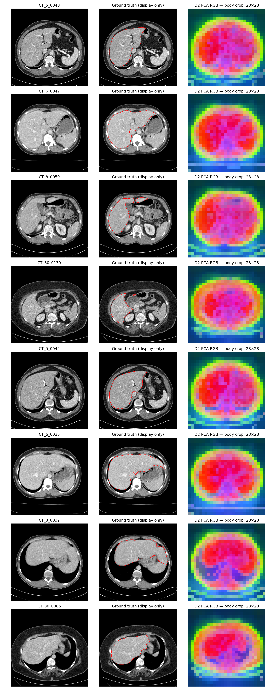
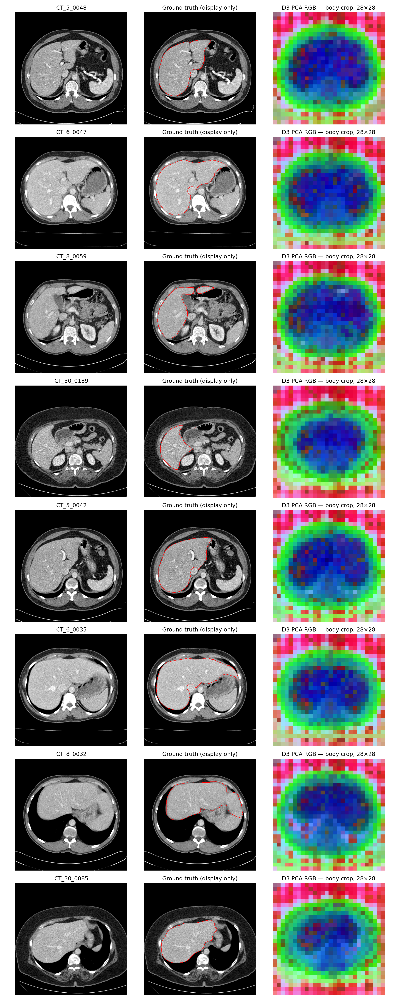

# D2 / D3 frozen-feature CT liver results

Parameters were locked in `PROTOCOL.json` before scoring. Producers: `verify_weights.py`, `extract.py`, `figures.py`, `fit_score.py`, `pair_affinities.py`, `pair_score.py`, `report.py`. Executed commands are in `commands.txt`. No gradients, network, downloads, installs, or modifications to project source / datasets / existing caches / weight files.

## Weight verification

| Arm/file | Supplied hub commit | Expected SHA256 | On-disk SHA256 | Match |
|---|---|---|---|---|
| D2 model.safetensors | f205d5d8e640a89a2b8ef0369670dfc37cc07fc2 | 2c465a30aa590f9b3fbe36feb962a1eb35635da809643f42857cf64ee450007c | 2c465a30aa590f9b3fbe36feb962a1eb35635da809643f42857cf64ee450007c | True |
| D2 original pytorch_model.bin (hash only, not loaded) | f205d5d8e640a89a2b8ef0369670dfc37cc07fc2 | a064e36c67289caaa5c949c0b3f7f31a0fcbcba5721f5fa12419933ec1f4fe6e | a064e36c67289caaa5c949c0b3f7f31a0fcbcba5721f5fa12419933ec1f4fe6e | True |
| D3 model.safetensors | f9e44c814b77203eaa57a6bdbbd535f21ede1415 | d73036b56966966d07975d696bde331762f37297e2f095de8cea0040c3aa0841 | d73036b56966966d07975d696bde331762f37297e2f095de8cea0040c3aa0841 | True |

Source: `weight_verification.json`. Both digests checked before any model load. Hub commits are the user-supplied provenance, not independently verified over the network. D2 converted safetensors has198 tensors; the original binary was hashed, never deserialized.

## Preprocessing and feature tap

Identical geometry to D1: native512 CT derivatives already windowed HU[-150,250] → [0,1], round(65535*x) uint16 storage then /65535; no second window. Image-only body mask >0.05, largest8-connected component, hole filling, square crop with5% margin on each side, zero padding. Bilinear antialiased resize to448 (D2) or392 (D3), grayscale replicated3 channels. ImageNet mean[0.485,0.456,0.406], std[0.229,0.224,0.225] read from each local processor JSON and applied exactly once. The processors' stock224/256 resize/crop and /255 settings are NOT applied: they would violate the declared geometry or double-rescale already normalized pixels.

D2: local transformers.ViTModel, add_pooling_layer=False, interpolate_pos_encoding=True. D3: local transformers.Dinov2Model, internal position interpolation. Both return785 last_hidden_state tokens including CLS, after final LayerNorm (verified with a forward hook). Drop CLS, L2 normalize784 patch tokens, uncentered, reshape28×28×768. D1 used the same semantic tap: project get_intermediate_layers(n=1) applied final LayerNorm before CLS removal and L2.

## Every difference from D1

- D2/D3 local transformers classes instead of project DINO v1 implementation
- local supplied weights with verified digests
- patch/input sizes16/448 and14/392 instead of8/224; same28 grid
- position embeddings interpolated (D2 explicitly, D3 automatically), unlike native28-grid D1
- normalization constants read from processor; values identical to D1
- last_hidden_state is same semantic post-final-LayerNorm token tap as D1 get_intermediate_layers(n=1); hook verified
- architecture/config layer norm epsilon and attention backend follow local installed transformers/model config; record actual backend
- extraction batch8 rather than D1 batch4; frozen eval behavior checked

D1 used the project eager-attention implementation and LayerNorm epsilon1e-6; D2 uses transformers SDPA with supplied config epsilon1e-12, and D3 uses transformers SDPA with supplied epsilon1e-6. These inherited differences were not tuned. All other fitting, mapping, mask inversion, scoring, pair sampling/centering and PCA settings are retained. `reuse_provenance.json` records hashes of reused D1 scripts; `fit_score.py` and `figures.py` differ only by arm arguments and output names. `common.py` additionally protects the pre-existing weights directory and serializes empty loader-diagnostic sets. The D2 log-writing retry did not alter any model setting.

## Load checks and timing

| Arm | Missing / unexpected / mismatched keys | Frozen / eval | Exact repeat | Token shape | Batch8 forward seconds | Full projection minutes | Actual extraction minutes | Backend / LayerNorm eps |
|---|---|---|---|---|---:|---:|---:|---|
| D2 | [] / [] / [] | True / True | True (max error 0.0) | [8, 785, 768] | 0.6480 | 3.252 | 3.295 | sdpa / 1e-12 |
| D3 | [] / [] / [] | True / True | True (max error 0.0) | [8, 785, 768] | 0.6648 | 3.338 | 3.330 | sdpa / 1e-06 |

Timing includes a warmed batch8 forward; full projection includes measured preprocessing time, not model loading or k-means/scoring. Neither completed arm exceeded90 minutes, so no200-slice fallback was necessary. Actual parameters are recorded before scoring in each *_checks.json and *_parameters.json. Installed model-forward and interpolation source is saved in *_model_forward_source.txt.

## Segmentation (%)

All2341 slices/20 patients fit label-free KMeans. K8/K2, seeds0/1/2, k-means++, n_init3, max_iter100, tol1e-4, Lloyd, float32; no post-processing. Leave one patient out of mapping: other19 labels determine strict-majority (>50%, ties background), exhaustive256-subset IoU-optimal K8 mapping, or one-to-one K2 Hungarian maximizing pixel agreement. Heldout labels only score. Outside-crop pixels are forced background. Native nearest inversion and224 nearest resize; mappings fitted independently at each scoring resolution, exactly as D1/IMPROVE.

IoU/Dice pool pixels within patient. Average seeds within each patient; then equal-patient mean, sample SD, min/max over20 patients. Complete per-patient mappings/confusions: *_scores.json; every seed also listed below.

| Arm | Grid | K | Mapping | Scale | IoU mean ± SD [min–max] | Dice mean ± SD [min–max] | AUC |
|---|---|---:|---|---:|---:|---:|---:|
| D2 | 28×28 | 8 | majority | 224 | 31.607 ± 16.940 [0.000–45.673] | 45.135 ± 23.751 [0.000–62.706] | 0.937077 |
| D2 | 28×28 | 8 | optimal | 224 | 41.350 ± 6.225 [26.726–50.780] | 58.236 ± 6.497 [42.179–67.356] | 0.937077 |
| D2 | 28×28 | 8 | majority | 512 | 31.619 ± 16.949 [0.000–45.643] | 45.147 ± 23.759 [0.000–62.678] | 0.937077 |
| D2 | 28×28 | 8 | optimal | 512 | 41.368 ± 6.240 [26.744–50.845] | 58.252 ± 6.511 [42.202–67.414] | 0.937077 |
| D2 | 28×28 | 2 | Hungarian | 224 | 15.743 ± 3.311 [8.934–23.266] | 27.071 ± 4.915 [16.402–37.749] | 0.937077 |
| D2 | 28×28 | 2 | Hungarian | 512 | 15.739 ± 3.312 [8.930–23.272] | 27.064 ± 4.917 [16.395–37.757] | 0.937077 |
| D3 | 28×28 | 8 | majority | 224 | 0.000 ± 0.000 [0.000–0.000] | 0.000 ± 0.000 [0.000–0.000] | 0.906456 |
| D3 | 28×28 | 8 | optimal | 224 | 24.167 ± 4.222 [16.468–35.120] | 38.623 ± 5.368 [28.166–51.811] | 0.906456 |
| D3 | 28×28 | 8 | majority | 512 | 0.000 ± 0.000 [0.000–0.000] | 0.000 ± 0.000 [0.000–0.000] | 0.906456 |
| D3 | 28×28 | 8 | optimal | 512 | 24.173 ± 4.224 [16.457–35.112] | 38.630 ± 5.372 [28.150–51.802] | 0.906456 |
| D3 | 28×28 | 2 | Hungarian | 224 | 0.664 ± 1.865 [0.043–8.553] | 1.259 ± 3.431 [0.087–15.758] | 0.906456 |
| D3 | 28×28 | 2 | Hungarian | 512 | 0.665 ± 1.866 [0.044–8.557] | 1.260 ± 3.433 [0.089–15.765] | 0.906456 |
| D1 reference | 28×28 | 8 | majority | 224 | 46.037 ± 4.873 [31.695–53.252] | 62.898 ± 4.752 [48.134–69.494] | 0.931644 |
| D1 reference | 28×28 | 8 | optimal | 224 | 46.037 ± 4.873 [31.695–53.252] | 62.898 ± 4.752 [48.134–69.494] | 0.931644 |
| D1 reference | 28×28 | 8 | majority | 512 | 46.043 ± 4.894 [31.618–53.290] | 62.902 ± 4.773 [48.045–69.526] | 0.931644 |
| D1 reference | 28×28 | 8 | optimal | 512 | 46.043 ± 4.894 [31.618–53.290] | 62.902 ± 4.773 [48.045–69.526] | 0.931644 |
| D1 reference | 28×28 | 2 | Hungarian | 224 | 0.000062 ± 0.000228 [0.000000–0.001004] | 0.000124 ± 0.000456 [0.000000–0.002008] | 0.931644 |
| D1 reference | 28×28 | 2 | Hungarian | 512 | 0.000067 ± 0.000236 [0.000000–0.001031] | 0.000135 ± 0.000471 [0.000000–0.002061] | 0.931644 |
| B0 (historical) reference | 14×14 | 8 | majority | 224 | 62.872 ± 2.604 [59.044–68.096] | 77.172 ± 1.959 [74.246–81.020] | 0.946049 |
| B0 (historical) reference | 14×14 | 8 | optimal | 224 | 62.872 ± 2.604 [59.044–68.096] | 77.172 ± 1.959 [74.246–81.020] | 0.946049 |
| B0 (historical) reference | 14×14 | 8 | majority | 512 | 62.733 ± 2.636 [58.909–68.221] | 77.066 ± 1.986 [74.138–81.108] | 0.946049 |
| B0 (historical) reference | 14×14 | 8 | optimal | 512 | 62.733 ± 2.636 [58.909–68.221] | 77.066 ± 1.986 [74.138–81.108] | 0.946049 |
| B2_448 (historical) reference | 28×28 | 8 | majority | 224 | 69.784 ± 2.959 [61.498–74.452] | 82.168 ± 2.089 [76.159–85.355] | 0.968364 |
| B2_448 (historical) reference | 28×28 | 8 | optimal | 224 | 69.784 ± 2.959 [61.498–74.452] | 82.168 ± 2.089 [76.159–85.355] | 0.968364 |
| B2_448 (historical) reference | 28×28 | 8 | majority | 512 | 69.801 ± 2.956 [61.565–74.539] | 82.180 ± 2.087 [76.211–85.412] | 0.968364 |
| B2_448 (historical) reference | 28×28 | 8 | optimal | 512 | 69.801 ± 2.956 [61.565–74.539] | 82.180 ± 2.087 [76.211–85.412] | 0.968364 |

References copied from `audit/dino/summary.json`, which aggregates IMPROVE/D1 outputs. B0 AUC uses historical14-grid/full-frame geometry; it is not the matched body-crop28-grid AUC. Matched BiomedCLIP B2-448 AUC is recomputed from unchanged cached features and checked against D1-run evidence.

## Same-image pair selectivity

Only472 validation slices/4 patients; labels diagnose pair classes and never select features, sampling, shifts or clustering. Same actual project loss.forward/helper restored-global-mean centering and PAIRS sampler as D1: batch16/last8,7 passes,11×11 coordinates,2048 fixed pair positions. Common28×28 majority labels from body-cropped nearest448 masks, ties background. Overall5/10/20% attraction thresholds fixed by label-free score quantiles before labels are read. AUC/AP and target precision/recall concern liver anchors. Includes same-coordinate/self pairs as D1 did.

| Arm | AUC | AP | Overall attraction | Threshold | Liver-target precision % | Liver-pair recall % |
|---|---:|---:|---:|---:|---:|---:|
| D2 | 0.937077 | 0.754243 | 5.000% | 0.811458 | 92.888 | 27.816 |
| D2 | 0.937077 | 0.754243 | 10.000% | 0.722989 | 86.098 | 42.820 |
| D2 | 0.937077 | 0.754243 | 20.000% | 0.579056 | 66.075 | 69.160 |
| D3 | 0.906456 | 0.656864 | 5.000% | 0.788168 | 82.792 | 27.835 |
| D3 | 0.906456 | 0.656864 | 10.000% | 0.696318 | 69.369 | 47.917 |
| D3 | 0.906456 | 0.656864 | 20.000% | 0.582741 | 49.116 | 73.487 |
| BiomedCLIP_B2_448 | 0.968364 | 0.857743 | 5.000% | 0.914159 | 86.314 | 65.656 |
| BiomedCLIP_B2_448 | 0.968364 | 0.857743 | 10.000% | 0.866341 | 79.324 | 75.710 |
| BiomedCLIP_B2_448 | 0.968364 | 0.857743 | 20.000% | 0.795405 | 67.267 | 86.617 |

## Every seed (%)

| Arm | K | Seed | Mapping | Scale | IoU mean ± SD [min–max] | Dice mean ± SD [min–max] |
|---|---:|---:|---|---:|---:|---:|
| D2 | 8 | 0 | majority | 224 | 31.607 ± 16.940 [0.000–45.671] | 45.135 ± 23.751 [0.000–62.705] |
| D2 | 8 | 1 | majority | 224 | 31.608 ± 16.940 [0.000–45.676] | 45.136 ± 23.751 [0.000–62.709] |
| D2 | 8 | 2 | majority | 224 | 31.606 ± 16.940 [0.000–45.671] | 45.134 ± 23.750 [0.000–62.705] |
| D2 | 8 | 0 | optimal | 224 | 41.349 ± 6.225 [26.722–50.783] | 58.235 ± 6.498 [42.174–67.359] |
| D2 | 8 | 1 | optimal | 224 | 41.352 ± 6.224 [26.734–50.781] | 58.237 ± 6.496 [42.189–67.357] |
| D2 | 8 | 2 | optimal | 224 | 41.349 ± 6.225 [26.722–50.775] | 58.235 ± 6.498 [42.174–67.352] |
| D2 | 8 | 0 | majority | 512 | 31.619 ± 16.949 [0.000–45.645] | 45.147 ± 23.759 [0.000–62.680] |
| D2 | 8 | 1 | majority | 512 | 31.620 ± 16.949 [0.000–45.640] | 45.148 ± 23.759 [0.000–62.675] |
| D2 | 8 | 2 | majority | 512 | 31.618 ± 16.949 [0.000–45.645] | 45.146 ± 23.759 [0.000–62.680] |
| D2 | 8 | 0 | optimal | 512 | 41.367 ± 6.240 [26.740–50.849] | 58.252 ± 6.512 [42.197–67.417] |
| D2 | 8 | 1 | optimal | 512 | 41.369 ± 6.239 [26.753–50.846] | 58.254 ± 6.510 [42.212–67.414] |
| D2 | 8 | 2 | optimal | 512 | 41.367 ± 6.240 [26.740–50.840] | 58.251 ± 6.511 [42.197–67.409] |
| D2 | 2 | 0 | Hungarian | 224 | 15.743 ± 3.311 [8.934–23.266] | 27.070 ± 4.915 [16.402–37.749] |
| D2 | 2 | 1 | Hungarian | 224 | 15.743 ± 3.311 [8.934–23.266] | 27.070 ± 4.915 [16.402–37.749] |
| D2 | 2 | 2 | Hungarian | 224 | 15.744 ± 3.311 [8.934–23.266] | 27.071 ± 4.915 [16.402–37.749] |
| D2 | 2 | 0 | Hungarian | 512 | 15.739 ± 3.312 [8.930–23.272] | 27.064 ± 4.917 [16.395–37.757] |
| D2 | 2 | 1 | Hungarian | 512 | 15.739 ± 3.312 [8.930–23.272] | 27.064 ± 4.917 [16.395–37.757] |
| D2 | 2 | 2 | Hungarian | 512 | 15.739 ± 3.312 [8.930–23.272] | 27.064 ± 4.917 [16.396–37.757] |
| D3 | 8 | 0 | majority | 224 | 0.000 ± 0.000 [0.000–0.000] | 0.000 ± 0.000 [0.000–0.000] |
| D3 | 8 | 1 | majority | 224 | 0.000 ± 0.000 [0.000–0.000] | 0.000 ± 0.000 [0.000–0.000] |
| D3 | 8 | 2 | majority | 224 | 0.000 ± 0.000 [0.000–0.000] | 0.000 ± 0.000 [0.000–0.000] |
| D3 | 8 | 0 | optimal | 224 | 21.411 ± 3.862 [14.287–31.482] | 35.115 ± 5.154 [25.002–47.887] |
| D3 | 8 | 1 | optimal | 224 | 29.179 ± 4.890 [20.724–41.694] | 44.969 ± 5.765 [34.333–58.851] |
| D3 | 8 | 2 | optimal | 224 | 21.911 ± 3.959 [14.393–32.184] | 35.784 ± 5.245 [25.164–48.695] |
| D3 | 8 | 0 | majority | 512 | 0.000 ± 0.000 [0.000–0.000] | 0.000 ± 0.000 [0.000–0.000] |
| D3 | 8 | 1 | majority | 512 | 0.000 ± 0.000 [0.000–0.000] | 0.000 ± 0.000 [0.000–0.000] |
| D3 | 8 | 2 | majority | 512 | 0.000 ± 0.000 [0.000–0.000] | 0.000 ± 0.000 [0.000–0.000] |
| D3 | 8 | 0 | optimal | 512 | 21.415 ± 3.865 [14.278–31.480] | 35.120 ± 5.158 [24.988–47.886] |
| D3 | 8 | 1 | optimal | 512 | 29.184 ± 4.893 [20.708–41.689] | 44.975 ± 5.769 [34.310–58.845] |
| D3 | 8 | 2 | optimal | 512 | 21.920 ± 3.962 [14.385–32.166] | 35.796 ± 5.249 [25.151–48.675] |
| D3 | 2 | 0 | Hungarian | 224 | 0.664 ± 1.865 [0.043–8.553] | 1.259 ± 3.431 [0.087–15.758] |
| D3 | 2 | 1 | Hungarian | 224 | 0.664 ± 1.865 [0.043–8.553] | 1.259 ± 3.431 [0.087–15.758] |
| D3 | 2 | 2 | Hungarian | 224 | 0.664 ± 1.865 [0.043–8.553] | 1.259 ± 3.431 [0.087–15.758] |
| D3 | 2 | 0 | Hungarian | 512 | 0.665 ± 1.866 [0.044–8.557] | 1.260 ± 3.433 [0.089–15.765] |
| D3 | 2 | 1 | Hungarian | 512 | 0.665 ± 1.866 [0.044–8.557] | 1.260 ± 3.433 [0.089–15.765] |
| D3 | 2 | 2 | Hungarian | 512 | 0.665 ± 1.866 [0.044–8.557] | 1.260 ± 3.433 [0.089–15.765] |

## PCA figures

Eight fixed slices unchanged from D1. PCA fit label-free jointly on their features; full SVD,3 components, joint1st/99th percentile color scaling. Ground truth is displayed only; inherited largest-liver slice selection used labels historically. Figures were generated before segmentation scoring.

## Declared decision rule

Justified: **False**. Requires K8 primary224 mean LOPO liver IoU≥62.87% AND AUC≥0.90. Qualifying arm/mapping rows: [].

'Beats BiomedCLIP' threshold (>69.78%) rows: []. This phrase denotes the declared numeric flag only. K2 is evaluated above; any qualifying arm still requires the label-free naming test before a claim. No head training was run.

## UNVERIFIED / limitations

These20 patients informed earlier choices. This is not an untouched test. KMeans is label-free, but cluster naming uses other-patient labels; optimal-subset LOPO is label-assisted mapping. Label-free naming, trained-head benefit, independent-cohort transfer, clinical utility and liver-absent behavior remain UNVERIFIED. Four-patient same-image pair selectivity includes self pairs and does not establish cross-image or cross-cohort selectivity. Hub commits are user-supplied provenance; the on-disk digests are independently verified without network. No unrequested settings, seeds or arms were added.

## Final validation

`validate.py` → `validation.json`: both supplied weight digests (and original D2 binary), both config JSON digests and processor JSON digests remain unchanged; no tracked source diff. All12 declared fits completed; every LOPO mapping excludes the heldout patient. PCA figures were generated before scoring and visually inspected. Final feature L2 errors: D2 3.5762786865234375e-07, D3 2.980232238769531e-07. Pair sample/label indices exactly match D1; the complete BiomedCLIP selectivity reference reproduces exactly. Full code-path diff: `D1_code_path_diff.txt`.
