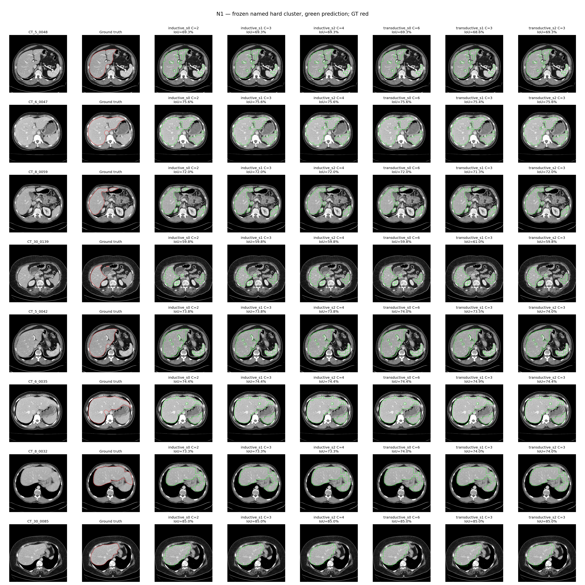

# Label-free naming of frozen K8 CT clusters

No gradient training, installs, network, changes to source/datasets/caches/checkpoints. All six requested saved fits exist; no refit was performed. CPU only. Names are fixed once per fit from its own image set, before opening labels.

## Sealed Stage A

Manifest SHA256: `ceb1f5e236980247444416469c03c86339348d4e73e51c2208de39f2d430416b`. `stageA_manifest.json` contains every parameter, all selected clusters and hashes of all StageA files. Detached self-hash: `stageA_manifest.sha256`. The only hash exclusions are the manifest itself and its self-hash sidecar. StageB verifies every hash before scoring. `stageA_ledger.json` lists opened paths and blocked attempts. StageB start record: `stageB_started.json`.

## Protocol details

Frozen BiomedCLIP final normalized patch tokens, L2 and uncentered, body-cropped448 input /28×28, K8 seeds0/1/2. Existing inductive centres fit on train16 (1869 slices), transductive centres fit on all20 (2341 slices). CT[-150,250] HU preprocessing is unchanged. StageA reads only image inventory/association metadata, images, raw DICOM, features, centres, label-free fit metadata, model/tokenizer files and code. It does not read the saved semantic mappings. Metadata includes unused mask filenames/hash fields, not mask values; those mask files are never opened.

N1:200 body patches nearest each centre (across all body patches, not restricted by hard cluster assignment) (squared Euclidean, ties image index then patch index); body membership uses patch centre in N2 body mask.112×112 native-windowed crops, nearest-integer centre, zero padding,224 bilinear antialias,3 channels, BiomedCLIP mean/std once. Full CLIP image projection gives normalized512D crop vectors, averaged and renormalized for cosine. Text prompts exactly as specified. Population z-score each prompt across8 clusters, zero variance→0. Argmax liver z-score names one cluster. Top prompt, z-margin and raw-cosine margin per cluster are saved in *_naming.json. Because liver z-scoring is a positive affine transform across clusters, the liver argmax also equals the raw liver-cosine argmax; z-scoring matters for cross-prompt ranking.

N2:raw nativeHU>-500 → opening disk5 → largest8-connected component → fill holes (4-connected background). Normalize patch-centre x/y to body bounding box. Eligible patches have centre inside body. Each patch counts once for area fraction/centroid. MeanHU is the arithmetic mean of patch-body-footprint HU means, using unwindowed HU. Candidate x<.5, y<.6, HU40..180 inclusive; choose largest area, tie lowestID; none→abstain. N3 accepts only exact N1/N2 agreement, else abstains. These operational conventions were fixed before scoring; full values are in PARAMETERS.json and manifest.

StageB: hard assignment and original F1, changing only the frozen selected semantic subset. F1 uses the original saved per-fit temperature and identical soft weights, inverse crop, guided radius8/eps.01,>=.5,LCC8,hole fill4,disk3 closing. Abstentions are empty masks, including F1. No tuning follows labels.

Reference: inductive uses stored train16 strict-majority mapping and train-confusion optimal subset (both resolutions same native-derived mapping, as FINAL_PIPELINE); transductive uses saved other19 LOPO majority/optimal mappings independently at224/512. FINAL_BASELINE was the earlier224-input baseline; the relevant saved448 reference is IMPROVE/FINAL_PIPELINE. Agreement is exact singleton/subset equality, per heldout patient; abstention agrees only if the assisted subset is empty.

## Main table: primary224 pooled-pixel scores (%)

Each patient pools TP/FP/FN across slices; report equal-patient mean/sample SD/min/max, separately for each fit and seed. Inductive scores4 validation patients; transductive scores20. Agreement columns count patients whose named subset exactly equals the assisted subset (majority / optimal). The full report also gives mean-slice metrics and native512 scores.

| Rule | Fit | Seed | Selected cluster | Assisted agreement M/O | Hard IoU | Hard Dice | F1 IoU | F1 Dice |
|---|---|---:|---|---|---:|---:|---:|---:|
| N1 | inductive | 0 | 2 | 4/4 / 4/4 | 70.831 ± 1.918 [68.759–73.303] | 82.914 ± 1.311 [81.488–84.595] | 77.962 ± 2.068 [75.514–80.185] | 87.605 ± 1.308 [86.049–89.003] |
| N2 | inductive | 0 | 2 | 4/4 / 4/4 | 70.831 ± 1.918 [68.759–73.303] | 82.914 ± 1.311 [81.488–84.595] | 77.962 ± 2.068 [75.514–80.185] | 87.605 ± 1.308 [86.049–89.003] |
| N3 | inductive | 0 | 2 | 4/4 / 4/4 | 70.831 ± 1.918 [68.759–73.303] | 82.914 ± 1.311 [81.488–84.595] | 77.962 ± 2.068 [75.514–80.185] | 87.605 ± 1.308 [86.049–89.003] |
| reference_majority | inductive | 0 | patient-dependent reference | Reference | 70.831 ± 1.918 [68.759–73.303] | 82.914 ± 1.311 [81.488–84.595] | 77.962 ± 2.068 [75.514–80.185] | 87.605 ± 1.308 [86.049–89.003] |
| reference_optimal | inductive | 0 | patient-dependent reference | Reference | 70.831 ± 1.918 [68.759–73.303] | 82.914 ± 1.311 [81.488–84.595] | 77.962 ± 2.068 [75.514–80.185] | 87.605 ± 1.308 [86.049–89.003] |
| N1 | inductive | 1 | 3 | 4/4 / 4/4 | 70.831 ± 1.918 [68.759–73.303] | 82.914 ± 1.311 [81.488–84.595] | 77.963 ± 2.068 [75.514–80.185] | 87.605 ± 1.308 [86.049–89.003] |
| N2 | inductive | 1 | 3 | 4/4 / 4/4 | 70.831 ± 1.918 [68.759–73.303] | 82.914 ± 1.311 [81.488–84.595] | 77.963 ± 2.068 [75.514–80.185] | 87.605 ± 1.308 [86.049–89.003] |
| N3 | inductive | 1 | 3 | 4/4 / 4/4 | 70.831 ± 1.918 [68.759–73.303] | 82.914 ± 1.311 [81.488–84.595] | 77.963 ± 2.068 [75.514–80.185] | 87.605 ± 1.308 [86.049–89.003] |
| reference_majority | inductive | 1 | patient-dependent reference | Reference | 70.831 ± 1.918 [68.759–73.303] | 82.914 ± 1.311 [81.488–84.595] | 77.963 ± 2.068 [75.514–80.185] | 87.605 ± 1.308 [86.049–89.003] |
| reference_optimal | inductive | 1 | patient-dependent reference | Reference | 70.831 ± 1.918 [68.759–73.303] | 82.914 ± 1.311 [81.488–84.595] | 77.963 ± 2.068 [75.514–80.185] | 87.605 ± 1.308 [86.049–89.003] |
| N1 | inductive | 2 | 4 | 4/4 / 4/4 | 70.831 ± 1.918 [68.759–73.303] | 82.914 ± 1.311 [81.488–84.595] | 77.963 ± 2.068 [75.514–80.186] | 87.605 ± 1.308 [86.049–89.003] |
| N2 | inductive | 2 | 4 | 4/4 / 4/4 | 70.831 ± 1.918 [68.759–73.303] | 82.914 ± 1.311 [81.488–84.595] | 77.963 ± 2.068 [75.514–80.186] | 87.605 ± 1.308 [86.049–89.003] |
| N3 | inductive | 2 | 4 | 4/4 / 4/4 | 70.831 ± 1.918 [68.759–73.303] | 82.914 ± 1.311 [81.488–84.595] | 77.963 ± 2.068 [75.514–80.186] | 87.605 ± 1.308 [86.049–89.003] |
| reference_majority | inductive | 2 | patient-dependent reference | Reference | 70.831 ± 1.918 [68.759–73.303] | 82.914 ± 1.311 [81.488–84.595] | 77.963 ± 2.068 [75.514–80.186] | 87.605 ± 1.308 [86.049–89.003] |
| reference_optimal | inductive | 2 | patient-dependent reference | Reference | 70.831 ± 1.918 [68.759–73.303] | 82.914 ± 1.311 [81.488–84.595] | 77.963 ± 2.068 [75.514–80.186] | 87.605 ± 1.308 [86.049–89.003] |
| N1 | transductive | 0 | 6 | 20/20 / 20/20 | 69.768 ± 2.975 [61.493–74.489] | 82.157 ± 2.100 [76.156–85.380] | 78.809 ± 2.936 [74.800–83.574] | 88.120 ± 1.837 [85.584–91.052] |
| N2 | transductive | 0 | 6 | 20/20 / 20/20 | 69.768 ± 2.975 [61.493–74.489] | 82.157 ± 2.100 [76.156–85.380] | 78.809 ± 2.936 [74.800–83.574] | 88.120 ± 1.837 [85.584–91.052] |
| N3 | transductive | 0 | 6 | 20/20 / 20/20 | 69.768 ± 2.975 [61.493–74.489] | 82.157 ± 2.100 [76.156–85.380] | 78.809 ± 2.936 [74.800–83.574] | 88.120 ± 1.837 [85.584–91.052] |
| reference_majority | transductive | 0 | patient-dependent reference | Reference | 69.768 ± 2.975 [61.493–74.489] | 82.157 ± 2.100 [76.156–85.380] | 78.809 ± 2.936 [74.800–83.574] | 88.120 ± 1.837 [85.584–91.052] |
| reference_optimal | transductive | 0 | patient-dependent reference | Reference | 69.768 ± 2.975 [61.493–74.489] | 82.157 ± 2.100 [76.156–85.380] | 78.809 ± 2.936 [74.800–83.574] | 88.120 ± 1.837 [85.584–91.052] |
| N1 | transductive | 1 | 3 | 20/20 / 20/20 | 69.813 ± 2.945 [61.496–74.378] | 82.189 ± 2.080 [76.158–85.306] | 80.199 ± 2.731 [75.759–85.320] | 88.987 ± 1.684 [86.208–92.078] |
| N2 | transductive | 1 | 3 | 20/20 / 20/20 | 69.813 ± 2.945 [61.496–74.378] | 82.189 ± 2.080 [76.158–85.306] | 80.199 ± 2.731 [75.759–85.320] | 88.987 ± 1.684 [86.208–92.078] |
| N3 | transductive | 1 | 3 | 20/20 / 20/20 | 69.813 ± 2.945 [61.496–74.378] | 82.189 ± 2.080 [76.158–85.306] | 80.199 ± 2.731 [75.759–85.320] | 88.987 ± 1.684 [86.208–92.078] |
| reference_majority | transductive | 1 | patient-dependent reference | Reference | 69.813 ± 2.945 [61.496–74.378] | 82.189 ± 2.080 [76.158–85.306] | 80.199 ± 2.731 [75.759–85.320] | 88.987 ± 1.684 [86.208–92.078] |
| reference_optimal | transductive | 1 | patient-dependent reference | Reference | 69.813 ± 2.945 [61.496–74.378] | 82.189 ± 2.080 [76.158–85.306] | 80.199 ± 2.731 [75.759–85.320] | 88.987 ± 1.684 [86.208–92.078] |
| N1 | transductive | 2 | 3 | 20/20 / 20/20 | 69.770 ± 2.973 [61.504–74.489] | 82.159 ± 2.099 [76.164–85.380] | 78.809 ± 2.936 [74.801–83.575] | 88.120 ± 1.837 [85.585–91.053] |
| N2 | transductive | 2 | 3 | 20/20 / 20/20 | 69.770 ± 2.973 [61.504–74.489] | 82.159 ± 2.099 [76.164–85.380] | 78.809 ± 2.936 [74.801–83.575] | 88.120 ± 1.837 [85.585–91.053] |
| N3 | transductive | 2 | 3 | 20/20 / 20/20 | 69.770 ± 2.973 [61.504–74.489] | 82.159 ± 2.099 [76.164–85.380] | 78.809 ± 2.936 [74.801–83.575] | 88.120 ± 1.837 [85.585–91.053] |
| reference_majority | transductive | 2 | patient-dependent reference | Reference | 69.770 ± 2.973 [61.504–74.489] | 82.159 ± 2.099 [76.164–85.380] | 78.809 ± 2.936 [74.801–83.575] | 88.120 ± 1.837 [85.585–91.053] |
| reference_optimal | transductive | 2 | patient-dependent reference | Reference | 69.770 ± 2.973 [61.504–74.489] | 82.159 ± 2.099 [76.164–85.380] | 78.809 ± 2.936 [74.801–83.575] | 88.120 ± 1.837 [85.585–91.053] |

## Abstention

| Fit / rule | Abstained fits | Fit rate | Empty-scored slice instances | Slice rate |
|---|---:|---:|---:|---:|
| inductive/N1 | 0/3 | 0.000% | 0/1416 | 0.000% |
| inductive/N2 | 0/3 | 0.000% | 0/1416 | 0.000% |
| inductive/N3 | 0/3 | 0.000% | 0/1416 | 0.000% |
| transductive/N1 | 0/3 | 0.000% | 0/7023 | 0.000% |
| transductive/N2 | 0/3 | 0.000% | 0/7023 | 0.000% |
| transductive/N3 | 0/3 | 0.000% | 0/7023 | 0.000% |

## All resolutions / aggregations (%)

| Rule | Fit | Seed | Prediction | Scale | Aggregation | IoU mean ± SD [min–max] | Dice mean ± SD [min–max] |
|---|---|---:|---|---:|---|---:|---:|
| N1 | inductive | 0 | hard | 224 | pooled | 70.831 ± 1.918 [68.759–73.303] | 82.914 ± 1.311 [81.488–84.595] |
| N1 | inductive | 0 | hard | 224 | mean_slice | 61.637 ± 6.577 [55.178–68.014] | 73.409 ± 6.834 [66.395–79.999] |
| N1 | inductive | 0 | hard | 512 | pooled | 70.897 ± 1.842 [68.927–73.294] | 82.960 ± 1.257 [81.606–84.589] |
| N1 | inductive | 0 | hard | 512 | mean_slice | 61.724 ± 6.555 [55.313–68.133] | 73.486 ± 6.813 [66.528–80.109] |
| N1 | inductive | 0 | F1 | 224 | pooled | 77.962 ± 2.068 [75.514–80.185] | 87.605 ± 1.308 [86.049–89.003] |
| N1 | inductive | 0 | F1 | 224 | mean_slice | 66.003 ± 7.821 [57.493–73.897] | 75.252 ± 8.133 [66.461–82.798] |
| N1 | inductive | 0 | F1 | 512 | pooled | 77.943 ± 2.048 [75.525–80.151] | 87.593 ± 1.296 [86.056–88.982] |
| N1 | inductive | 0 | F1 | 512 | mean_slice | 65.972 ± 7.845 [57.458–73.859] | 75.232 ± 8.157 [66.435–82.766] |
| N2 | inductive | 0 | hard | 224 | pooled | 70.831 ± 1.918 [68.759–73.303] | 82.914 ± 1.311 [81.488–84.595] |
| N2 | inductive | 0 | hard | 224 | mean_slice | 61.637 ± 6.577 [55.178–68.014] | 73.409 ± 6.834 [66.395–79.999] |
| N2 | inductive | 0 | hard | 512 | pooled | 70.897 ± 1.842 [68.927–73.294] | 82.960 ± 1.257 [81.606–84.589] |
| N2 | inductive | 0 | hard | 512 | mean_slice | 61.724 ± 6.555 [55.313–68.133] | 73.486 ± 6.813 [66.528–80.109] |
| N2 | inductive | 0 | F1 | 224 | pooled | 77.962 ± 2.068 [75.514–80.185] | 87.605 ± 1.308 [86.049–89.003] |
| N2 | inductive | 0 | F1 | 224 | mean_slice | 66.003 ± 7.821 [57.493–73.897] | 75.252 ± 8.133 [66.461–82.798] |
| N2 | inductive | 0 | F1 | 512 | pooled | 77.943 ± 2.048 [75.525–80.151] | 87.593 ± 1.296 [86.056–88.982] |
| N2 | inductive | 0 | F1 | 512 | mean_slice | 65.972 ± 7.845 [57.458–73.859] | 75.232 ± 8.157 [66.435–82.766] |
| N3 | inductive | 0 | hard | 224 | pooled | 70.831 ± 1.918 [68.759–73.303] | 82.914 ± 1.311 [81.488–84.595] |
| N3 | inductive | 0 | hard | 224 | mean_slice | 61.637 ± 6.577 [55.178–68.014] | 73.409 ± 6.834 [66.395–79.999] |
| N3 | inductive | 0 | hard | 512 | pooled | 70.897 ± 1.842 [68.927–73.294] | 82.960 ± 1.257 [81.606–84.589] |
| N3 | inductive | 0 | hard | 512 | mean_slice | 61.724 ± 6.555 [55.313–68.133] | 73.486 ± 6.813 [66.528–80.109] |
| N3 | inductive | 0 | F1 | 224 | pooled | 77.962 ± 2.068 [75.514–80.185] | 87.605 ± 1.308 [86.049–89.003] |
| N3 | inductive | 0 | F1 | 224 | mean_slice | 66.003 ± 7.821 [57.493–73.897] | 75.252 ± 8.133 [66.461–82.798] |
| N3 | inductive | 0 | F1 | 512 | pooled | 77.943 ± 2.048 [75.525–80.151] | 87.593 ± 1.296 [86.056–88.982] |
| N3 | inductive | 0 | F1 | 512 | mean_slice | 65.972 ± 7.845 [57.458–73.859] | 75.232 ± 8.157 [66.435–82.766] |
| reference_majority | inductive | 0 | hard | 224 | pooled | 70.831 ± 1.918 [68.759–73.303] | 82.914 ± 1.311 [81.488–84.595] |
| reference_majority | inductive | 0 | hard | 224 | mean_slice | 61.637 ± 6.577 [55.178–68.014] | 73.409 ± 6.834 [66.395–79.999] |
| reference_majority | inductive | 0 | hard | 512 | pooled | 70.897 ± 1.842 [68.927–73.294] | 82.960 ± 1.257 [81.606–84.589] |
| reference_majority | inductive | 0 | hard | 512 | mean_slice | 61.724 ± 6.555 [55.313–68.133] | 73.486 ± 6.813 [66.528–80.109] |
| reference_majority | inductive | 0 | F1 | 224 | pooled | 77.962 ± 2.068 [75.514–80.185] | 87.605 ± 1.308 [86.049–89.003] |
| reference_majority | inductive | 0 | F1 | 224 | mean_slice | 66.003 ± 7.821 [57.493–73.897] | 75.252 ± 8.133 [66.461–82.798] |
| reference_majority | inductive | 0 | F1 | 512 | pooled | 77.943 ± 2.048 [75.525–80.151] | 87.593 ± 1.296 [86.056–88.982] |
| reference_majority | inductive | 0 | F1 | 512 | mean_slice | 65.972 ± 7.845 [57.458–73.859] | 75.232 ± 8.157 [66.435–82.766] |
| reference_optimal | inductive | 0 | hard | 224 | pooled | 70.831 ± 1.918 [68.759–73.303] | 82.914 ± 1.311 [81.488–84.595] |
| reference_optimal | inductive | 0 | hard | 224 | mean_slice | 61.637 ± 6.577 [55.178–68.014] | 73.409 ± 6.834 [66.395–79.999] |
| reference_optimal | inductive | 0 | hard | 512 | pooled | 70.897 ± 1.842 [68.927–73.294] | 82.960 ± 1.257 [81.606–84.589] |
| reference_optimal | inductive | 0 | hard | 512 | mean_slice | 61.724 ± 6.555 [55.313–68.133] | 73.486 ± 6.813 [66.528–80.109] |
| reference_optimal | inductive | 0 | F1 | 224 | pooled | 77.962 ± 2.068 [75.514–80.185] | 87.605 ± 1.308 [86.049–89.003] |
| reference_optimal | inductive | 0 | F1 | 224 | mean_slice | 66.003 ± 7.821 [57.493–73.897] | 75.252 ± 8.133 [66.461–82.798] |
| reference_optimal | inductive | 0 | F1 | 512 | pooled | 77.943 ± 2.048 [75.525–80.151] | 87.593 ± 1.296 [86.056–88.982] |
| reference_optimal | inductive | 0 | F1 | 512 | mean_slice | 65.972 ± 7.845 [57.458–73.859] | 75.232 ± 8.157 [66.435–82.766] |
| N1 | inductive | 1 | hard | 224 | pooled | 70.831 ± 1.918 [68.759–73.303] | 82.914 ± 1.311 [81.488–84.595] |
| N1 | inductive | 1 | hard | 224 | mean_slice | 61.637 ± 6.577 [55.178–68.014] | 73.409 ± 6.834 [66.395–79.999] |
| N1 | inductive | 1 | hard | 512 | pooled | 70.897 ± 1.842 [68.927–73.294] | 82.960 ± 1.257 [81.606–84.589] |
| N1 | inductive | 1 | hard | 512 | mean_slice | 61.724 ± 6.555 [55.313–68.133] | 73.486 ± 6.813 [66.528–80.109] |
| N1 | inductive | 1 | F1 | 224 | pooled | 77.963 ± 2.068 [75.514–80.185] | 87.605 ± 1.308 [86.049–89.003] |
| N1 | inductive | 1 | F1 | 224 | mean_slice | 66.003 ± 7.821 [57.493–73.897] | 75.252 ± 8.133 [66.461–82.798] |
| N1 | inductive | 1 | F1 | 512 | pooled | 77.943 ± 2.048 [75.525–80.151] | 87.593 ± 1.296 [86.056–88.982] |
| N1 | inductive | 1 | F1 | 512 | mean_slice | 65.972 ± 7.845 [57.458–73.859] | 75.232 ± 8.157 [66.435–82.766] |
| N2 | inductive | 1 | hard | 224 | pooled | 70.831 ± 1.918 [68.759–73.303] | 82.914 ± 1.311 [81.488–84.595] |
| N2 | inductive | 1 | hard | 224 | mean_slice | 61.637 ± 6.577 [55.178–68.014] | 73.409 ± 6.834 [66.395–79.999] |
| N2 | inductive | 1 | hard | 512 | pooled | 70.897 ± 1.842 [68.927–73.294] | 82.960 ± 1.257 [81.606–84.589] |
| N2 | inductive | 1 | hard | 512 | mean_slice | 61.724 ± 6.555 [55.313–68.133] | 73.486 ± 6.813 [66.528–80.109] |
| N2 | inductive | 1 | F1 | 224 | pooled | 77.963 ± 2.068 [75.514–80.185] | 87.605 ± 1.308 [86.049–89.003] |
| N2 | inductive | 1 | F1 | 224 | mean_slice | 66.003 ± 7.821 [57.493–73.897] | 75.252 ± 8.133 [66.461–82.798] |
| N2 | inductive | 1 | F1 | 512 | pooled | 77.943 ± 2.048 [75.525–80.151] | 87.593 ± 1.296 [86.056–88.982] |
| N2 | inductive | 1 | F1 | 512 | mean_slice | 65.972 ± 7.845 [57.458–73.859] | 75.232 ± 8.157 [66.435–82.766] |
| N3 | inductive | 1 | hard | 224 | pooled | 70.831 ± 1.918 [68.759–73.303] | 82.914 ± 1.311 [81.488–84.595] |
| N3 | inductive | 1 | hard | 224 | mean_slice | 61.637 ± 6.577 [55.178–68.014] | 73.409 ± 6.834 [66.395–79.999] |
| N3 | inductive | 1 | hard | 512 | pooled | 70.897 ± 1.842 [68.927–73.294] | 82.960 ± 1.257 [81.606–84.589] |
| N3 | inductive | 1 | hard | 512 | mean_slice | 61.724 ± 6.555 [55.313–68.133] | 73.486 ± 6.813 [66.528–80.109] |
| N3 | inductive | 1 | F1 | 224 | pooled | 77.963 ± 2.068 [75.514–80.185] | 87.605 ± 1.308 [86.049–89.003] |
| N3 | inductive | 1 | F1 | 224 | mean_slice | 66.003 ± 7.821 [57.493–73.897] | 75.252 ± 8.133 [66.461–82.798] |
| N3 | inductive | 1 | F1 | 512 | pooled | 77.943 ± 2.048 [75.525–80.151] | 87.593 ± 1.296 [86.056–88.982] |
| N3 | inductive | 1 | F1 | 512 | mean_slice | 65.972 ± 7.845 [57.458–73.859] | 75.232 ± 8.157 [66.435–82.766] |
| reference_majority | inductive | 1 | hard | 224 | pooled | 70.831 ± 1.918 [68.759–73.303] | 82.914 ± 1.311 [81.488–84.595] |
| reference_majority | inductive | 1 | hard | 224 | mean_slice | 61.637 ± 6.577 [55.178–68.014] | 73.409 ± 6.834 [66.395–79.999] |
| reference_majority | inductive | 1 | hard | 512 | pooled | 70.897 ± 1.842 [68.927–73.294] | 82.960 ± 1.257 [81.606–84.589] |
| reference_majority | inductive | 1 | hard | 512 | mean_slice | 61.724 ± 6.555 [55.313–68.133] | 73.486 ± 6.813 [66.528–80.109] |
| reference_majority | inductive | 1 | F1 | 224 | pooled | 77.963 ± 2.068 [75.514–80.185] | 87.605 ± 1.308 [86.049–89.003] |
| reference_majority | inductive | 1 | F1 | 224 | mean_slice | 66.003 ± 7.821 [57.493–73.897] | 75.252 ± 8.133 [66.461–82.798] |
| reference_majority | inductive | 1 | F1 | 512 | pooled | 77.943 ± 2.048 [75.525–80.151] | 87.593 ± 1.296 [86.056–88.982] |
| reference_majority | inductive | 1 | F1 | 512 | mean_slice | 65.972 ± 7.845 [57.458–73.859] | 75.232 ± 8.157 [66.435–82.766] |
| reference_optimal | inductive | 1 | hard | 224 | pooled | 70.831 ± 1.918 [68.759–73.303] | 82.914 ± 1.311 [81.488–84.595] |
| reference_optimal | inductive | 1 | hard | 224 | mean_slice | 61.637 ± 6.577 [55.178–68.014] | 73.409 ± 6.834 [66.395–79.999] |
| reference_optimal | inductive | 1 | hard | 512 | pooled | 70.897 ± 1.842 [68.927–73.294] | 82.960 ± 1.257 [81.606–84.589] |
| reference_optimal | inductive | 1 | hard | 512 | mean_slice | 61.724 ± 6.555 [55.313–68.133] | 73.486 ± 6.813 [66.528–80.109] |
| reference_optimal | inductive | 1 | F1 | 224 | pooled | 77.963 ± 2.068 [75.514–80.185] | 87.605 ± 1.308 [86.049–89.003] |
| reference_optimal | inductive | 1 | F1 | 224 | mean_slice | 66.003 ± 7.821 [57.493–73.897] | 75.252 ± 8.133 [66.461–82.798] |
| reference_optimal | inductive | 1 | F1 | 512 | pooled | 77.943 ± 2.048 [75.525–80.151] | 87.593 ± 1.296 [86.056–88.982] |
| reference_optimal | inductive | 1 | F1 | 512 | mean_slice | 65.972 ± 7.845 [57.458–73.859] | 75.232 ± 8.157 [66.435–82.766] |
| N1 | inductive | 2 | hard | 224 | pooled | 70.831 ± 1.918 [68.759–73.303] | 82.914 ± 1.311 [81.488–84.595] |
| N1 | inductive | 2 | hard | 224 | mean_slice | 61.637 ± 6.577 [55.178–68.014] | 73.409 ± 6.834 [66.395–79.999] |
| N1 | inductive | 2 | hard | 512 | pooled | 70.897 ± 1.842 [68.927–73.294] | 82.960 ± 1.257 [81.606–84.589] |
| N1 | inductive | 2 | hard | 512 | mean_slice | 61.724 ± 6.555 [55.313–68.133] | 73.486 ± 6.813 [66.528–80.109] |
| N1 | inductive | 2 | F1 | 224 | pooled | 77.963 ± 2.068 [75.514–80.186] | 87.605 ± 1.308 [86.049–89.003] |
| N1 | inductive | 2 | F1 | 224 | mean_slice | 66.003 ± 7.821 [57.493–73.897] | 75.252 ± 8.133 [66.461–82.798] |
| N1 | inductive | 2 | F1 | 512 | pooled | 77.943 ± 2.048 [75.525–80.151] | 87.593 ± 1.296 [86.056–88.982] |
| N1 | inductive | 2 | F1 | 512 | mean_slice | 65.972 ± 7.845 [57.458–73.859] | 75.232 ± 8.157 [66.435–82.766] |
| N2 | inductive | 2 | hard | 224 | pooled | 70.831 ± 1.918 [68.759–73.303] | 82.914 ± 1.311 [81.488–84.595] |
| N2 | inductive | 2 | hard | 224 | mean_slice | 61.637 ± 6.577 [55.178–68.014] | 73.409 ± 6.834 [66.395–79.999] |
| N2 | inductive | 2 | hard | 512 | pooled | 70.897 ± 1.842 [68.927–73.294] | 82.960 ± 1.257 [81.606–84.589] |
| N2 | inductive | 2 | hard | 512 | mean_slice | 61.724 ± 6.555 [55.313–68.133] | 73.486 ± 6.813 [66.528–80.109] |
| N2 | inductive | 2 | F1 | 224 | pooled | 77.963 ± 2.068 [75.514–80.186] | 87.605 ± 1.308 [86.049–89.003] |
| N2 | inductive | 2 | F1 | 224 | mean_slice | 66.003 ± 7.821 [57.493–73.897] | 75.252 ± 8.133 [66.461–82.798] |
| N2 | inductive | 2 | F1 | 512 | pooled | 77.943 ± 2.048 [75.525–80.151] | 87.593 ± 1.296 [86.056–88.982] |
| N2 | inductive | 2 | F1 | 512 | mean_slice | 65.972 ± 7.845 [57.458–73.859] | 75.232 ± 8.157 [66.435–82.766] |
| N3 | inductive | 2 | hard | 224 | pooled | 70.831 ± 1.918 [68.759–73.303] | 82.914 ± 1.311 [81.488–84.595] |
| N3 | inductive | 2 | hard | 224 | mean_slice | 61.637 ± 6.577 [55.178–68.014] | 73.409 ± 6.834 [66.395–79.999] |
| N3 | inductive | 2 | hard | 512 | pooled | 70.897 ± 1.842 [68.927–73.294] | 82.960 ± 1.257 [81.606–84.589] |
| N3 | inductive | 2 | hard | 512 | mean_slice | 61.724 ± 6.555 [55.313–68.133] | 73.486 ± 6.813 [66.528–80.109] |
| N3 | inductive | 2 | F1 | 224 | pooled | 77.963 ± 2.068 [75.514–80.186] | 87.605 ± 1.308 [86.049–89.003] |
| N3 | inductive | 2 | F1 | 224 | mean_slice | 66.003 ± 7.821 [57.493–73.897] | 75.252 ± 8.133 [66.461–82.798] |
| N3 | inductive | 2 | F1 | 512 | pooled | 77.943 ± 2.048 [75.525–80.151] | 87.593 ± 1.296 [86.056–88.982] |
| N3 | inductive | 2 | F1 | 512 | mean_slice | 65.972 ± 7.845 [57.458–73.859] | 75.232 ± 8.157 [66.435–82.766] |
| reference_majority | inductive | 2 | hard | 224 | pooled | 70.831 ± 1.918 [68.759–73.303] | 82.914 ± 1.311 [81.488–84.595] |
| reference_majority | inductive | 2 | hard | 224 | mean_slice | 61.637 ± 6.577 [55.178–68.014] | 73.409 ± 6.834 [66.395–79.999] |
| reference_majority | inductive | 2 | hard | 512 | pooled | 70.897 ± 1.842 [68.927–73.294] | 82.960 ± 1.257 [81.606–84.589] |
| reference_majority | inductive | 2 | hard | 512 | mean_slice | 61.724 ± 6.555 [55.313–68.133] | 73.486 ± 6.813 [66.528–80.109] |
| reference_majority | inductive | 2 | F1 | 224 | pooled | 77.963 ± 2.068 [75.514–80.186] | 87.605 ± 1.308 [86.049–89.003] |
| reference_majority | inductive | 2 | F1 | 224 | mean_slice | 66.003 ± 7.821 [57.493–73.897] | 75.252 ± 8.133 [66.461–82.798] |
| reference_majority | inductive | 2 | F1 | 512 | pooled | 77.943 ± 2.048 [75.525–80.151] | 87.593 ± 1.296 [86.056–88.982] |
| reference_majority | inductive | 2 | F1 | 512 | mean_slice | 65.972 ± 7.845 [57.458–73.859] | 75.232 ± 8.157 [66.435–82.766] |
| reference_optimal | inductive | 2 | hard | 224 | pooled | 70.831 ± 1.918 [68.759–73.303] | 82.914 ± 1.311 [81.488–84.595] |
| reference_optimal | inductive | 2 | hard | 224 | mean_slice | 61.637 ± 6.577 [55.178–68.014] | 73.409 ± 6.834 [66.395–79.999] |
| reference_optimal | inductive | 2 | hard | 512 | pooled | 70.897 ± 1.842 [68.927–73.294] | 82.960 ± 1.257 [81.606–84.589] |
| reference_optimal | inductive | 2 | hard | 512 | mean_slice | 61.724 ± 6.555 [55.313–68.133] | 73.486 ± 6.813 [66.528–80.109] |
| reference_optimal | inductive | 2 | F1 | 224 | pooled | 77.963 ± 2.068 [75.514–80.186] | 87.605 ± 1.308 [86.049–89.003] |
| reference_optimal | inductive | 2 | F1 | 224 | mean_slice | 66.003 ± 7.821 [57.493–73.897] | 75.252 ± 8.133 [66.461–82.798] |
| reference_optimal | inductive | 2 | F1 | 512 | pooled | 77.943 ± 2.048 [75.525–80.151] | 87.593 ± 1.296 [86.056–88.982] |
| reference_optimal | inductive | 2 | F1 | 512 | mean_slice | 65.972 ± 7.845 [57.458–73.859] | 75.232 ± 8.157 [66.435–82.766] |
| N1 | transductive | 0 | hard | 224 | pooled | 69.768 ± 2.975 [61.493–74.489] | 82.157 ± 2.100 [76.156–85.380] |
| N1 | transductive | 0 | hard | 224 | mean_slice | 59.915 ± 4.955 [49.082–68.061] | 71.714 ± 5.319 [60.118–80.033] |
| N1 | transductive | 0 | hard | 512 | pooled | 69.786 ± 2.972 [61.564–74.571] | 82.170 ± 2.097 [76.210–85.433] |
| N1 | transductive | 0 | hard | 512 | mean_slice | 59.941 ± 4.983 [48.969–68.183] | 71.743 ± 5.339 [60.036–80.146] |
| N1 | transductive | 0 | F1 | 224 | pooled | 78.809 ± 2.936 [74.800–83.574] | 88.120 ± 1.837 [85.584–91.052] |
| N1 | transductive | 0 | F1 | 224 | mean_slice | 65.072 ± 5.724 [54.141–73.927] | 73.958 ± 6.160 [62.247–82.846] |
| N1 | transductive | 0 | F1 | 512 | pooled | 78.812 ± 2.944 [74.819–83.606] | 88.122 ± 1.842 [85.596–91.071] |
| N1 | transductive | 0 | F1 | 512 | mean_slice | 65.071 ± 5.747 [54.096–73.888] | 73.956 ± 6.176 [62.212–82.817] |
| N2 | transductive | 0 | hard | 224 | pooled | 69.768 ± 2.975 [61.493–74.489] | 82.157 ± 2.100 [76.156–85.380] |
| N2 | transductive | 0 | hard | 224 | mean_slice | 59.915 ± 4.955 [49.082–68.061] | 71.714 ± 5.319 [60.118–80.033] |
| N2 | transductive | 0 | hard | 512 | pooled | 69.786 ± 2.972 [61.564–74.571] | 82.170 ± 2.097 [76.210–85.433] |
| N2 | transductive | 0 | hard | 512 | mean_slice | 59.941 ± 4.983 [48.969–68.183] | 71.743 ± 5.339 [60.036–80.146] |
| N2 | transductive | 0 | F1 | 224 | pooled | 78.809 ± 2.936 [74.800–83.574] | 88.120 ± 1.837 [85.584–91.052] |
| N2 | transductive | 0 | F1 | 224 | mean_slice | 65.072 ± 5.724 [54.141–73.927] | 73.958 ± 6.160 [62.247–82.846] |
| N2 | transductive | 0 | F1 | 512 | pooled | 78.812 ± 2.944 [74.819–83.606] | 88.122 ± 1.842 [85.596–91.071] |
| N2 | transductive | 0 | F1 | 512 | mean_slice | 65.071 ± 5.747 [54.096–73.888] | 73.956 ± 6.176 [62.212–82.817] |
| N3 | transductive | 0 | hard | 224 | pooled | 69.768 ± 2.975 [61.493–74.489] | 82.157 ± 2.100 [76.156–85.380] |
| N3 | transductive | 0 | hard | 224 | mean_slice | 59.915 ± 4.955 [49.082–68.061] | 71.714 ± 5.319 [60.118–80.033] |
| N3 | transductive | 0 | hard | 512 | pooled | 69.786 ± 2.972 [61.564–74.571] | 82.170 ± 2.097 [76.210–85.433] |
| N3 | transductive | 0 | hard | 512 | mean_slice | 59.941 ± 4.983 [48.969–68.183] | 71.743 ± 5.339 [60.036–80.146] |
| N3 | transductive | 0 | F1 | 224 | pooled | 78.809 ± 2.936 [74.800–83.574] | 88.120 ± 1.837 [85.584–91.052] |
| N3 | transductive | 0 | F1 | 224 | mean_slice | 65.072 ± 5.724 [54.141–73.927] | 73.958 ± 6.160 [62.247–82.846] |
| N3 | transductive | 0 | F1 | 512 | pooled | 78.812 ± 2.944 [74.819–83.606] | 88.122 ± 1.842 [85.596–91.071] |
| N3 | transductive | 0 | F1 | 512 | mean_slice | 65.071 ± 5.747 [54.096–73.888] | 73.956 ± 6.176 [62.212–82.817] |
| reference_majority | transductive | 0 | hard | 224 | pooled | 69.768 ± 2.975 [61.493–74.489] | 82.157 ± 2.100 [76.156–85.380] |
| reference_majority | transductive | 0 | hard | 224 | mean_slice | 59.915 ± 4.955 [49.082–68.061] | 71.714 ± 5.319 [60.118–80.033] |
| reference_majority | transductive | 0 | hard | 512 | pooled | 69.786 ± 2.972 [61.564–74.571] | 82.170 ± 2.097 [76.210–85.433] |
| reference_majority | transductive | 0 | hard | 512 | mean_slice | 59.941 ± 4.983 [48.969–68.183] | 71.743 ± 5.339 [60.036–80.146] |
| reference_majority | transductive | 0 | F1 | 224 | pooled | 78.809 ± 2.936 [74.800–83.574] | 88.120 ± 1.837 [85.584–91.052] |
| reference_majority | transductive | 0 | F1 | 224 | mean_slice | 65.072 ± 5.724 [54.141–73.927] | 73.958 ± 6.160 [62.247–82.846] |
| reference_majority | transductive | 0 | F1 | 512 | pooled | 78.812 ± 2.944 [74.819–83.606] | 88.122 ± 1.842 [85.596–91.071] |
| reference_majority | transductive | 0 | F1 | 512 | mean_slice | 65.071 ± 5.747 [54.096–73.888] | 73.956 ± 6.176 [62.212–82.817] |
| reference_optimal | transductive | 0 | hard | 224 | pooled | 69.768 ± 2.975 [61.493–74.489] | 82.157 ± 2.100 [76.156–85.380] |
| reference_optimal | transductive | 0 | hard | 224 | mean_slice | 59.915 ± 4.955 [49.082–68.061] | 71.714 ± 5.319 [60.118–80.033] |
| reference_optimal | transductive | 0 | hard | 512 | pooled | 69.786 ± 2.972 [61.564–74.571] | 82.170 ± 2.097 [76.210–85.433] |
| reference_optimal | transductive | 0 | hard | 512 | mean_slice | 59.941 ± 4.983 [48.969–68.183] | 71.743 ± 5.339 [60.036–80.146] |
| reference_optimal | transductive | 0 | F1 | 224 | pooled | 78.809 ± 2.936 [74.800–83.574] | 88.120 ± 1.837 [85.584–91.052] |
| reference_optimal | transductive | 0 | F1 | 224 | mean_slice | 65.072 ± 5.724 [54.141–73.927] | 73.958 ± 6.160 [62.247–82.846] |
| reference_optimal | transductive | 0 | F1 | 512 | pooled | 78.812 ± 2.944 [74.819–83.606] | 88.122 ± 1.842 [85.596–91.071] |
| reference_optimal | transductive | 0 | F1 | 512 | mean_slice | 65.071 ± 5.747 [54.096–73.888] | 73.956 ± 6.176 [62.212–82.817] |
| N1 | transductive | 1 | hard | 224 | pooled | 69.813 ± 2.945 [61.496–74.378] | 82.189 ± 2.080 [76.158–85.306] |
| N1 | transductive | 1 | hard | 224 | mean_slice | 59.936 ± 4.981 [49.281–68.141] | 71.708 ± 5.378 [60.261–80.081] |
| N1 | transductive | 1 | hard | 512 | pooled | 69.828 ± 2.944 [61.554–74.476] | 82.199 ± 2.079 [76.203–85.371] |
| N1 | transductive | 1 | hard | 512 | mean_slice | 59.961 ± 5.012 [49.180–68.267] | 71.735 ± 5.397 [60.192–80.197] |
| N1 | transductive | 1 | F1 | 224 | pooled | 80.199 ± 2.731 [75.759–85.320] | 88.987 ± 1.684 [86.208–92.078] |
| N1 | transductive | 1 | F1 | 224 | mean_slice | 66.272 ± 5.798 [55.049–75.840] | 74.839 ± 6.287 [62.948–84.514] |
| N1 | transductive | 1 | F1 | 512 | pooled | 80.199 ± 2.736 [75.813–85.341] | 88.988 ± 1.686 [86.243–92.091] |
| N1 | transductive | 1 | F1 | 512 | mean_slice | 66.266 ± 5.819 [54.996–75.809] | 74.833 ± 6.303 [62.910–84.494] |
| N2 | transductive | 1 | hard | 224 | pooled | 69.813 ± 2.945 [61.496–74.378] | 82.189 ± 2.080 [76.158–85.306] |
| N2 | transductive | 1 | hard | 224 | mean_slice | 59.936 ± 4.981 [49.281–68.141] | 71.708 ± 5.378 [60.261–80.081] |
| N2 | transductive | 1 | hard | 512 | pooled | 69.828 ± 2.944 [61.554–74.476] | 82.199 ± 2.079 [76.203–85.371] |
| N2 | transductive | 1 | hard | 512 | mean_slice | 59.961 ± 5.012 [49.180–68.267] | 71.735 ± 5.397 [60.192–80.197] |
| N2 | transductive | 1 | F1 | 224 | pooled | 80.199 ± 2.731 [75.759–85.320] | 88.987 ± 1.684 [86.208–92.078] |
| N2 | transductive | 1 | F1 | 224 | mean_slice | 66.272 ± 5.798 [55.049–75.840] | 74.839 ± 6.287 [62.948–84.514] |
| N2 | transductive | 1 | F1 | 512 | pooled | 80.199 ± 2.736 [75.813–85.341] | 88.988 ± 1.686 [86.243–92.091] |
| N2 | transductive | 1 | F1 | 512 | mean_slice | 66.266 ± 5.819 [54.996–75.809] | 74.833 ± 6.303 [62.910–84.494] |
| N3 | transductive | 1 | hard | 224 | pooled | 69.813 ± 2.945 [61.496–74.378] | 82.189 ± 2.080 [76.158–85.306] |
| N3 | transductive | 1 | hard | 224 | mean_slice | 59.936 ± 4.981 [49.281–68.141] | 71.708 ± 5.378 [60.261–80.081] |
| N3 | transductive | 1 | hard | 512 | pooled | 69.828 ± 2.944 [61.554–74.476] | 82.199 ± 2.079 [76.203–85.371] |
| N3 | transductive | 1 | hard | 512 | mean_slice | 59.961 ± 5.012 [49.180–68.267] | 71.735 ± 5.397 [60.192–80.197] |
| N3 | transductive | 1 | F1 | 224 | pooled | 80.199 ± 2.731 [75.759–85.320] | 88.987 ± 1.684 [86.208–92.078] |
| N3 | transductive | 1 | F1 | 224 | mean_slice | 66.272 ± 5.798 [55.049–75.840] | 74.839 ± 6.287 [62.948–84.514] |
| N3 | transductive | 1 | F1 | 512 | pooled | 80.199 ± 2.736 [75.813–85.341] | 88.988 ± 1.686 [86.243–92.091] |
| N3 | transductive | 1 | F1 | 512 | mean_slice | 66.266 ± 5.819 [54.996–75.809] | 74.833 ± 6.303 [62.910–84.494] |
| reference_majority | transductive | 1 | hard | 224 | pooled | 69.813 ± 2.945 [61.496–74.378] | 82.189 ± 2.080 [76.158–85.306] |
| reference_majority | transductive | 1 | hard | 224 | mean_slice | 59.936 ± 4.981 [49.281–68.141] | 71.708 ± 5.378 [60.261–80.081] |
| reference_majority | transductive | 1 | hard | 512 | pooled | 69.828 ± 2.944 [61.554–74.476] | 82.199 ± 2.079 [76.203–85.371] |
| reference_majority | transductive | 1 | hard | 512 | mean_slice | 59.961 ± 5.012 [49.180–68.267] | 71.735 ± 5.397 [60.192–80.197] |
| reference_majority | transductive | 1 | F1 | 224 | pooled | 80.199 ± 2.731 [75.759–85.320] | 88.987 ± 1.684 [86.208–92.078] |
| reference_majority | transductive | 1 | F1 | 224 | mean_slice | 66.272 ± 5.798 [55.049–75.840] | 74.839 ± 6.287 [62.948–84.514] |
| reference_majority | transductive | 1 | F1 | 512 | pooled | 80.199 ± 2.736 [75.813–85.341] | 88.988 ± 1.686 [86.243–92.091] |
| reference_majority | transductive | 1 | F1 | 512 | mean_slice | 66.266 ± 5.819 [54.996–75.809] | 74.833 ± 6.303 [62.910–84.494] |
| reference_optimal | transductive | 1 | hard | 224 | pooled | 69.813 ± 2.945 [61.496–74.378] | 82.189 ± 2.080 [76.158–85.306] |
| reference_optimal | transductive | 1 | hard | 224 | mean_slice | 59.936 ± 4.981 [49.281–68.141] | 71.708 ± 5.378 [60.261–80.081] |
| reference_optimal | transductive | 1 | hard | 512 | pooled | 69.828 ± 2.944 [61.554–74.476] | 82.199 ± 2.079 [76.203–85.371] |
| reference_optimal | transductive | 1 | hard | 512 | mean_slice | 59.961 ± 5.012 [49.180–68.267] | 71.735 ± 5.397 [60.192–80.197] |
| reference_optimal | transductive | 1 | F1 | 224 | pooled | 80.199 ± 2.731 [75.759–85.320] | 88.987 ± 1.684 [86.208–92.078] |
| reference_optimal | transductive | 1 | F1 | 224 | mean_slice | 66.272 ± 5.798 [55.049–75.840] | 74.839 ± 6.287 [62.948–84.514] |
| reference_optimal | transductive | 1 | F1 | 512 | pooled | 80.199 ± 2.736 [75.813–85.341] | 88.988 ± 1.686 [86.243–92.091] |
| reference_optimal | transductive | 1 | F1 | 512 | mean_slice | 66.266 ± 5.819 [54.996–75.809] | 74.833 ± 6.303 [62.910–84.494] |
| N1 | transductive | 2 | hard | 224 | pooled | 69.770 ± 2.973 [61.504–74.489] | 82.159 ± 2.099 [76.164–85.380] |
| N1 | transductive | 2 | hard | 224 | mean_slice | 59.920 ± 4.952 [49.082–68.061] | 71.721 ± 5.314 [60.118–80.033] |
| N1 | transductive | 2 | hard | 512 | pooled | 69.789 ± 2.970 [61.576–74.571] | 82.172 ± 2.095 [76.219–85.433] |
| N1 | transductive | 2 | hard | 512 | mean_slice | 59.947 ± 4.979 [48.969–68.183] | 71.751 ± 5.332 [60.036–80.146] |
| N1 | transductive | 2 | F1 | 224 | pooled | 78.809 ± 2.936 [74.801–83.575] | 88.120 ± 1.837 [85.585–91.053] |
| N1 | transductive | 2 | F1 | 224 | mean_slice | 65.073 ± 5.724 [54.142–73.928] | 73.958 ± 6.160 [62.249–82.846] |
| N1 | transductive | 2 | F1 | 512 | pooled | 78.812 ± 2.944 [74.821–83.606] | 88.122 ± 1.842 [85.597–91.071] |
| N1 | transductive | 2 | F1 | 512 | mean_slice | 65.072 ± 5.747 [54.097–73.889] | 73.957 ± 6.176 [62.213–82.818] |
| N2 | transductive | 2 | hard | 224 | pooled | 69.770 ± 2.973 [61.504–74.489] | 82.159 ± 2.099 [76.164–85.380] |
| N2 | transductive | 2 | hard | 224 | mean_slice | 59.920 ± 4.952 [49.082–68.061] | 71.721 ± 5.314 [60.118–80.033] |
| N2 | transductive | 2 | hard | 512 | pooled | 69.789 ± 2.970 [61.576–74.571] | 82.172 ± 2.095 [76.219–85.433] |
| N2 | transductive | 2 | hard | 512 | mean_slice | 59.947 ± 4.979 [48.969–68.183] | 71.751 ± 5.332 [60.036–80.146] |
| N2 | transductive | 2 | F1 | 224 | pooled | 78.809 ± 2.936 [74.801–83.575] | 88.120 ± 1.837 [85.585–91.053] |
| N2 | transductive | 2 | F1 | 224 | mean_slice | 65.073 ± 5.724 [54.142–73.928] | 73.958 ± 6.160 [62.249–82.846] |
| N2 | transductive | 2 | F1 | 512 | pooled | 78.812 ± 2.944 [74.821–83.606] | 88.122 ± 1.842 [85.597–91.071] |
| N2 | transductive | 2 | F1 | 512 | mean_slice | 65.072 ± 5.747 [54.097–73.889] | 73.957 ± 6.176 [62.213–82.818] |
| N3 | transductive | 2 | hard | 224 | pooled | 69.770 ± 2.973 [61.504–74.489] | 82.159 ± 2.099 [76.164–85.380] |
| N3 | transductive | 2 | hard | 224 | mean_slice | 59.920 ± 4.952 [49.082–68.061] | 71.721 ± 5.314 [60.118–80.033] |
| N3 | transductive | 2 | hard | 512 | pooled | 69.789 ± 2.970 [61.576–74.571] | 82.172 ± 2.095 [76.219–85.433] |
| N3 | transductive | 2 | hard | 512 | mean_slice | 59.947 ± 4.979 [48.969–68.183] | 71.751 ± 5.332 [60.036–80.146] |
| N3 | transductive | 2 | F1 | 224 | pooled | 78.809 ± 2.936 [74.801–83.575] | 88.120 ± 1.837 [85.585–91.053] |
| N3 | transductive | 2 | F1 | 224 | mean_slice | 65.073 ± 5.724 [54.142–73.928] | 73.958 ± 6.160 [62.249–82.846] |
| N3 | transductive | 2 | F1 | 512 | pooled | 78.812 ± 2.944 [74.821–83.606] | 88.122 ± 1.842 [85.597–91.071] |
| N3 | transductive | 2 | F1 | 512 | mean_slice | 65.072 ± 5.747 [54.097–73.889] | 73.957 ± 6.176 [62.213–82.818] |
| reference_majority | transductive | 2 | hard | 224 | pooled | 69.770 ± 2.973 [61.504–74.489] | 82.159 ± 2.099 [76.164–85.380] |
| reference_majority | transductive | 2 | hard | 224 | mean_slice | 59.920 ± 4.952 [49.082–68.061] | 71.721 ± 5.314 [60.118–80.033] |
| reference_majority | transductive | 2 | hard | 512 | pooled | 69.789 ± 2.970 [61.576–74.571] | 82.172 ± 2.095 [76.219–85.433] |
| reference_majority | transductive | 2 | hard | 512 | mean_slice | 59.947 ± 4.979 [48.969–68.183] | 71.751 ± 5.332 [60.036–80.146] |
| reference_majority | transductive | 2 | F1 | 224 | pooled | 78.809 ± 2.936 [74.801–83.575] | 88.120 ± 1.837 [85.585–91.053] |
| reference_majority | transductive | 2 | F1 | 224 | mean_slice | 65.073 ± 5.724 [54.142–73.928] | 73.958 ± 6.160 [62.249–82.846] |
| reference_majority | transductive | 2 | F1 | 512 | pooled | 78.812 ± 2.944 [74.821–83.606] | 88.122 ± 1.842 [85.597–91.071] |
| reference_majority | transductive | 2 | F1 | 512 | mean_slice | 65.072 ± 5.747 [54.097–73.889] | 73.957 ± 6.176 [62.213–82.818] |
| reference_optimal | transductive | 2 | hard | 224 | pooled | 69.770 ± 2.973 [61.504–74.489] | 82.159 ± 2.099 [76.164–85.380] |
| reference_optimal | transductive | 2 | hard | 224 | mean_slice | 59.920 ± 4.952 [49.082–68.061] | 71.721 ± 5.314 [60.118–80.033] |
| reference_optimal | transductive | 2 | hard | 512 | pooled | 69.789 ± 2.970 [61.576–74.571] | 82.172 ± 2.095 [76.219–85.433] |
| reference_optimal | transductive | 2 | hard | 512 | mean_slice | 59.947 ± 4.979 [48.969–68.183] | 71.751 ± 5.332 [60.036–80.146] |
| reference_optimal | transductive | 2 | F1 | 224 | pooled | 78.809 ± 2.936 [74.801–83.575] | 88.120 ± 1.837 [85.585–91.053] |
| reference_optimal | transductive | 2 | F1 | 224 | mean_slice | 65.073 ± 5.724 [54.142–73.928] | 73.958 ± 6.160 [62.249–82.846] |
| reference_optimal | transductive | 2 | F1 | 512 | pooled | 78.812 ± 2.944 [74.821–83.606] | 88.122 ± 1.842 [85.597–91.071] |
| reference_optimal | transductive | 2 | F1 | 512 | mean_slice | 65.072 ± 5.747 [54.097–73.889] | 73.957 ± 6.176 [62.213–82.818] |

## Per-patient scores (%)

| Rule | Fit | Seed | Patient | Prediction | Scale | Pooled IoU/Dice | Mean-slice IoU/Dice |
|---|---|---:|---|---|---:|---:|---:|
| N1 | inductive | 0 | 5 | hard | 224 | 73.303/84.595 | 68.014/79.999 |
| N1 | inductive | 0 | 6 | hard | 224 | 71.159/83.150 | 66.544/78.491 |
| N1 | inductive | 0 | 8 | hard | 224 | 68.759/81.488 | 56.810/68.753 |
| N1 | inductive | 0 | 30 | hard | 224 | 70.102/82.423 | 55.178/66.395 |
| N1 | inductive | 0 | 5 | hard | 512 | 73.294/84.589 | 68.133/80.109 |
| N1 | inductive | 0 | 6 | hard | 512 | 71.164/83.153 | 66.558/78.497 |
| N1 | inductive | 0 | 8 | hard | 512 | 68.927/81.606 | 56.891/68.810 |
| N1 | inductive | 0 | 30 | hard | 512 | 70.203/82.493 | 55.313/66.528 |
| N1 | inductive | 0 | 5 | F1 | 224 | 79.041/88.294 | 71.240/81.507 |
| N1 | inductive | 0 | 6 | F1 | 224 | 80.185/89.003 | 73.897/82.798 |
| N1 | inductive | 0 | 8 | F1 | 224 | 75.514/86.049 | 61.383/70.242 |
| N1 | inductive | 0 | 30 | F1 | 224 | 77.109/87.075 | 57.493/66.461 |
| N1 | inductive | 0 | 5 | F1 | 512 | 79.007/88.272 | 71.274/81.550 |
| N1 | inductive | 0 | 6 | F1 | 512 | 80.151/88.982 | 73.859/82.766 |
| N1 | inductive | 0 | 8 | F1 | 512 | 75.525/86.056 | 61.298/70.178 |
| N1 | inductive | 0 | 30 | F1 | 512 | 77.087/87.061 | 57.458/66.435 |
| N2 | inductive | 0 | 5 | hard | 224 | 73.303/84.595 | 68.014/79.999 |
| N2 | inductive | 0 | 6 | hard | 224 | 71.159/83.150 | 66.544/78.491 |
| N2 | inductive | 0 | 8 | hard | 224 | 68.759/81.488 | 56.810/68.753 |
| N2 | inductive | 0 | 30 | hard | 224 | 70.102/82.423 | 55.178/66.395 |
| N2 | inductive | 0 | 5 | hard | 512 | 73.294/84.589 | 68.133/80.109 |
| N2 | inductive | 0 | 6 | hard | 512 | 71.164/83.153 | 66.558/78.497 |
| N2 | inductive | 0 | 8 | hard | 512 | 68.927/81.606 | 56.891/68.810 |
| N2 | inductive | 0 | 30 | hard | 512 | 70.203/82.493 | 55.313/66.528 |
| N2 | inductive | 0 | 5 | F1 | 224 | 79.041/88.294 | 71.240/81.507 |
| N2 | inductive | 0 | 6 | F1 | 224 | 80.185/89.003 | 73.897/82.798 |
| N2 | inductive | 0 | 8 | F1 | 224 | 75.514/86.049 | 61.383/70.242 |
| N2 | inductive | 0 | 30 | F1 | 224 | 77.109/87.075 | 57.493/66.461 |
| N2 | inductive | 0 | 5 | F1 | 512 | 79.007/88.272 | 71.274/81.550 |
| N2 | inductive | 0 | 6 | F1 | 512 | 80.151/88.982 | 73.859/82.766 |
| N2 | inductive | 0 | 8 | F1 | 512 | 75.525/86.056 | 61.298/70.178 |
| N2 | inductive | 0 | 30 | F1 | 512 | 77.087/87.061 | 57.458/66.435 |
| N3 | inductive | 0 | 5 | hard | 224 | 73.303/84.595 | 68.014/79.999 |
| N3 | inductive | 0 | 6 | hard | 224 | 71.159/83.150 | 66.544/78.491 |
| N3 | inductive | 0 | 8 | hard | 224 | 68.759/81.488 | 56.810/68.753 |
| N3 | inductive | 0 | 30 | hard | 224 | 70.102/82.423 | 55.178/66.395 |
| N3 | inductive | 0 | 5 | hard | 512 | 73.294/84.589 | 68.133/80.109 |
| N3 | inductive | 0 | 6 | hard | 512 | 71.164/83.153 | 66.558/78.497 |
| N3 | inductive | 0 | 8 | hard | 512 | 68.927/81.606 | 56.891/68.810 |
| N3 | inductive | 0 | 30 | hard | 512 | 70.203/82.493 | 55.313/66.528 |
| N3 | inductive | 0 | 5 | F1 | 224 | 79.041/88.294 | 71.240/81.507 |
| N3 | inductive | 0 | 6 | F1 | 224 | 80.185/89.003 | 73.897/82.798 |
| N3 | inductive | 0 | 8 | F1 | 224 | 75.514/86.049 | 61.383/70.242 |
| N3 | inductive | 0 | 30 | F1 | 224 | 77.109/87.075 | 57.493/66.461 |
| N3 | inductive | 0 | 5 | F1 | 512 | 79.007/88.272 | 71.274/81.550 |
| N3 | inductive | 0 | 6 | F1 | 512 | 80.151/88.982 | 73.859/82.766 |
| N3 | inductive | 0 | 8 | F1 | 512 | 75.525/86.056 | 61.298/70.178 |
| N3 | inductive | 0 | 30 | F1 | 512 | 77.087/87.061 | 57.458/66.435 |
| reference_majority | inductive | 0 | 5 | hard | 224 | 73.303/84.595 | 68.014/79.999 |
| reference_majority | inductive | 0 | 6 | hard | 224 | 71.159/83.150 | 66.544/78.491 |
| reference_majority | inductive | 0 | 8 | hard | 224 | 68.759/81.488 | 56.810/68.753 |
| reference_majority | inductive | 0 | 30 | hard | 224 | 70.102/82.423 | 55.178/66.395 |
| reference_majority | inductive | 0 | 5 | hard | 512 | 73.294/84.589 | 68.133/80.109 |
| reference_majority | inductive | 0 | 6 | hard | 512 | 71.164/83.153 | 66.558/78.497 |
| reference_majority | inductive | 0 | 8 | hard | 512 | 68.927/81.606 | 56.891/68.810 |
| reference_majority | inductive | 0 | 30 | hard | 512 | 70.203/82.493 | 55.313/66.528 |
| reference_majority | inductive | 0 | 5 | F1 | 224 | 79.041/88.294 | 71.240/81.507 |
| reference_majority | inductive | 0 | 6 | F1 | 224 | 80.185/89.003 | 73.897/82.798 |
| reference_majority | inductive | 0 | 8 | F1 | 224 | 75.514/86.049 | 61.383/70.242 |
| reference_majority | inductive | 0 | 30 | F1 | 224 | 77.109/87.075 | 57.493/66.461 |
| reference_majority | inductive | 0 | 5 | F1 | 512 | 79.007/88.272 | 71.274/81.550 |
| reference_majority | inductive | 0 | 6 | F1 | 512 | 80.151/88.982 | 73.859/82.766 |
| reference_majority | inductive | 0 | 8 | F1 | 512 | 75.525/86.056 | 61.298/70.178 |
| reference_majority | inductive | 0 | 30 | F1 | 512 | 77.087/87.061 | 57.458/66.435 |
| reference_optimal | inductive | 0 | 5 | hard | 224 | 73.303/84.595 | 68.014/79.999 |
| reference_optimal | inductive | 0 | 6 | hard | 224 | 71.159/83.150 | 66.544/78.491 |
| reference_optimal | inductive | 0 | 8 | hard | 224 | 68.759/81.488 | 56.810/68.753 |
| reference_optimal | inductive | 0 | 30 | hard | 224 | 70.102/82.423 | 55.178/66.395 |
| reference_optimal | inductive | 0 | 5 | hard | 512 | 73.294/84.589 | 68.133/80.109 |
| reference_optimal | inductive | 0 | 6 | hard | 512 | 71.164/83.153 | 66.558/78.497 |
| reference_optimal | inductive | 0 | 8 | hard | 512 | 68.927/81.606 | 56.891/68.810 |
| reference_optimal | inductive | 0 | 30 | hard | 512 | 70.203/82.493 | 55.313/66.528 |
| reference_optimal | inductive | 0 | 5 | F1 | 224 | 79.041/88.294 | 71.240/81.507 |
| reference_optimal | inductive | 0 | 6 | F1 | 224 | 80.185/89.003 | 73.897/82.798 |
| reference_optimal | inductive | 0 | 8 | F1 | 224 | 75.514/86.049 | 61.383/70.242 |
| reference_optimal | inductive | 0 | 30 | F1 | 224 | 77.109/87.075 | 57.493/66.461 |
| reference_optimal | inductive | 0 | 5 | F1 | 512 | 79.007/88.272 | 71.274/81.550 |
| reference_optimal | inductive | 0 | 6 | F1 | 512 | 80.151/88.982 | 73.859/82.766 |
| reference_optimal | inductive | 0 | 8 | F1 | 512 | 75.525/86.056 | 61.298/70.178 |
| reference_optimal | inductive | 0 | 30 | F1 | 512 | 77.087/87.061 | 57.458/66.435 |
| N1 | inductive | 1 | 5 | hard | 224 | 73.303/84.595 | 68.014/79.999 |
| N1 | inductive | 1 | 6 | hard | 224 | 71.159/83.150 | 66.544/78.491 |
| N1 | inductive | 1 | 8 | hard | 224 | 68.759/81.488 | 56.810/68.753 |
| N1 | inductive | 1 | 30 | hard | 224 | 70.102/82.423 | 55.178/66.395 |
| N1 | inductive | 1 | 5 | hard | 512 | 73.294/84.589 | 68.133/80.109 |
| N1 | inductive | 1 | 6 | hard | 512 | 71.164/83.153 | 66.558/78.497 |
| N1 | inductive | 1 | 8 | hard | 512 | 68.927/81.606 | 56.891/68.810 |
| N1 | inductive | 1 | 30 | hard | 512 | 70.203/82.493 | 55.313/66.528 |
| N1 | inductive | 1 | 5 | F1 | 224 | 79.041/88.294 | 71.240/81.507 |
| N1 | inductive | 1 | 6 | F1 | 224 | 80.185/89.003 | 73.897/82.798 |
| N1 | inductive | 1 | 8 | F1 | 224 | 75.514/86.049 | 61.383/70.242 |
| N1 | inductive | 1 | 30 | F1 | 224 | 77.109/87.075 | 57.493/66.461 |
| N1 | inductive | 1 | 5 | F1 | 512 | 79.007/88.272 | 71.274/81.550 |
| N1 | inductive | 1 | 6 | F1 | 512 | 80.151/88.982 | 73.859/82.766 |
| N1 | inductive | 1 | 8 | F1 | 512 | 75.525/86.056 | 61.298/70.178 |
| N1 | inductive | 1 | 30 | F1 | 512 | 77.087/87.061 | 57.458/66.435 |
| N2 | inductive | 1 | 5 | hard | 224 | 73.303/84.595 | 68.014/79.999 |
| N2 | inductive | 1 | 6 | hard | 224 | 71.159/83.150 | 66.544/78.491 |
| N2 | inductive | 1 | 8 | hard | 224 | 68.759/81.488 | 56.810/68.753 |
| N2 | inductive | 1 | 30 | hard | 224 | 70.102/82.423 | 55.178/66.395 |
| N2 | inductive | 1 | 5 | hard | 512 | 73.294/84.589 | 68.133/80.109 |
| N2 | inductive | 1 | 6 | hard | 512 | 71.164/83.153 | 66.558/78.497 |
| N2 | inductive | 1 | 8 | hard | 512 | 68.927/81.606 | 56.891/68.810 |
| N2 | inductive | 1 | 30 | hard | 512 | 70.203/82.493 | 55.313/66.528 |
| N2 | inductive | 1 | 5 | F1 | 224 | 79.041/88.294 | 71.240/81.507 |
| N2 | inductive | 1 | 6 | F1 | 224 | 80.185/89.003 | 73.897/82.798 |
| N2 | inductive | 1 | 8 | F1 | 224 | 75.514/86.049 | 61.383/70.242 |
| N2 | inductive | 1 | 30 | F1 | 224 | 77.109/87.075 | 57.493/66.461 |
| N2 | inductive | 1 | 5 | F1 | 512 | 79.007/88.272 | 71.274/81.550 |
| N2 | inductive | 1 | 6 | F1 | 512 | 80.151/88.982 | 73.859/82.766 |
| N2 | inductive | 1 | 8 | F1 | 512 | 75.525/86.056 | 61.298/70.178 |
| N2 | inductive | 1 | 30 | F1 | 512 | 77.087/87.061 | 57.458/66.435 |
| N3 | inductive | 1 | 5 | hard | 224 | 73.303/84.595 | 68.014/79.999 |
| N3 | inductive | 1 | 6 | hard | 224 | 71.159/83.150 | 66.544/78.491 |
| N3 | inductive | 1 | 8 | hard | 224 | 68.759/81.488 | 56.810/68.753 |
| N3 | inductive | 1 | 30 | hard | 224 | 70.102/82.423 | 55.178/66.395 |
| N3 | inductive | 1 | 5 | hard | 512 | 73.294/84.589 | 68.133/80.109 |
| N3 | inductive | 1 | 6 | hard | 512 | 71.164/83.153 | 66.558/78.497 |
| N3 | inductive | 1 | 8 | hard | 512 | 68.927/81.606 | 56.891/68.810 |
| N3 | inductive | 1 | 30 | hard | 512 | 70.203/82.493 | 55.313/66.528 |
| N3 | inductive | 1 | 5 | F1 | 224 | 79.041/88.294 | 71.240/81.507 |
| N3 | inductive | 1 | 6 | F1 | 224 | 80.185/89.003 | 73.897/82.798 |
| N3 | inductive | 1 | 8 | F1 | 224 | 75.514/86.049 | 61.383/70.242 |
| N3 | inductive | 1 | 30 | F1 | 224 | 77.109/87.075 | 57.493/66.461 |
| N3 | inductive | 1 | 5 | F1 | 512 | 79.007/88.272 | 71.274/81.550 |
| N3 | inductive | 1 | 6 | F1 | 512 | 80.151/88.982 | 73.859/82.766 |
| N3 | inductive | 1 | 8 | F1 | 512 | 75.525/86.056 | 61.298/70.178 |
| N3 | inductive | 1 | 30 | F1 | 512 | 77.087/87.061 | 57.458/66.435 |
| reference_majority | inductive | 1 | 5 | hard | 224 | 73.303/84.595 | 68.014/79.999 |
| reference_majority | inductive | 1 | 6 | hard | 224 | 71.159/83.150 | 66.544/78.491 |
| reference_majority | inductive | 1 | 8 | hard | 224 | 68.759/81.488 | 56.810/68.753 |
| reference_majority | inductive | 1 | 30 | hard | 224 | 70.102/82.423 | 55.178/66.395 |
| reference_majority | inductive | 1 | 5 | hard | 512 | 73.294/84.589 | 68.133/80.109 |
| reference_majority | inductive | 1 | 6 | hard | 512 | 71.164/83.153 | 66.558/78.497 |
| reference_majority | inductive | 1 | 8 | hard | 512 | 68.927/81.606 | 56.891/68.810 |
| reference_majority | inductive | 1 | 30 | hard | 512 | 70.203/82.493 | 55.313/66.528 |
| reference_majority | inductive | 1 | 5 | F1 | 224 | 79.041/88.294 | 71.240/81.507 |
| reference_majority | inductive | 1 | 6 | F1 | 224 | 80.185/89.003 | 73.897/82.798 |
| reference_majority | inductive | 1 | 8 | F1 | 224 | 75.514/86.049 | 61.383/70.242 |
| reference_majority | inductive | 1 | 30 | F1 | 224 | 77.109/87.075 | 57.493/66.461 |
| reference_majority | inductive | 1 | 5 | F1 | 512 | 79.007/88.272 | 71.274/81.550 |
| reference_majority | inductive | 1 | 6 | F1 | 512 | 80.151/88.982 | 73.859/82.766 |
| reference_majority | inductive | 1 | 8 | F1 | 512 | 75.525/86.056 | 61.298/70.178 |
| reference_majority | inductive | 1 | 30 | F1 | 512 | 77.087/87.061 | 57.458/66.435 |
| reference_optimal | inductive | 1 | 5 | hard | 224 | 73.303/84.595 | 68.014/79.999 |
| reference_optimal | inductive | 1 | 6 | hard | 224 | 71.159/83.150 | 66.544/78.491 |
| reference_optimal | inductive | 1 | 8 | hard | 224 | 68.759/81.488 | 56.810/68.753 |
| reference_optimal | inductive | 1 | 30 | hard | 224 | 70.102/82.423 | 55.178/66.395 |
| reference_optimal | inductive | 1 | 5 | hard | 512 | 73.294/84.589 | 68.133/80.109 |
| reference_optimal | inductive | 1 | 6 | hard | 512 | 71.164/83.153 | 66.558/78.497 |
| reference_optimal | inductive | 1 | 8 | hard | 512 | 68.927/81.606 | 56.891/68.810 |
| reference_optimal | inductive | 1 | 30 | hard | 512 | 70.203/82.493 | 55.313/66.528 |
| reference_optimal | inductive | 1 | 5 | F1 | 224 | 79.041/88.294 | 71.240/81.507 |
| reference_optimal | inductive | 1 | 6 | F1 | 224 | 80.185/89.003 | 73.897/82.798 |
| reference_optimal | inductive | 1 | 8 | F1 | 224 | 75.514/86.049 | 61.383/70.242 |
| reference_optimal | inductive | 1 | 30 | F1 | 224 | 77.109/87.075 | 57.493/66.461 |
| reference_optimal | inductive | 1 | 5 | F1 | 512 | 79.007/88.272 | 71.274/81.550 |
| reference_optimal | inductive | 1 | 6 | F1 | 512 | 80.151/88.982 | 73.859/82.766 |
| reference_optimal | inductive | 1 | 8 | F1 | 512 | 75.525/86.056 | 61.298/70.178 |
| reference_optimal | inductive | 1 | 30 | F1 | 512 | 77.087/87.061 | 57.458/66.435 |
| N1 | inductive | 2 | 5 | hard | 224 | 73.303/84.595 | 68.014/79.999 |
| N1 | inductive | 2 | 6 | hard | 224 | 71.159/83.150 | 66.544/78.491 |
| N1 | inductive | 2 | 8 | hard | 224 | 68.759/81.488 | 56.810/68.753 |
| N1 | inductive | 2 | 30 | hard | 224 | 70.102/82.423 | 55.178/66.395 |
| N1 | inductive | 2 | 5 | hard | 512 | 73.294/84.589 | 68.133/80.109 |
| N1 | inductive | 2 | 6 | hard | 512 | 71.164/83.153 | 66.558/78.497 |
| N1 | inductive | 2 | 8 | hard | 512 | 68.927/81.606 | 56.891/68.810 |
| N1 | inductive | 2 | 30 | hard | 512 | 70.203/82.493 | 55.313/66.528 |
| N1 | inductive | 2 | 5 | F1 | 224 | 79.042/88.294 | 71.240/81.507 |
| N1 | inductive | 2 | 6 | F1 | 224 | 80.186/89.003 | 73.897/82.798 |
| N1 | inductive | 2 | 8 | F1 | 224 | 75.514/86.049 | 61.383/70.242 |
| N1 | inductive | 2 | 30 | F1 | 224 | 77.109/87.075 | 57.493/66.461 |
| N1 | inductive | 2 | 5 | F1 | 512 | 79.007/88.272 | 71.274/81.550 |
| N1 | inductive | 2 | 6 | F1 | 512 | 80.151/88.982 | 73.859/82.766 |
| N1 | inductive | 2 | 8 | F1 | 512 | 75.525/86.056 | 61.298/70.178 |
| N1 | inductive | 2 | 30 | F1 | 512 | 77.087/87.061 | 57.458/66.435 |
| N2 | inductive | 2 | 5 | hard | 224 | 73.303/84.595 | 68.014/79.999 |
| N2 | inductive | 2 | 6 | hard | 224 | 71.159/83.150 | 66.544/78.491 |
| N2 | inductive | 2 | 8 | hard | 224 | 68.759/81.488 | 56.810/68.753 |
| N2 | inductive | 2 | 30 | hard | 224 | 70.102/82.423 | 55.178/66.395 |
| N2 | inductive | 2 | 5 | hard | 512 | 73.294/84.589 | 68.133/80.109 |
| N2 | inductive | 2 | 6 | hard | 512 | 71.164/83.153 | 66.558/78.497 |
| N2 | inductive | 2 | 8 | hard | 512 | 68.927/81.606 | 56.891/68.810 |
| N2 | inductive | 2 | 30 | hard | 512 | 70.203/82.493 | 55.313/66.528 |
| N2 | inductive | 2 | 5 | F1 | 224 | 79.042/88.294 | 71.240/81.507 |
| N2 | inductive | 2 | 6 | F1 | 224 | 80.186/89.003 | 73.897/82.798 |
| N2 | inductive | 2 | 8 | F1 | 224 | 75.514/86.049 | 61.383/70.242 |
| N2 | inductive | 2 | 30 | F1 | 224 | 77.109/87.075 | 57.493/66.461 |
| N2 | inductive | 2 | 5 | F1 | 512 | 79.007/88.272 | 71.274/81.550 |
| N2 | inductive | 2 | 6 | F1 | 512 | 80.151/88.982 | 73.859/82.766 |
| N2 | inductive | 2 | 8 | F1 | 512 | 75.525/86.056 | 61.298/70.178 |
| N2 | inductive | 2 | 30 | F1 | 512 | 77.087/87.061 | 57.458/66.435 |
| N3 | inductive | 2 | 5 | hard | 224 | 73.303/84.595 | 68.014/79.999 |
| N3 | inductive | 2 | 6 | hard | 224 | 71.159/83.150 | 66.544/78.491 |
| N3 | inductive | 2 | 8 | hard | 224 | 68.759/81.488 | 56.810/68.753 |
| N3 | inductive | 2 | 30 | hard | 224 | 70.102/82.423 | 55.178/66.395 |
| N3 | inductive | 2 | 5 | hard | 512 | 73.294/84.589 | 68.133/80.109 |
| N3 | inductive | 2 | 6 | hard | 512 | 71.164/83.153 | 66.558/78.497 |
| N3 | inductive | 2 | 8 | hard | 512 | 68.927/81.606 | 56.891/68.810 |
| N3 | inductive | 2 | 30 | hard | 512 | 70.203/82.493 | 55.313/66.528 |
| N3 | inductive | 2 | 5 | F1 | 224 | 79.042/88.294 | 71.240/81.507 |
| N3 | inductive | 2 | 6 | F1 | 224 | 80.186/89.003 | 73.897/82.798 |
| N3 | inductive | 2 | 8 | F1 | 224 | 75.514/86.049 | 61.383/70.242 |
| N3 | inductive | 2 | 30 | F1 | 224 | 77.109/87.075 | 57.493/66.461 |
| N3 | inductive | 2 | 5 | F1 | 512 | 79.007/88.272 | 71.274/81.550 |
| N3 | inductive | 2 | 6 | F1 | 512 | 80.151/88.982 | 73.859/82.766 |
| N3 | inductive | 2 | 8 | F1 | 512 | 75.525/86.056 | 61.298/70.178 |
| N3 | inductive | 2 | 30 | F1 | 512 | 77.087/87.061 | 57.458/66.435 |
| reference_majority | inductive | 2 | 5 | hard | 224 | 73.303/84.595 | 68.014/79.999 |
| reference_majority | inductive | 2 | 6 | hard | 224 | 71.159/83.150 | 66.544/78.491 |
| reference_majority | inductive | 2 | 8 | hard | 224 | 68.759/81.488 | 56.810/68.753 |
| reference_majority | inductive | 2 | 30 | hard | 224 | 70.102/82.423 | 55.178/66.395 |
| reference_majority | inductive | 2 | 5 | hard | 512 | 73.294/84.589 | 68.133/80.109 |
| reference_majority | inductive | 2 | 6 | hard | 512 | 71.164/83.153 | 66.558/78.497 |
| reference_majority | inductive | 2 | 8 | hard | 512 | 68.927/81.606 | 56.891/68.810 |
| reference_majority | inductive | 2 | 30 | hard | 512 | 70.203/82.493 | 55.313/66.528 |
| reference_majority | inductive | 2 | 5 | F1 | 224 | 79.042/88.294 | 71.240/81.507 |
| reference_majority | inductive | 2 | 6 | F1 | 224 | 80.186/89.003 | 73.897/82.798 |
| reference_majority | inductive | 2 | 8 | F1 | 224 | 75.514/86.049 | 61.383/70.242 |
| reference_majority | inductive | 2 | 30 | F1 | 224 | 77.109/87.075 | 57.493/66.461 |
| reference_majority | inductive | 2 | 5 | F1 | 512 | 79.007/88.272 | 71.274/81.550 |
| reference_majority | inductive | 2 | 6 | F1 | 512 | 80.151/88.982 | 73.859/82.766 |
| reference_majority | inductive | 2 | 8 | F1 | 512 | 75.525/86.056 | 61.298/70.178 |
| reference_majority | inductive | 2 | 30 | F1 | 512 | 77.087/87.061 | 57.458/66.435 |
| reference_optimal | inductive | 2 | 5 | hard | 224 | 73.303/84.595 | 68.014/79.999 |
| reference_optimal | inductive | 2 | 6 | hard | 224 | 71.159/83.150 | 66.544/78.491 |
| reference_optimal | inductive | 2 | 8 | hard | 224 | 68.759/81.488 | 56.810/68.753 |
| reference_optimal | inductive | 2 | 30 | hard | 224 | 70.102/82.423 | 55.178/66.395 |
| reference_optimal | inductive | 2 | 5 | hard | 512 | 73.294/84.589 | 68.133/80.109 |
| reference_optimal | inductive | 2 | 6 | hard | 512 | 71.164/83.153 | 66.558/78.497 |
| reference_optimal | inductive | 2 | 8 | hard | 512 | 68.927/81.606 | 56.891/68.810 |
| reference_optimal | inductive | 2 | 30 | hard | 512 | 70.203/82.493 | 55.313/66.528 |
| reference_optimal | inductive | 2 | 5 | F1 | 224 | 79.042/88.294 | 71.240/81.507 |
| reference_optimal | inductive | 2 | 6 | F1 | 224 | 80.186/89.003 | 73.897/82.798 |
| reference_optimal | inductive | 2 | 8 | F1 | 224 | 75.514/86.049 | 61.383/70.242 |
| reference_optimal | inductive | 2 | 30 | F1 | 224 | 77.109/87.075 | 57.493/66.461 |
| reference_optimal | inductive | 2 | 5 | F1 | 512 | 79.007/88.272 | 71.274/81.550 |
| reference_optimal | inductive | 2 | 6 | F1 | 512 | 80.151/88.982 | 73.859/82.766 |
| reference_optimal | inductive | 2 | 8 | F1 | 512 | 75.525/86.056 | 61.298/70.178 |
| reference_optimal | inductive | 2 | 30 | F1 | 512 | 77.087/87.061 | 57.458/66.435 |
| N1 | transductive | 0 | 1 | hard | 224 | 71.214/83.187 | 65.548/77.156 |
| N1 | transductive | 0 | 2 | hard | 224 | 74.489/85.380 | 61.853/71.207 |
| N1 | transductive | 0 | 5 | hard | 224 | 73.342/84.621 | 68.061/80.033 |
| N1 | transductive | 0 | 6 | hard | 224 | 71.153/83.146 | 66.544/78.481 |
| N1 | transductive | 0 | 8 | hard | 224 | 68.909/81.593 | 56.914/68.851 |
| N1 | transductive | 0 | 10 | hard | 224 | 71.962/83.696 | 63.970/75.935 |
| N1 | transductive | 0 | 14 | hard | 224 | 66.033/79.542 | 49.082/60.118 |
| N1 | transductive | 0 | 16 | hard | 224 | 70.366/82.606 | 65.883/78.591 |
| N1 | transductive | 0 | 18 | hard | 224 | 67.654/80.707 | 62.506/75.845 |
| N1 | transductive | 0 | 19 | hard | 224 | 66.937/80.194 | 63.682/77.014 |
| N1 | transductive | 0 | 21 | hard | 224 | 72.868/84.305 | 62.046/72.817 |
| N1 | transductive | 0 | 22 | hard | 224 | 71.653/83.486 | 61.958/73.424 |
| N1 | transductive | 0 | 23 | hard | 224 | 69.965/82.329 | 56.616/68.047 |
| N1 | transductive | 0 | 24 | hard | 224 | 69.201/81.797 | 55.038/66.307 |
| N1 | transductive | 0 | 25 | hard | 224 | 69.004/81.660 | 57.196/68.545 |
| N1 | transductive | 0 | 26 | hard | 224 | 72.443/84.019 | 56.436/66.528 |
| N1 | transductive | 0 | 27 | hard | 224 | 69.378/81.921 | 56.341/67.934 |
| N1 | transductive | 0 | 28 | hard | 224 | 61.493/76.156 | 57.926/72.827 |
| N1 | transductive | 0 | 29 | hard | 224 | 67.166/80.359 | 55.503/68.229 |
| N1 | transductive | 0 | 30 | hard | 224 | 70.122/82.437 | 55.188/66.393 |
| N1 | transductive | 0 | 1 | hard | 512 | 71.179/83.163 | 65.461/77.095 |
| N1 | transductive | 0 | 2 | hard | 512 | 74.571/85.433 | 61.949/71.303 |
| N1 | transductive | 0 | 5 | hard | 512 | 73.334/84.616 | 68.183/80.146 |
| N1 | transductive | 0 | 6 | hard | 512 | 71.156/83.148 | 66.556/78.487 |
| N1 | transductive | 0 | 8 | hard | 512 | 69.076/81.710 | 56.991/68.906 |
| N1 | transductive | 0 | 10 | hard | 512 | 71.985/83.711 | 63.963/75.938 |
| N1 | transductive | 0 | 14 | hard | 512 | 65.925/79.463 | 48.969/60.036 |
| N1 | transductive | 0 | 16 | hard | 512 | 70.515/82.709 | 66.087/78.758 |
| N1 | transductive | 0 | 18 | hard | 512 | 67.567/80.645 | 62.378/75.744 |
| N1 | transductive | 0 | 19 | hard | 512 | 67.025/80.257 | 63.902/77.208 |
| N1 | transductive | 0 | 21 | hard | 512 | 72.869/84.305 | 61.920/72.670 |
| N1 | transductive | 0 | 22 | hard | 512 | 71.603/83.452 | 61.945/73.417 |
| N1 | transductive | 0 | 23 | hard | 512 | 69.968/82.331 | 56.634/68.073 |
| N1 | transductive | 0 | 24 | hard | 512 | 69.099/81.726 | 54.879/66.179 |
| N1 | transductive | 0 | 25 | hard | 512 | 69.198/81.796 | 57.384/68.715 |
| N1 | transductive | 0 | 26 | hard | 512 | 72.321/83.937 | 56.373/66.527 |
| N1 | transductive | 0 | 27 | hard | 512 | 69.427/81.955 | 56.478/68.058 |
| N1 | transductive | 0 | 28 | hard | 512 | 61.564/76.210 | 57.966/72.852 |
| N1 | transductive | 0 | 29 | hard | 512 | 67.109/80.318 | 55.475/68.221 |
| N1 | transductive | 0 | 30 | hard | 512 | 70.225/82.508 | 55.324/66.528 |
| N1 | transductive | 0 | 1 | F1 | 224 | 81.685/89.919 | 73.312/81.367 |
| N1 | transductive | 0 | 2 | F1 | 224 | 82.507/90.415 | 66.889/73.240 |
| N1 | transductive | 0 | 5 | F1 | 224 | 79.039/88.293 | 71.218/81.485 |
| N1 | transductive | 0 | 6 | F1 | 224 | 80.164/88.990 | 73.927/82.846 |
| N1 | transductive | 0 | 8 | F1 | 224 | 75.663/86.146 | 61.422/70.275 |
| N1 | transductive | 0 | 10 | F1 | 224 | 77.864/87.555 | 64.192/73.823 |
| N1 | transductive | 0 | 14 | F1 | 224 | 75.427/85.992 | 54.141/62.247 |
| N1 | transductive | 0 | 16 | F1 | 224 | 80.978/89.489 | 72.488/82.297 |
| N1 | transductive | 0 | 18 | F1 | 224 | 74.858/85.622 | 67.060/78.541 |
| N1 | transductive | 0 | 19 | F1 | 224 | 74.800/85.584 | 69.422/79.904 |
| N1 | transductive | 0 | 21 | F1 | 224 | 83.574/91.052 | 70.507/77.944 |
| N1 | transductive | 0 | 22 | F1 | 224 | 80.597/89.256 | 66.022/74.107 |
| N1 | transductive | 0 | 23 | F1 | 224 | 82.868/90.632 | 65.792/73.738 |
| N1 | transductive | 0 | 24 | F1 | 224 | 76.814/86.887 | 57.540/66.677 |
| N1 | transductive | 0 | 25 | F1 | 224 | 76.003/86.365 | 61.459/70.059 |
| N1 | transductive | 0 | 26 | F1 | 224 | 79.435/88.539 | 59.035/66.585 |
| N1 | transductive | 0 | 27 | F1 | 224 | 80.250/89.043 | 61.379/69.733 |
| N1 | transductive | 0 | 28 | F1 | 224 | 75.015/85.724 | 66.595/78.382 |
| N1 | transductive | 0 | 29 | F1 | 224 | 81.524/89.822 | 61.642/69.550 |
| N1 | transductive | 0 | 30 | F1 | 224 | 77.110/87.076 | 57.404/66.352 |
| N1 | transductive | 0 | 1 | F1 | 512 | 81.723/89.942 | 73.344/81.384 |
| N1 | transductive | 0 | 2 | F1 | 512 | 82.632/90.490 | 67.006/73.322 |
| N1 | transductive | 0 | 5 | F1 | 512 | 79.009/88.274 | 71.254/81.529 |
| N1 | transductive | 0 | 6 | F1 | 512 | 80.129/88.968 | 73.888/82.817 |
| N1 | transductive | 0 | 8 | F1 | 512 | 75.676/86.154 | 61.345/70.218 |
| N1 | transductive | 0 | 10 | F1 | 512 | 77.919/87.590 | 64.263/73.876 |
| N1 | transductive | 0 | 14 | F1 | 512 | 75.407/85.980 | 54.096/62.212 |
| N1 | transductive | 0 | 16 | F1 | 512 | 80.967/89.483 | 72.452/82.274 |
| N1 | transductive | 0 | 18 | F1 | 512 | 74.876/85.633 | 67.066/78.542 |
| N1 | transductive | 0 | 19 | F1 | 512 | 74.819/85.596 | 69.490/79.957 |
| N1 | transductive | 0 | 21 | F1 | 512 | 83.606/91.071 | 70.510/77.939 |
| N1 | transductive | 0 | 22 | F1 | 512 | 80.641/89.283 | 66.058/74.123 |
| N1 | transductive | 0 | 23 | F1 | 512 | 82.880/90.639 | 65.762/73.703 |
| N1 | transductive | 0 | 24 | F1 | 512 | 76.794/86.874 | 57.488/66.633 |
| N1 | transductive | 0 | 25 | F1 | 512 | 75.939/86.324 | 61.414/70.032 |
| N1 | transductive | 0 | 26 | F1 | 512 | 79.338/88.479 | 58.951/66.532 |
| N1 | transductive | 0 | 27 | F1 | 512 | 80.216/89.022 | 61.378/69.736 |
| N1 | transductive | 0 | 28 | F1 | 512 | 75.079/85.766 | 66.642/78.404 |
| N1 | transductive | 0 | 29 | F1 | 512 | 81.496/89.805 | 61.634/69.554 |
| N1 | transductive | 0 | 30 | F1 | 512 | 77.087/87.061 | 57.379/66.338 |
| N2 | transductive | 0 | 1 | hard | 224 | 71.214/83.187 | 65.548/77.156 |
| N2 | transductive | 0 | 2 | hard | 224 | 74.489/85.380 | 61.853/71.207 |
| N2 | transductive | 0 | 5 | hard | 224 | 73.342/84.621 | 68.061/80.033 |
| N2 | transductive | 0 | 6 | hard | 224 | 71.153/83.146 | 66.544/78.481 |
| N2 | transductive | 0 | 8 | hard | 224 | 68.909/81.593 | 56.914/68.851 |
| N2 | transductive | 0 | 10 | hard | 224 | 71.962/83.696 | 63.970/75.935 |
| N2 | transductive | 0 | 14 | hard | 224 | 66.033/79.542 | 49.082/60.118 |
| N2 | transductive | 0 | 16 | hard | 224 | 70.366/82.606 | 65.883/78.591 |
| N2 | transductive | 0 | 18 | hard | 224 | 67.654/80.707 | 62.506/75.845 |
| N2 | transductive | 0 | 19 | hard | 224 | 66.937/80.194 | 63.682/77.014 |
| N2 | transductive | 0 | 21 | hard | 224 | 72.868/84.305 | 62.046/72.817 |
| N2 | transductive | 0 | 22 | hard | 224 | 71.653/83.486 | 61.958/73.424 |
| N2 | transductive | 0 | 23 | hard | 224 | 69.965/82.329 | 56.616/68.047 |
| N2 | transductive | 0 | 24 | hard | 224 | 69.201/81.797 | 55.038/66.307 |
| N2 | transductive | 0 | 25 | hard | 224 | 69.004/81.660 | 57.196/68.545 |
| N2 | transductive | 0 | 26 | hard | 224 | 72.443/84.019 | 56.436/66.528 |
| N2 | transductive | 0 | 27 | hard | 224 | 69.378/81.921 | 56.341/67.934 |
| N2 | transductive | 0 | 28 | hard | 224 | 61.493/76.156 | 57.926/72.827 |
| N2 | transductive | 0 | 29 | hard | 224 | 67.166/80.359 | 55.503/68.229 |
| N2 | transductive | 0 | 30 | hard | 224 | 70.122/82.437 | 55.188/66.393 |
| N2 | transductive | 0 | 1 | hard | 512 | 71.179/83.163 | 65.461/77.095 |
| N2 | transductive | 0 | 2 | hard | 512 | 74.571/85.433 | 61.949/71.303 |
| N2 | transductive | 0 | 5 | hard | 512 | 73.334/84.616 | 68.183/80.146 |
| N2 | transductive | 0 | 6 | hard | 512 | 71.156/83.148 | 66.556/78.487 |
| N2 | transductive | 0 | 8 | hard | 512 | 69.076/81.710 | 56.991/68.906 |
| N2 | transductive | 0 | 10 | hard | 512 | 71.985/83.711 | 63.963/75.938 |
| N2 | transductive | 0 | 14 | hard | 512 | 65.925/79.463 | 48.969/60.036 |
| N2 | transductive | 0 | 16 | hard | 512 | 70.515/82.709 | 66.087/78.758 |
| N2 | transductive | 0 | 18 | hard | 512 | 67.567/80.645 | 62.378/75.744 |
| N2 | transductive | 0 | 19 | hard | 512 | 67.025/80.257 | 63.902/77.208 |
| N2 | transductive | 0 | 21 | hard | 512 | 72.869/84.305 | 61.920/72.670 |
| N2 | transductive | 0 | 22 | hard | 512 | 71.603/83.452 | 61.945/73.417 |
| N2 | transductive | 0 | 23 | hard | 512 | 69.968/82.331 | 56.634/68.073 |
| N2 | transductive | 0 | 24 | hard | 512 | 69.099/81.726 | 54.879/66.179 |
| N2 | transductive | 0 | 25 | hard | 512 | 69.198/81.796 | 57.384/68.715 |
| N2 | transductive | 0 | 26 | hard | 512 | 72.321/83.937 | 56.373/66.527 |
| N2 | transductive | 0 | 27 | hard | 512 | 69.427/81.955 | 56.478/68.058 |
| N2 | transductive | 0 | 28 | hard | 512 | 61.564/76.210 | 57.966/72.852 |
| N2 | transductive | 0 | 29 | hard | 512 | 67.109/80.318 | 55.475/68.221 |
| N2 | transductive | 0 | 30 | hard | 512 | 70.225/82.508 | 55.324/66.528 |
| N2 | transductive | 0 | 1 | F1 | 224 | 81.685/89.919 | 73.312/81.367 |
| N2 | transductive | 0 | 2 | F1 | 224 | 82.507/90.415 | 66.889/73.240 |
| N2 | transductive | 0 | 5 | F1 | 224 | 79.039/88.293 | 71.218/81.485 |
| N2 | transductive | 0 | 6 | F1 | 224 | 80.164/88.990 | 73.927/82.846 |
| N2 | transductive | 0 | 8 | F1 | 224 | 75.663/86.146 | 61.422/70.275 |
| N2 | transductive | 0 | 10 | F1 | 224 | 77.864/87.555 | 64.192/73.823 |
| N2 | transductive | 0 | 14 | F1 | 224 | 75.427/85.992 | 54.141/62.247 |
| N2 | transductive | 0 | 16 | F1 | 224 | 80.978/89.489 | 72.488/82.297 |
| N2 | transductive | 0 | 18 | F1 | 224 | 74.858/85.622 | 67.060/78.541 |
| N2 | transductive | 0 | 19 | F1 | 224 | 74.800/85.584 | 69.422/79.904 |
| N2 | transductive | 0 | 21 | F1 | 224 | 83.574/91.052 | 70.507/77.944 |
| N2 | transductive | 0 | 22 | F1 | 224 | 80.597/89.256 | 66.022/74.107 |
| N2 | transductive | 0 | 23 | F1 | 224 | 82.868/90.632 | 65.792/73.738 |
| N2 | transductive | 0 | 24 | F1 | 224 | 76.814/86.887 | 57.540/66.677 |
| N2 | transductive | 0 | 25 | F1 | 224 | 76.003/86.365 | 61.459/70.059 |
| N2 | transductive | 0 | 26 | F1 | 224 | 79.435/88.539 | 59.035/66.585 |
| N2 | transductive | 0 | 27 | F1 | 224 | 80.250/89.043 | 61.379/69.733 |
| N2 | transductive | 0 | 28 | F1 | 224 | 75.015/85.724 | 66.595/78.382 |
| N2 | transductive | 0 | 29 | F1 | 224 | 81.524/89.822 | 61.642/69.550 |
| N2 | transductive | 0 | 30 | F1 | 224 | 77.110/87.076 | 57.404/66.352 |
| N2 | transductive | 0 | 1 | F1 | 512 | 81.723/89.942 | 73.344/81.384 |
| N2 | transductive | 0 | 2 | F1 | 512 | 82.632/90.490 | 67.006/73.322 |
| N2 | transductive | 0 | 5 | F1 | 512 | 79.009/88.274 | 71.254/81.529 |
| N2 | transductive | 0 | 6 | F1 | 512 | 80.129/88.968 | 73.888/82.817 |
| N2 | transductive | 0 | 8 | F1 | 512 | 75.676/86.154 | 61.345/70.218 |
| N2 | transductive | 0 | 10 | F1 | 512 | 77.919/87.590 | 64.263/73.876 |
| N2 | transductive | 0 | 14 | F1 | 512 | 75.407/85.980 | 54.096/62.212 |
| N2 | transductive | 0 | 16 | F1 | 512 | 80.967/89.483 | 72.452/82.274 |
| N2 | transductive | 0 | 18 | F1 | 512 | 74.876/85.633 | 67.066/78.542 |
| N2 | transductive | 0 | 19 | F1 | 512 | 74.819/85.596 | 69.490/79.957 |
| N2 | transductive | 0 | 21 | F1 | 512 | 83.606/91.071 | 70.510/77.939 |
| N2 | transductive | 0 | 22 | F1 | 512 | 80.641/89.283 | 66.058/74.123 |
| N2 | transductive | 0 | 23 | F1 | 512 | 82.880/90.639 | 65.762/73.703 |
| N2 | transductive | 0 | 24 | F1 | 512 | 76.794/86.874 | 57.488/66.633 |
| N2 | transductive | 0 | 25 | F1 | 512 | 75.939/86.324 | 61.414/70.032 |
| N2 | transductive | 0 | 26 | F1 | 512 | 79.338/88.479 | 58.951/66.532 |
| N2 | transductive | 0 | 27 | F1 | 512 | 80.216/89.022 | 61.378/69.736 |
| N2 | transductive | 0 | 28 | F1 | 512 | 75.079/85.766 | 66.642/78.404 |
| N2 | transductive | 0 | 29 | F1 | 512 | 81.496/89.805 | 61.634/69.554 |
| N2 | transductive | 0 | 30 | F1 | 512 | 77.087/87.061 | 57.379/66.338 |
| N3 | transductive | 0 | 1 | hard | 224 | 71.214/83.187 | 65.548/77.156 |
| N3 | transductive | 0 | 2 | hard | 224 | 74.489/85.380 | 61.853/71.207 |
| N3 | transductive | 0 | 5 | hard | 224 | 73.342/84.621 | 68.061/80.033 |
| N3 | transductive | 0 | 6 | hard | 224 | 71.153/83.146 | 66.544/78.481 |
| N3 | transductive | 0 | 8 | hard | 224 | 68.909/81.593 | 56.914/68.851 |
| N3 | transductive | 0 | 10 | hard | 224 | 71.962/83.696 | 63.970/75.935 |
| N3 | transductive | 0 | 14 | hard | 224 | 66.033/79.542 | 49.082/60.118 |
| N3 | transductive | 0 | 16 | hard | 224 | 70.366/82.606 | 65.883/78.591 |
| N3 | transductive | 0 | 18 | hard | 224 | 67.654/80.707 | 62.506/75.845 |
| N3 | transductive | 0 | 19 | hard | 224 | 66.937/80.194 | 63.682/77.014 |
| N3 | transductive | 0 | 21 | hard | 224 | 72.868/84.305 | 62.046/72.817 |
| N3 | transductive | 0 | 22 | hard | 224 | 71.653/83.486 | 61.958/73.424 |
| N3 | transductive | 0 | 23 | hard | 224 | 69.965/82.329 | 56.616/68.047 |
| N3 | transductive | 0 | 24 | hard | 224 | 69.201/81.797 | 55.038/66.307 |
| N3 | transductive | 0 | 25 | hard | 224 | 69.004/81.660 | 57.196/68.545 |
| N3 | transductive | 0 | 26 | hard | 224 | 72.443/84.019 | 56.436/66.528 |
| N3 | transductive | 0 | 27 | hard | 224 | 69.378/81.921 | 56.341/67.934 |
| N3 | transductive | 0 | 28 | hard | 224 | 61.493/76.156 | 57.926/72.827 |
| N3 | transductive | 0 | 29 | hard | 224 | 67.166/80.359 | 55.503/68.229 |
| N3 | transductive | 0 | 30 | hard | 224 | 70.122/82.437 | 55.188/66.393 |
| N3 | transductive | 0 | 1 | hard | 512 | 71.179/83.163 | 65.461/77.095 |
| N3 | transductive | 0 | 2 | hard | 512 | 74.571/85.433 | 61.949/71.303 |
| N3 | transductive | 0 | 5 | hard | 512 | 73.334/84.616 | 68.183/80.146 |
| N3 | transductive | 0 | 6 | hard | 512 | 71.156/83.148 | 66.556/78.487 |
| N3 | transductive | 0 | 8 | hard | 512 | 69.076/81.710 | 56.991/68.906 |
| N3 | transductive | 0 | 10 | hard | 512 | 71.985/83.711 | 63.963/75.938 |
| N3 | transductive | 0 | 14 | hard | 512 | 65.925/79.463 | 48.969/60.036 |
| N3 | transductive | 0 | 16 | hard | 512 | 70.515/82.709 | 66.087/78.758 |
| N3 | transductive | 0 | 18 | hard | 512 | 67.567/80.645 | 62.378/75.744 |
| N3 | transductive | 0 | 19 | hard | 512 | 67.025/80.257 | 63.902/77.208 |
| N3 | transductive | 0 | 21 | hard | 512 | 72.869/84.305 | 61.920/72.670 |
| N3 | transductive | 0 | 22 | hard | 512 | 71.603/83.452 | 61.945/73.417 |
| N3 | transductive | 0 | 23 | hard | 512 | 69.968/82.331 | 56.634/68.073 |
| N3 | transductive | 0 | 24 | hard | 512 | 69.099/81.726 | 54.879/66.179 |
| N3 | transductive | 0 | 25 | hard | 512 | 69.198/81.796 | 57.384/68.715 |
| N3 | transductive | 0 | 26 | hard | 512 | 72.321/83.937 | 56.373/66.527 |
| N3 | transductive | 0 | 27 | hard | 512 | 69.427/81.955 | 56.478/68.058 |
| N3 | transductive | 0 | 28 | hard | 512 | 61.564/76.210 | 57.966/72.852 |
| N3 | transductive | 0 | 29 | hard | 512 | 67.109/80.318 | 55.475/68.221 |
| N3 | transductive | 0 | 30 | hard | 512 | 70.225/82.508 | 55.324/66.528 |
| N3 | transductive | 0 | 1 | F1 | 224 | 81.685/89.919 | 73.312/81.367 |
| N3 | transductive | 0 | 2 | F1 | 224 | 82.507/90.415 | 66.889/73.240 |
| N3 | transductive | 0 | 5 | F1 | 224 | 79.039/88.293 | 71.218/81.485 |
| N3 | transductive | 0 | 6 | F1 | 224 | 80.164/88.990 | 73.927/82.846 |
| N3 | transductive | 0 | 8 | F1 | 224 | 75.663/86.146 | 61.422/70.275 |
| N3 | transductive | 0 | 10 | F1 | 224 | 77.864/87.555 | 64.192/73.823 |
| N3 | transductive | 0 | 14 | F1 | 224 | 75.427/85.992 | 54.141/62.247 |
| N3 | transductive | 0 | 16 | F1 | 224 | 80.978/89.489 | 72.488/82.297 |
| N3 | transductive | 0 | 18 | F1 | 224 | 74.858/85.622 | 67.060/78.541 |
| N3 | transductive | 0 | 19 | F1 | 224 | 74.800/85.584 | 69.422/79.904 |
| N3 | transductive | 0 | 21 | F1 | 224 | 83.574/91.052 | 70.507/77.944 |
| N3 | transductive | 0 | 22 | F1 | 224 | 80.597/89.256 | 66.022/74.107 |
| N3 | transductive | 0 | 23 | F1 | 224 | 82.868/90.632 | 65.792/73.738 |
| N3 | transductive | 0 | 24 | F1 | 224 | 76.814/86.887 | 57.540/66.677 |
| N3 | transductive | 0 | 25 | F1 | 224 | 76.003/86.365 | 61.459/70.059 |
| N3 | transductive | 0 | 26 | F1 | 224 | 79.435/88.539 | 59.035/66.585 |
| N3 | transductive | 0 | 27 | F1 | 224 | 80.250/89.043 | 61.379/69.733 |
| N3 | transductive | 0 | 28 | F1 | 224 | 75.015/85.724 | 66.595/78.382 |
| N3 | transductive | 0 | 29 | F1 | 224 | 81.524/89.822 | 61.642/69.550 |
| N3 | transductive | 0 | 30 | F1 | 224 | 77.110/87.076 | 57.404/66.352 |
| N3 | transductive | 0 | 1 | F1 | 512 | 81.723/89.942 | 73.344/81.384 |
| N3 | transductive | 0 | 2 | F1 | 512 | 82.632/90.490 | 67.006/73.322 |
| N3 | transductive | 0 | 5 | F1 | 512 | 79.009/88.274 | 71.254/81.529 |
| N3 | transductive | 0 | 6 | F1 | 512 | 80.129/88.968 | 73.888/82.817 |
| N3 | transductive | 0 | 8 | F1 | 512 | 75.676/86.154 | 61.345/70.218 |
| N3 | transductive | 0 | 10 | F1 | 512 | 77.919/87.590 | 64.263/73.876 |
| N3 | transductive | 0 | 14 | F1 | 512 | 75.407/85.980 | 54.096/62.212 |
| N3 | transductive | 0 | 16 | F1 | 512 | 80.967/89.483 | 72.452/82.274 |
| N3 | transductive | 0 | 18 | F1 | 512 | 74.876/85.633 | 67.066/78.542 |
| N3 | transductive | 0 | 19 | F1 | 512 | 74.819/85.596 | 69.490/79.957 |
| N3 | transductive | 0 | 21 | F1 | 512 | 83.606/91.071 | 70.510/77.939 |
| N3 | transductive | 0 | 22 | F1 | 512 | 80.641/89.283 | 66.058/74.123 |
| N3 | transductive | 0 | 23 | F1 | 512 | 82.880/90.639 | 65.762/73.703 |
| N3 | transductive | 0 | 24 | F1 | 512 | 76.794/86.874 | 57.488/66.633 |
| N3 | transductive | 0 | 25 | F1 | 512 | 75.939/86.324 | 61.414/70.032 |
| N3 | transductive | 0 | 26 | F1 | 512 | 79.338/88.479 | 58.951/66.532 |
| N3 | transductive | 0 | 27 | F1 | 512 | 80.216/89.022 | 61.378/69.736 |
| N3 | transductive | 0 | 28 | F1 | 512 | 75.079/85.766 | 66.642/78.404 |
| N3 | transductive | 0 | 29 | F1 | 512 | 81.496/89.805 | 61.634/69.554 |
| N3 | transductive | 0 | 30 | F1 | 512 | 77.087/87.061 | 57.379/66.338 |
| reference_majority | transductive | 0 | 1 | hard | 224 | 71.214/83.187 | 65.548/77.156 |
| reference_majority | transductive | 0 | 2 | hard | 224 | 74.489/85.380 | 61.853/71.207 |
| reference_majority | transductive | 0 | 5 | hard | 224 | 73.342/84.621 | 68.061/80.033 |
| reference_majority | transductive | 0 | 6 | hard | 224 | 71.153/83.146 | 66.544/78.481 |
| reference_majority | transductive | 0 | 8 | hard | 224 | 68.909/81.593 | 56.914/68.851 |
| reference_majority | transductive | 0 | 10 | hard | 224 | 71.962/83.696 | 63.970/75.935 |
| reference_majority | transductive | 0 | 14 | hard | 224 | 66.033/79.542 | 49.082/60.118 |
| reference_majority | transductive | 0 | 16 | hard | 224 | 70.366/82.606 | 65.883/78.591 |
| reference_majority | transductive | 0 | 18 | hard | 224 | 67.654/80.707 | 62.506/75.845 |
| reference_majority | transductive | 0 | 19 | hard | 224 | 66.937/80.194 | 63.682/77.014 |
| reference_majority | transductive | 0 | 21 | hard | 224 | 72.868/84.305 | 62.046/72.817 |
| reference_majority | transductive | 0 | 22 | hard | 224 | 71.653/83.486 | 61.958/73.424 |
| reference_majority | transductive | 0 | 23 | hard | 224 | 69.965/82.329 | 56.616/68.047 |
| reference_majority | transductive | 0 | 24 | hard | 224 | 69.201/81.797 | 55.038/66.307 |
| reference_majority | transductive | 0 | 25 | hard | 224 | 69.004/81.660 | 57.196/68.545 |
| reference_majority | transductive | 0 | 26 | hard | 224 | 72.443/84.019 | 56.436/66.528 |
| reference_majority | transductive | 0 | 27 | hard | 224 | 69.378/81.921 | 56.341/67.934 |
| reference_majority | transductive | 0 | 28 | hard | 224 | 61.493/76.156 | 57.926/72.827 |
| reference_majority | transductive | 0 | 29 | hard | 224 | 67.166/80.359 | 55.503/68.229 |
| reference_majority | transductive | 0 | 30 | hard | 224 | 70.122/82.437 | 55.188/66.393 |
| reference_majority | transductive | 0 | 1 | hard | 512 | 71.179/83.163 | 65.461/77.095 |
| reference_majority | transductive | 0 | 2 | hard | 512 | 74.571/85.433 | 61.949/71.303 |
| reference_majority | transductive | 0 | 5 | hard | 512 | 73.334/84.616 | 68.183/80.146 |
| reference_majority | transductive | 0 | 6 | hard | 512 | 71.156/83.148 | 66.556/78.487 |
| reference_majority | transductive | 0 | 8 | hard | 512 | 69.076/81.710 | 56.991/68.906 |
| reference_majority | transductive | 0 | 10 | hard | 512 | 71.985/83.711 | 63.963/75.938 |
| reference_majority | transductive | 0 | 14 | hard | 512 | 65.925/79.463 | 48.969/60.036 |
| reference_majority | transductive | 0 | 16 | hard | 512 | 70.515/82.709 | 66.087/78.758 |
| reference_majority | transductive | 0 | 18 | hard | 512 | 67.567/80.645 | 62.378/75.744 |
| reference_majority | transductive | 0 | 19 | hard | 512 | 67.025/80.257 | 63.902/77.208 |
| reference_majority | transductive | 0 | 21 | hard | 512 | 72.869/84.305 | 61.920/72.670 |
| reference_majority | transductive | 0 | 22 | hard | 512 | 71.603/83.452 | 61.945/73.417 |
| reference_majority | transductive | 0 | 23 | hard | 512 | 69.968/82.331 | 56.634/68.073 |
| reference_majority | transductive | 0 | 24 | hard | 512 | 69.099/81.726 | 54.879/66.179 |
| reference_majority | transductive | 0 | 25 | hard | 512 | 69.198/81.796 | 57.384/68.715 |
| reference_majority | transductive | 0 | 26 | hard | 512 | 72.321/83.937 | 56.373/66.527 |
| reference_majority | transductive | 0 | 27 | hard | 512 | 69.427/81.955 | 56.478/68.058 |
| reference_majority | transductive | 0 | 28 | hard | 512 | 61.564/76.210 | 57.966/72.852 |
| reference_majority | transductive | 0 | 29 | hard | 512 | 67.109/80.318 | 55.475/68.221 |
| reference_majority | transductive | 0 | 30 | hard | 512 | 70.225/82.508 | 55.324/66.528 |
| reference_majority | transductive | 0 | 1 | F1 | 224 | 81.685/89.919 | 73.312/81.367 |
| reference_majority | transductive | 0 | 2 | F1 | 224 | 82.507/90.415 | 66.889/73.240 |
| reference_majority | transductive | 0 | 5 | F1 | 224 | 79.039/88.293 | 71.218/81.485 |
| reference_majority | transductive | 0 | 6 | F1 | 224 | 80.164/88.990 | 73.927/82.846 |
| reference_majority | transductive | 0 | 8 | F1 | 224 | 75.663/86.146 | 61.422/70.275 |
| reference_majority | transductive | 0 | 10 | F1 | 224 | 77.864/87.555 | 64.192/73.823 |
| reference_majority | transductive | 0 | 14 | F1 | 224 | 75.427/85.992 | 54.141/62.247 |
| reference_majority | transductive | 0 | 16 | F1 | 224 | 80.978/89.489 | 72.488/82.297 |
| reference_majority | transductive | 0 | 18 | F1 | 224 | 74.858/85.622 | 67.060/78.541 |
| reference_majority | transductive | 0 | 19 | F1 | 224 | 74.800/85.584 | 69.422/79.904 |
| reference_majority | transductive | 0 | 21 | F1 | 224 | 83.574/91.052 | 70.507/77.944 |
| reference_majority | transductive | 0 | 22 | F1 | 224 | 80.597/89.256 | 66.022/74.107 |
| reference_majority | transductive | 0 | 23 | F1 | 224 | 82.868/90.632 | 65.792/73.738 |
| reference_majority | transductive | 0 | 24 | F1 | 224 | 76.814/86.887 | 57.540/66.677 |
| reference_majority | transductive | 0 | 25 | F1 | 224 | 76.003/86.365 | 61.459/70.059 |
| reference_majority | transductive | 0 | 26 | F1 | 224 | 79.435/88.539 | 59.035/66.585 |
| reference_majority | transductive | 0 | 27 | F1 | 224 | 80.250/89.043 | 61.379/69.733 |
| reference_majority | transductive | 0 | 28 | F1 | 224 | 75.015/85.724 | 66.595/78.382 |
| reference_majority | transductive | 0 | 29 | F1 | 224 | 81.524/89.822 | 61.642/69.550 |
| reference_majority | transductive | 0 | 30 | F1 | 224 | 77.110/87.076 | 57.404/66.352 |
| reference_majority | transductive | 0 | 1 | F1 | 512 | 81.723/89.942 | 73.344/81.384 |
| reference_majority | transductive | 0 | 2 | F1 | 512 | 82.632/90.490 | 67.006/73.322 |
| reference_majority | transductive | 0 | 5 | F1 | 512 | 79.009/88.274 | 71.254/81.529 |
| reference_majority | transductive | 0 | 6 | F1 | 512 | 80.129/88.968 | 73.888/82.817 |
| reference_majority | transductive | 0 | 8 | F1 | 512 | 75.676/86.154 | 61.345/70.218 |
| reference_majority | transductive | 0 | 10 | F1 | 512 | 77.919/87.590 | 64.263/73.876 |
| reference_majority | transductive | 0 | 14 | F1 | 512 | 75.407/85.980 | 54.096/62.212 |
| reference_majority | transductive | 0 | 16 | F1 | 512 | 80.967/89.483 | 72.452/82.274 |
| reference_majority | transductive | 0 | 18 | F1 | 512 | 74.876/85.633 | 67.066/78.542 |
| reference_majority | transductive | 0 | 19 | F1 | 512 | 74.819/85.596 | 69.490/79.957 |
| reference_majority | transductive | 0 | 21 | F1 | 512 | 83.606/91.071 | 70.510/77.939 |
| reference_majority | transductive | 0 | 22 | F1 | 512 | 80.641/89.283 | 66.058/74.123 |
| reference_majority | transductive | 0 | 23 | F1 | 512 | 82.880/90.639 | 65.762/73.703 |
| reference_majority | transductive | 0 | 24 | F1 | 512 | 76.794/86.874 | 57.488/66.633 |
| reference_majority | transductive | 0 | 25 | F1 | 512 | 75.939/86.324 | 61.414/70.032 |
| reference_majority | transductive | 0 | 26 | F1 | 512 | 79.338/88.479 | 58.951/66.532 |
| reference_majority | transductive | 0 | 27 | F1 | 512 | 80.216/89.022 | 61.378/69.736 |
| reference_majority | transductive | 0 | 28 | F1 | 512 | 75.079/85.766 | 66.642/78.404 |
| reference_majority | transductive | 0 | 29 | F1 | 512 | 81.496/89.805 | 61.634/69.554 |
| reference_majority | transductive | 0 | 30 | F1 | 512 | 77.087/87.061 | 57.379/66.338 |
| reference_optimal | transductive | 0 | 1 | hard | 224 | 71.214/83.187 | 65.548/77.156 |
| reference_optimal | transductive | 0 | 2 | hard | 224 | 74.489/85.380 | 61.853/71.207 |
| reference_optimal | transductive | 0 | 5 | hard | 224 | 73.342/84.621 | 68.061/80.033 |
| reference_optimal | transductive | 0 | 6 | hard | 224 | 71.153/83.146 | 66.544/78.481 |
| reference_optimal | transductive | 0 | 8 | hard | 224 | 68.909/81.593 | 56.914/68.851 |
| reference_optimal | transductive | 0 | 10 | hard | 224 | 71.962/83.696 | 63.970/75.935 |
| reference_optimal | transductive | 0 | 14 | hard | 224 | 66.033/79.542 | 49.082/60.118 |
| reference_optimal | transductive | 0 | 16 | hard | 224 | 70.366/82.606 | 65.883/78.591 |
| reference_optimal | transductive | 0 | 18 | hard | 224 | 67.654/80.707 | 62.506/75.845 |
| reference_optimal | transductive | 0 | 19 | hard | 224 | 66.937/80.194 | 63.682/77.014 |
| reference_optimal | transductive | 0 | 21 | hard | 224 | 72.868/84.305 | 62.046/72.817 |
| reference_optimal | transductive | 0 | 22 | hard | 224 | 71.653/83.486 | 61.958/73.424 |
| reference_optimal | transductive | 0 | 23 | hard | 224 | 69.965/82.329 | 56.616/68.047 |
| reference_optimal | transductive | 0 | 24 | hard | 224 | 69.201/81.797 | 55.038/66.307 |
| reference_optimal | transductive | 0 | 25 | hard | 224 | 69.004/81.660 | 57.196/68.545 |
| reference_optimal | transductive | 0 | 26 | hard | 224 | 72.443/84.019 | 56.436/66.528 |
| reference_optimal | transductive | 0 | 27 | hard | 224 | 69.378/81.921 | 56.341/67.934 |
| reference_optimal | transductive | 0 | 28 | hard | 224 | 61.493/76.156 | 57.926/72.827 |
| reference_optimal | transductive | 0 | 29 | hard | 224 | 67.166/80.359 | 55.503/68.229 |
| reference_optimal | transductive | 0 | 30 | hard | 224 | 70.122/82.437 | 55.188/66.393 |
| reference_optimal | transductive | 0 | 1 | hard | 512 | 71.179/83.163 | 65.461/77.095 |
| reference_optimal | transductive | 0 | 2 | hard | 512 | 74.571/85.433 | 61.949/71.303 |
| reference_optimal | transductive | 0 | 5 | hard | 512 | 73.334/84.616 | 68.183/80.146 |
| reference_optimal | transductive | 0 | 6 | hard | 512 | 71.156/83.148 | 66.556/78.487 |
| reference_optimal | transductive | 0 | 8 | hard | 512 | 69.076/81.710 | 56.991/68.906 |
| reference_optimal | transductive | 0 | 10 | hard | 512 | 71.985/83.711 | 63.963/75.938 |
| reference_optimal | transductive | 0 | 14 | hard | 512 | 65.925/79.463 | 48.969/60.036 |
| reference_optimal | transductive | 0 | 16 | hard | 512 | 70.515/82.709 | 66.087/78.758 |
| reference_optimal | transductive | 0 | 18 | hard | 512 | 67.567/80.645 | 62.378/75.744 |
| reference_optimal | transductive | 0 | 19 | hard | 512 | 67.025/80.257 | 63.902/77.208 |
| reference_optimal | transductive | 0 | 21 | hard | 512 | 72.869/84.305 | 61.920/72.670 |
| reference_optimal | transductive | 0 | 22 | hard | 512 | 71.603/83.452 | 61.945/73.417 |
| reference_optimal | transductive | 0 | 23 | hard | 512 | 69.968/82.331 | 56.634/68.073 |
| reference_optimal | transductive | 0 | 24 | hard | 512 | 69.099/81.726 | 54.879/66.179 |
| reference_optimal | transductive | 0 | 25 | hard | 512 | 69.198/81.796 | 57.384/68.715 |
| reference_optimal | transductive | 0 | 26 | hard | 512 | 72.321/83.937 | 56.373/66.527 |
| reference_optimal | transductive | 0 | 27 | hard | 512 | 69.427/81.955 | 56.478/68.058 |
| reference_optimal | transductive | 0 | 28 | hard | 512 | 61.564/76.210 | 57.966/72.852 |
| reference_optimal | transductive | 0 | 29 | hard | 512 | 67.109/80.318 | 55.475/68.221 |
| reference_optimal | transductive | 0 | 30 | hard | 512 | 70.225/82.508 | 55.324/66.528 |
| reference_optimal | transductive | 0 | 1 | F1 | 224 | 81.685/89.919 | 73.312/81.367 |
| reference_optimal | transductive | 0 | 2 | F1 | 224 | 82.507/90.415 | 66.889/73.240 |
| reference_optimal | transductive | 0 | 5 | F1 | 224 | 79.039/88.293 | 71.218/81.485 |
| reference_optimal | transductive | 0 | 6 | F1 | 224 | 80.164/88.990 | 73.927/82.846 |
| reference_optimal | transductive | 0 | 8 | F1 | 224 | 75.663/86.146 | 61.422/70.275 |
| reference_optimal | transductive | 0 | 10 | F1 | 224 | 77.864/87.555 | 64.192/73.823 |
| reference_optimal | transductive | 0 | 14 | F1 | 224 | 75.427/85.992 | 54.141/62.247 |
| reference_optimal | transductive | 0 | 16 | F1 | 224 | 80.978/89.489 | 72.488/82.297 |
| reference_optimal | transductive | 0 | 18 | F1 | 224 | 74.858/85.622 | 67.060/78.541 |
| reference_optimal | transductive | 0 | 19 | F1 | 224 | 74.800/85.584 | 69.422/79.904 |
| reference_optimal | transductive | 0 | 21 | F1 | 224 | 83.574/91.052 | 70.507/77.944 |
| reference_optimal | transductive | 0 | 22 | F1 | 224 | 80.597/89.256 | 66.022/74.107 |
| reference_optimal | transductive | 0 | 23 | F1 | 224 | 82.868/90.632 | 65.792/73.738 |
| reference_optimal | transductive | 0 | 24 | F1 | 224 | 76.814/86.887 | 57.540/66.677 |
| reference_optimal | transductive | 0 | 25 | F1 | 224 | 76.003/86.365 | 61.459/70.059 |
| reference_optimal | transductive | 0 | 26 | F1 | 224 | 79.435/88.539 | 59.035/66.585 |
| reference_optimal | transductive | 0 | 27 | F1 | 224 | 80.250/89.043 | 61.379/69.733 |
| reference_optimal | transductive | 0 | 28 | F1 | 224 | 75.015/85.724 | 66.595/78.382 |
| reference_optimal | transductive | 0 | 29 | F1 | 224 | 81.524/89.822 | 61.642/69.550 |
| reference_optimal | transductive | 0 | 30 | F1 | 224 | 77.110/87.076 | 57.404/66.352 |
| reference_optimal | transductive | 0 | 1 | F1 | 512 | 81.723/89.942 | 73.344/81.384 |
| reference_optimal | transductive | 0 | 2 | F1 | 512 | 82.632/90.490 | 67.006/73.322 |
| reference_optimal | transductive | 0 | 5 | F1 | 512 | 79.009/88.274 | 71.254/81.529 |
| reference_optimal | transductive | 0 | 6 | F1 | 512 | 80.129/88.968 | 73.888/82.817 |
| reference_optimal | transductive | 0 | 8 | F1 | 512 | 75.676/86.154 | 61.345/70.218 |
| reference_optimal | transductive | 0 | 10 | F1 | 512 | 77.919/87.590 | 64.263/73.876 |
| reference_optimal | transductive | 0 | 14 | F1 | 512 | 75.407/85.980 | 54.096/62.212 |
| reference_optimal | transductive | 0 | 16 | F1 | 512 | 80.967/89.483 | 72.452/82.274 |
| reference_optimal | transductive | 0 | 18 | F1 | 512 | 74.876/85.633 | 67.066/78.542 |
| reference_optimal | transductive | 0 | 19 | F1 | 512 | 74.819/85.596 | 69.490/79.957 |
| reference_optimal | transductive | 0 | 21 | F1 | 512 | 83.606/91.071 | 70.510/77.939 |
| reference_optimal | transductive | 0 | 22 | F1 | 512 | 80.641/89.283 | 66.058/74.123 |
| reference_optimal | transductive | 0 | 23 | F1 | 512 | 82.880/90.639 | 65.762/73.703 |
| reference_optimal | transductive | 0 | 24 | F1 | 512 | 76.794/86.874 | 57.488/66.633 |
| reference_optimal | transductive | 0 | 25 | F1 | 512 | 75.939/86.324 | 61.414/70.032 |
| reference_optimal | transductive | 0 | 26 | F1 | 512 | 79.338/88.479 | 58.951/66.532 |
| reference_optimal | transductive | 0 | 27 | F1 | 512 | 80.216/89.022 | 61.378/69.736 |
| reference_optimal | transductive | 0 | 28 | F1 | 512 | 75.079/85.766 | 66.642/78.404 |
| reference_optimal | transductive | 0 | 29 | F1 | 512 | 81.496/89.805 | 61.634/69.554 |
| reference_optimal | transductive | 0 | 30 | F1 | 512 | 77.087/87.061 | 57.379/66.338 |
| N1 | transductive | 1 | 1 | hard | 224 | 70.904/82.975 | 65.507/77.189 |
| N1 | transductive | 1 | 2 | hard | 224 | 74.378/85.306 | 61.752/71.181 |
| N1 | transductive | 1 | 5 | hard | 224 | 73.321/84.607 | 68.141/80.081 |
| N1 | transductive | 1 | 6 | hard | 224 | 71.457/83.353 | 66.889/78.718 |
| N1 | transductive | 1 | 8 | hard | 224 | 69.167/81.774 | 56.806/68.724 |
| N1 | transductive | 1 | 10 | hard | 224 | 72.054/83.758 | 63.663/75.626 |
| N1 | transductive | 1 | 14 | hard | 224 | 66.052/79.556 | 49.281/60.261 |
| N1 | transductive | 1 | 16 | hard | 224 | 70.040/82.380 | 65.534/78.297 |
| N1 | transductive | 1 | 18 | hard | 224 | 67.461/80.569 | 62.271/75.644 |
| N1 | transductive | 1 | 19 | hard | 224 | 67.532/80.620 | 64.606/77.950 |
| N1 | transductive | 1 | 21 | hard | 224 | 72.822/84.274 | 62.034/72.845 |
| N1 | transductive | 1 | 22 | hard | 224 | 71.434/83.337 | 61.753/73.275 |
| N1 | transductive | 1 | 23 | hard | 224 | 69.730/82.166 | 56.453/67.922 |
| N1 | transductive | 1 | 24 | hard | 224 | 69.477/81.990 | 55.001/66.102 |
| N1 | transductive | 1 | 25 | hard | 224 | 70.324/82.577 | 58.571/69.444 |
| N1 | transductive | 1 | 26 | hard | 224 | 72.555/84.095 | 56.265/66.179 |
| N1 | transductive | 1 | 27 | hard | 224 | 69.268/81.844 | 56.360/68.070 |
| N1 | transductive | 1 | 28 | hard | 224 | 61.496/76.158 | 57.862/72.767 |
| N1 | transductive | 1 | 29 | hard | 224 | 66.934/80.192 | 55.160/67.884 |
| N1 | transductive | 1 | 30 | hard | 224 | 69.859/82.255 | 54.815/65.998 |
| N1 | transductive | 1 | 1 | hard | 512 | 70.864/82.948 | 65.425/77.136 |
| N1 | transductive | 1 | 2 | hard | 512 | 74.476/85.371 | 61.865/71.287 |
| N1 | transductive | 1 | 5 | hard | 512 | 73.321/84.607 | 68.267/80.197 |
| N1 | transductive | 1 | 6 | hard | 512 | 71.458/83.353 | 66.903/78.724 |
| N1 | transductive | 1 | 8 | hard | 512 | 69.356/81.906 | 56.904/68.793 |
| N1 | transductive | 1 | 10 | hard | 512 | 72.028/83.740 | 63.628/75.612 |
| N1 | transductive | 1 | 14 | hard | 512 | 65.953/79.484 | 49.180/60.192 |
| N1 | transductive | 1 | 16 | hard | 512 | 70.182/82.479 | 65.742/78.460 |
| N1 | transductive | 1 | 18 | hard | 512 | 67.370/80.505 | 62.135/75.528 |
| N1 | transductive | 1 | 19 | hard | 512 | 67.628/80.688 | 64.823/78.126 |
| N1 | transductive | 1 | 21 | hard | 512 | 72.834/84.282 | 61.918/72.703 |
| N1 | transductive | 1 | 22 | hard | 512 | 71.367/83.292 | 61.722/73.255 |
| N1 | transductive | 1 | 23 | hard | 512 | 69.727/82.164 | 56.465/67.944 |
| N1 | transductive | 1 | 24 | hard | 512 | 69.358/81.907 | 54.851/65.984 |
| N1 | transductive | 1 | 25 | hard | 512 | 70.522/82.713 | 58.762/69.611 |
| N1 | transductive | 1 | 26 | hard | 512 | 72.399/83.990 | 56.168/66.148 |
| N1 | transductive | 1 | 27 | hard | 512 | 69.297/81.864 | 56.488/68.188 |
| N1 | transductive | 1 | 28 | hard | 512 | 61.554/76.203 | 57.891/72.784 |
| N1 | transductive | 1 | 29 | hard | 512 | 66.903/80.170 | 55.152/67.895 |
| N1 | transductive | 1 | 30 | hard | 512 | 69.956/82.322 | 54.938/66.126 |
| N1 | transductive | 1 | 1 | F1 | 224 | 82.526/90.427 | 74.241/82.301 |
| N1 | transductive | 1 | 2 | F1 | 224 | 83.424/90.963 | 67.426/73.676 |
| N1 | transductive | 1 | 5 | F1 | 224 | 79.916/88.837 | 72.298/82.228 |
| N1 | transductive | 1 | 6 | F1 | 224 | 81.668/89.909 | 75.840/84.514 |
| N1 | transductive | 1 | 8 | F1 | 224 | 77.674/87.434 | 62.730/71.423 |
| N1 | transductive | 1 | 10 | F1 | 224 | 79.317/88.466 | 65.210/74.418 |
| N1 | transductive | 1 | 14 | F1 | 224 | 76.362/86.597 | 55.049/62.948 |
| N1 | transductive | 1 | 16 | F1 | 224 | 81.992/90.105 | 73.337/82.856 |
| N1 | transductive | 1 | 18 | F1 | 224 | 76.183/86.482 | 68.007/79.213 |
| N1 | transductive | 1 | 19 | F1 | 224 | 76.960/86.980 | 71.759/82.278 |
| N1 | transductive | 1 | 21 | F1 | 224 | 85.320/92.078 | 72.192/78.983 |
| N1 | transductive | 1 | 22 | F1 | 224 | 81.452/89.778 | 66.681/74.456 |
| N1 | transductive | 1 | 23 | F1 | 224 | 84.072/91.347 | 67.014/74.616 |
| N1 | transductive | 1 | 24 | F1 | 224 | 78.950/88.237 | 59.065/67.664 |
| N1 | transductive | 1 | 25 | F1 | 224 | 79.621/88.654 | 64.652/72.263 |
| N1 | transductive | 1 | 26 | F1 | 224 | 81.144/89.591 | 60.302/67.401 |
| N1 | transductive | 1 | 27 | F1 | 224 | 80.985/89.494 | 62.101/70.188 |
| N1 | transductive | 1 | 28 | F1 | 224 | 75.759/86.208 | 67.055/78.576 |
| N1 | transductive | 1 | 29 | F1 | 224 | 82.056/90.143 | 62.044/69.821 |
| N1 | transductive | 1 | 30 | F1 | 224 | 78.594/88.014 | 58.433/66.955 |
| N1 | transductive | 1 | 1 | F1 | 512 | 82.578/90.458 | 74.291/82.337 |
| N1 | transductive | 1 | 2 | F1 | 512 | 83.551/91.039 | 67.526/73.727 |
| N1 | transductive | 1 | 5 | F1 | 512 | 79.881/88.815 | 72.318/82.260 |
| N1 | transductive | 1 | 6 | F1 | 512 | 81.637/89.890 | 75.809/84.494 |
| N1 | transductive | 1 | 8 | F1 | 512 | 77.669/87.431 | 62.642/71.351 |
| N1 | transductive | 1 | 10 | F1 | 512 | 79.354/88.489 | 65.262/74.449 |
| N1 | transductive | 1 | 14 | F1 | 512 | 76.341/86.583 | 54.996/62.910 |
| N1 | transductive | 1 | 16 | F1 | 512 | 81.970/90.092 | 73.301/82.834 |
| N1 | transductive | 1 | 18 | F1 | 512 | 76.191/86.487 | 67.998/79.200 |
| N1 | transductive | 1 | 19 | F1 | 512 | 76.974/86.989 | 71.825/82.334 |
| N1 | transductive | 1 | 21 | F1 | 512 | 85.341/92.091 | 72.189/78.974 |
| N1 | transductive | 1 | 22 | F1 | 512 | 81.499/89.806 | 66.715/74.473 |
| N1 | transductive | 1 | 23 | F1 | 512 | 84.059/91.339 | 66.960/74.562 |
| N1 | transductive | 1 | 24 | F1 | 512 | 78.941/88.231 | 59.028/67.633 |
| N1 | transductive | 1 | 25 | F1 | 512 | 79.552/88.612 | 64.607/72.237 |
| N1 | transductive | 1 | 26 | F1 | 512 | 81.073/89.547 | 60.231/67.348 |
| N1 | transductive | 1 | 27 | F1 | 512 | 80.960/89.478 | 62.090/70.177 |
| N1 | transductive | 1 | 28 | F1 | 512 | 75.813/86.243 | 67.096/78.597 |
| N1 | transductive | 1 | 29 | F1 | 512 | 82.016/90.120 | 62.022/69.816 |
| N1 | transductive | 1 | 30 | F1 | 512 | 78.586/88.009 | 58.421/66.949 |
| N2 | transductive | 1 | 1 | hard | 224 | 70.904/82.975 | 65.507/77.189 |
| N2 | transductive | 1 | 2 | hard | 224 | 74.378/85.306 | 61.752/71.181 |
| N2 | transductive | 1 | 5 | hard | 224 | 73.321/84.607 | 68.141/80.081 |
| N2 | transductive | 1 | 6 | hard | 224 | 71.457/83.353 | 66.889/78.718 |
| N2 | transductive | 1 | 8 | hard | 224 | 69.167/81.774 | 56.806/68.724 |
| N2 | transductive | 1 | 10 | hard | 224 | 72.054/83.758 | 63.663/75.626 |
| N2 | transductive | 1 | 14 | hard | 224 | 66.052/79.556 | 49.281/60.261 |
| N2 | transductive | 1 | 16 | hard | 224 | 70.040/82.380 | 65.534/78.297 |
| N2 | transductive | 1 | 18 | hard | 224 | 67.461/80.569 | 62.271/75.644 |
| N2 | transductive | 1 | 19 | hard | 224 | 67.532/80.620 | 64.606/77.950 |
| N2 | transductive | 1 | 21 | hard | 224 | 72.822/84.274 | 62.034/72.845 |
| N2 | transductive | 1 | 22 | hard | 224 | 71.434/83.337 | 61.753/73.275 |
| N2 | transductive | 1 | 23 | hard | 224 | 69.730/82.166 | 56.453/67.922 |
| N2 | transductive | 1 | 24 | hard | 224 | 69.477/81.990 | 55.001/66.102 |
| N2 | transductive | 1 | 25 | hard | 224 | 70.324/82.577 | 58.571/69.444 |
| N2 | transductive | 1 | 26 | hard | 224 | 72.555/84.095 | 56.265/66.179 |
| N2 | transductive | 1 | 27 | hard | 224 | 69.268/81.844 | 56.360/68.070 |
| N2 | transductive | 1 | 28 | hard | 224 | 61.496/76.158 | 57.862/72.767 |
| N2 | transductive | 1 | 29 | hard | 224 | 66.934/80.192 | 55.160/67.884 |
| N2 | transductive | 1 | 30 | hard | 224 | 69.859/82.255 | 54.815/65.998 |
| N2 | transductive | 1 | 1 | hard | 512 | 70.864/82.948 | 65.425/77.136 |
| N2 | transductive | 1 | 2 | hard | 512 | 74.476/85.371 | 61.865/71.287 |
| N2 | transductive | 1 | 5 | hard | 512 | 73.321/84.607 | 68.267/80.197 |
| N2 | transductive | 1 | 6 | hard | 512 | 71.458/83.353 | 66.903/78.724 |
| N2 | transductive | 1 | 8 | hard | 512 | 69.356/81.906 | 56.904/68.793 |
| N2 | transductive | 1 | 10 | hard | 512 | 72.028/83.740 | 63.628/75.612 |
| N2 | transductive | 1 | 14 | hard | 512 | 65.953/79.484 | 49.180/60.192 |
| N2 | transductive | 1 | 16 | hard | 512 | 70.182/82.479 | 65.742/78.460 |
| N2 | transductive | 1 | 18 | hard | 512 | 67.370/80.505 | 62.135/75.528 |
| N2 | transductive | 1 | 19 | hard | 512 | 67.628/80.688 | 64.823/78.126 |
| N2 | transductive | 1 | 21 | hard | 512 | 72.834/84.282 | 61.918/72.703 |
| N2 | transductive | 1 | 22 | hard | 512 | 71.367/83.292 | 61.722/73.255 |
| N2 | transductive | 1 | 23 | hard | 512 | 69.727/82.164 | 56.465/67.944 |
| N2 | transductive | 1 | 24 | hard | 512 | 69.358/81.907 | 54.851/65.984 |
| N2 | transductive | 1 | 25 | hard | 512 | 70.522/82.713 | 58.762/69.611 |
| N2 | transductive | 1 | 26 | hard | 512 | 72.399/83.990 | 56.168/66.148 |
| N2 | transductive | 1 | 27 | hard | 512 | 69.297/81.864 | 56.488/68.188 |
| N2 | transductive | 1 | 28 | hard | 512 | 61.554/76.203 | 57.891/72.784 |
| N2 | transductive | 1 | 29 | hard | 512 | 66.903/80.170 | 55.152/67.895 |
| N2 | transductive | 1 | 30 | hard | 512 | 69.956/82.322 | 54.938/66.126 |
| N2 | transductive | 1 | 1 | F1 | 224 | 82.526/90.427 | 74.241/82.301 |
| N2 | transductive | 1 | 2 | F1 | 224 | 83.424/90.963 | 67.426/73.676 |
| N2 | transductive | 1 | 5 | F1 | 224 | 79.916/88.837 | 72.298/82.228 |
| N2 | transductive | 1 | 6 | F1 | 224 | 81.668/89.909 | 75.840/84.514 |
| N2 | transductive | 1 | 8 | F1 | 224 | 77.674/87.434 | 62.730/71.423 |
| N2 | transductive | 1 | 10 | F1 | 224 | 79.317/88.466 | 65.210/74.418 |
| N2 | transductive | 1 | 14 | F1 | 224 | 76.362/86.597 | 55.049/62.948 |
| N2 | transductive | 1 | 16 | F1 | 224 | 81.992/90.105 | 73.337/82.856 |
| N2 | transductive | 1 | 18 | F1 | 224 | 76.183/86.482 | 68.007/79.213 |
| N2 | transductive | 1 | 19 | F1 | 224 | 76.960/86.980 | 71.759/82.278 |
| N2 | transductive | 1 | 21 | F1 | 224 | 85.320/92.078 | 72.192/78.983 |
| N2 | transductive | 1 | 22 | F1 | 224 | 81.452/89.778 | 66.681/74.456 |
| N2 | transductive | 1 | 23 | F1 | 224 | 84.072/91.347 | 67.014/74.616 |
| N2 | transductive | 1 | 24 | F1 | 224 | 78.950/88.237 | 59.065/67.664 |
| N2 | transductive | 1 | 25 | F1 | 224 | 79.621/88.654 | 64.652/72.263 |
| N2 | transductive | 1 | 26 | F1 | 224 | 81.144/89.591 | 60.302/67.401 |
| N2 | transductive | 1 | 27 | F1 | 224 | 80.985/89.494 | 62.101/70.188 |
| N2 | transductive | 1 | 28 | F1 | 224 | 75.759/86.208 | 67.055/78.576 |
| N2 | transductive | 1 | 29 | F1 | 224 | 82.056/90.143 | 62.044/69.821 |
| N2 | transductive | 1 | 30 | F1 | 224 | 78.594/88.014 | 58.433/66.955 |
| N2 | transductive | 1 | 1 | F1 | 512 | 82.578/90.458 | 74.291/82.337 |
| N2 | transductive | 1 | 2 | F1 | 512 | 83.551/91.039 | 67.526/73.727 |
| N2 | transductive | 1 | 5 | F1 | 512 | 79.881/88.815 | 72.318/82.260 |
| N2 | transductive | 1 | 6 | F1 | 512 | 81.637/89.890 | 75.809/84.494 |
| N2 | transductive | 1 | 8 | F1 | 512 | 77.669/87.431 | 62.642/71.351 |
| N2 | transductive | 1 | 10 | F1 | 512 | 79.354/88.489 | 65.262/74.449 |
| N2 | transductive | 1 | 14 | F1 | 512 | 76.341/86.583 | 54.996/62.910 |
| N2 | transductive | 1 | 16 | F1 | 512 | 81.970/90.092 | 73.301/82.834 |
| N2 | transductive | 1 | 18 | F1 | 512 | 76.191/86.487 | 67.998/79.200 |
| N2 | transductive | 1 | 19 | F1 | 512 | 76.974/86.989 | 71.825/82.334 |
| N2 | transductive | 1 | 21 | F1 | 512 | 85.341/92.091 | 72.189/78.974 |
| N2 | transductive | 1 | 22 | F1 | 512 | 81.499/89.806 | 66.715/74.473 |
| N2 | transductive | 1 | 23 | F1 | 512 | 84.059/91.339 | 66.960/74.562 |
| N2 | transductive | 1 | 24 | F1 | 512 | 78.941/88.231 | 59.028/67.633 |
| N2 | transductive | 1 | 25 | F1 | 512 | 79.552/88.612 | 64.607/72.237 |
| N2 | transductive | 1 | 26 | F1 | 512 | 81.073/89.547 | 60.231/67.348 |
| N2 | transductive | 1 | 27 | F1 | 512 | 80.960/89.478 | 62.090/70.177 |
| N2 | transductive | 1 | 28 | F1 | 512 | 75.813/86.243 | 67.096/78.597 |
| N2 | transductive | 1 | 29 | F1 | 512 | 82.016/90.120 | 62.022/69.816 |
| N2 | transductive | 1 | 30 | F1 | 512 | 78.586/88.009 | 58.421/66.949 |
| N3 | transductive | 1 | 1 | hard | 224 | 70.904/82.975 | 65.507/77.189 |
| N3 | transductive | 1 | 2 | hard | 224 | 74.378/85.306 | 61.752/71.181 |
| N3 | transductive | 1 | 5 | hard | 224 | 73.321/84.607 | 68.141/80.081 |
| N3 | transductive | 1 | 6 | hard | 224 | 71.457/83.353 | 66.889/78.718 |
| N3 | transductive | 1 | 8 | hard | 224 | 69.167/81.774 | 56.806/68.724 |
| N3 | transductive | 1 | 10 | hard | 224 | 72.054/83.758 | 63.663/75.626 |
| N3 | transductive | 1 | 14 | hard | 224 | 66.052/79.556 | 49.281/60.261 |
| N3 | transductive | 1 | 16 | hard | 224 | 70.040/82.380 | 65.534/78.297 |
| N3 | transductive | 1 | 18 | hard | 224 | 67.461/80.569 | 62.271/75.644 |
| N3 | transductive | 1 | 19 | hard | 224 | 67.532/80.620 | 64.606/77.950 |
| N3 | transductive | 1 | 21 | hard | 224 | 72.822/84.274 | 62.034/72.845 |
| N3 | transductive | 1 | 22 | hard | 224 | 71.434/83.337 | 61.753/73.275 |
| N3 | transductive | 1 | 23 | hard | 224 | 69.730/82.166 | 56.453/67.922 |
| N3 | transductive | 1 | 24 | hard | 224 | 69.477/81.990 | 55.001/66.102 |
| N3 | transductive | 1 | 25 | hard | 224 | 70.324/82.577 | 58.571/69.444 |
| N3 | transductive | 1 | 26 | hard | 224 | 72.555/84.095 | 56.265/66.179 |
| N3 | transductive | 1 | 27 | hard | 224 | 69.268/81.844 | 56.360/68.070 |
| N3 | transductive | 1 | 28 | hard | 224 | 61.496/76.158 | 57.862/72.767 |
| N3 | transductive | 1 | 29 | hard | 224 | 66.934/80.192 | 55.160/67.884 |
| N3 | transductive | 1 | 30 | hard | 224 | 69.859/82.255 | 54.815/65.998 |
| N3 | transductive | 1 | 1 | hard | 512 | 70.864/82.948 | 65.425/77.136 |
| N3 | transductive | 1 | 2 | hard | 512 | 74.476/85.371 | 61.865/71.287 |
| N3 | transductive | 1 | 5 | hard | 512 | 73.321/84.607 | 68.267/80.197 |
| N3 | transductive | 1 | 6 | hard | 512 | 71.458/83.353 | 66.903/78.724 |
| N3 | transductive | 1 | 8 | hard | 512 | 69.356/81.906 | 56.904/68.793 |
| N3 | transductive | 1 | 10 | hard | 512 | 72.028/83.740 | 63.628/75.612 |
| N3 | transductive | 1 | 14 | hard | 512 | 65.953/79.484 | 49.180/60.192 |
| N3 | transductive | 1 | 16 | hard | 512 | 70.182/82.479 | 65.742/78.460 |
| N3 | transductive | 1 | 18 | hard | 512 | 67.370/80.505 | 62.135/75.528 |
| N3 | transductive | 1 | 19 | hard | 512 | 67.628/80.688 | 64.823/78.126 |
| N3 | transductive | 1 | 21 | hard | 512 | 72.834/84.282 | 61.918/72.703 |
| N3 | transductive | 1 | 22 | hard | 512 | 71.367/83.292 | 61.722/73.255 |
| N3 | transductive | 1 | 23 | hard | 512 | 69.727/82.164 | 56.465/67.944 |
| N3 | transductive | 1 | 24 | hard | 512 | 69.358/81.907 | 54.851/65.984 |
| N3 | transductive | 1 | 25 | hard | 512 | 70.522/82.713 | 58.762/69.611 |
| N3 | transductive | 1 | 26 | hard | 512 | 72.399/83.990 | 56.168/66.148 |
| N3 | transductive | 1 | 27 | hard | 512 | 69.297/81.864 | 56.488/68.188 |
| N3 | transductive | 1 | 28 | hard | 512 | 61.554/76.203 | 57.891/72.784 |
| N3 | transductive | 1 | 29 | hard | 512 | 66.903/80.170 | 55.152/67.895 |
| N3 | transductive | 1 | 30 | hard | 512 | 69.956/82.322 | 54.938/66.126 |
| N3 | transductive | 1 | 1 | F1 | 224 | 82.526/90.427 | 74.241/82.301 |
| N3 | transductive | 1 | 2 | F1 | 224 | 83.424/90.963 | 67.426/73.676 |
| N3 | transductive | 1 | 5 | F1 | 224 | 79.916/88.837 | 72.298/82.228 |
| N3 | transductive | 1 | 6 | F1 | 224 | 81.668/89.909 | 75.840/84.514 |
| N3 | transductive | 1 | 8 | F1 | 224 | 77.674/87.434 | 62.730/71.423 |
| N3 | transductive | 1 | 10 | F1 | 224 | 79.317/88.466 | 65.210/74.418 |
| N3 | transductive | 1 | 14 | F1 | 224 | 76.362/86.597 | 55.049/62.948 |
| N3 | transductive | 1 | 16 | F1 | 224 | 81.992/90.105 | 73.337/82.856 |
| N3 | transductive | 1 | 18 | F1 | 224 | 76.183/86.482 | 68.007/79.213 |
| N3 | transductive | 1 | 19 | F1 | 224 | 76.960/86.980 | 71.759/82.278 |
| N3 | transductive | 1 | 21 | F1 | 224 | 85.320/92.078 | 72.192/78.983 |
| N3 | transductive | 1 | 22 | F1 | 224 | 81.452/89.778 | 66.681/74.456 |
| N3 | transductive | 1 | 23 | F1 | 224 | 84.072/91.347 | 67.014/74.616 |
| N3 | transductive | 1 | 24 | F1 | 224 | 78.950/88.237 | 59.065/67.664 |
| N3 | transductive | 1 | 25 | F1 | 224 | 79.621/88.654 | 64.652/72.263 |
| N3 | transductive | 1 | 26 | F1 | 224 | 81.144/89.591 | 60.302/67.401 |
| N3 | transductive | 1 | 27 | F1 | 224 | 80.985/89.494 | 62.101/70.188 |
| N3 | transductive | 1 | 28 | F1 | 224 | 75.759/86.208 | 67.055/78.576 |
| N3 | transductive | 1 | 29 | F1 | 224 | 82.056/90.143 | 62.044/69.821 |
| N3 | transductive | 1 | 30 | F1 | 224 | 78.594/88.014 | 58.433/66.955 |
| N3 | transductive | 1 | 1 | F1 | 512 | 82.578/90.458 | 74.291/82.337 |
| N3 | transductive | 1 | 2 | F1 | 512 | 83.551/91.039 | 67.526/73.727 |
| N3 | transductive | 1 | 5 | F1 | 512 | 79.881/88.815 | 72.318/82.260 |
| N3 | transductive | 1 | 6 | F1 | 512 | 81.637/89.890 | 75.809/84.494 |
| N3 | transductive | 1 | 8 | F1 | 512 | 77.669/87.431 | 62.642/71.351 |
| N3 | transductive | 1 | 10 | F1 | 512 | 79.354/88.489 | 65.262/74.449 |
| N3 | transductive | 1 | 14 | F1 | 512 | 76.341/86.583 | 54.996/62.910 |
| N3 | transductive | 1 | 16 | F1 | 512 | 81.970/90.092 | 73.301/82.834 |
| N3 | transductive | 1 | 18 | F1 | 512 | 76.191/86.487 | 67.998/79.200 |
| N3 | transductive | 1 | 19 | F1 | 512 | 76.974/86.989 | 71.825/82.334 |
| N3 | transductive | 1 | 21 | F1 | 512 | 85.341/92.091 | 72.189/78.974 |
| N3 | transductive | 1 | 22 | F1 | 512 | 81.499/89.806 | 66.715/74.473 |
| N3 | transductive | 1 | 23 | F1 | 512 | 84.059/91.339 | 66.960/74.562 |
| N3 | transductive | 1 | 24 | F1 | 512 | 78.941/88.231 | 59.028/67.633 |
| N3 | transductive | 1 | 25 | F1 | 512 | 79.552/88.612 | 64.607/72.237 |
| N3 | transductive | 1 | 26 | F1 | 512 | 81.073/89.547 | 60.231/67.348 |
| N3 | transductive | 1 | 27 | F1 | 512 | 80.960/89.478 | 62.090/70.177 |
| N3 | transductive | 1 | 28 | F1 | 512 | 75.813/86.243 | 67.096/78.597 |
| N3 | transductive | 1 | 29 | F1 | 512 | 82.016/90.120 | 62.022/69.816 |
| N3 | transductive | 1 | 30 | F1 | 512 | 78.586/88.009 | 58.421/66.949 |
| reference_majority | transductive | 1 | 1 | hard | 224 | 70.904/82.975 | 65.507/77.189 |
| reference_majority | transductive | 1 | 2 | hard | 224 | 74.378/85.306 | 61.752/71.181 |
| reference_majority | transductive | 1 | 5 | hard | 224 | 73.321/84.607 | 68.141/80.081 |
| reference_majority | transductive | 1 | 6 | hard | 224 | 71.457/83.353 | 66.889/78.718 |
| reference_majority | transductive | 1 | 8 | hard | 224 | 69.167/81.774 | 56.806/68.724 |
| reference_majority | transductive | 1 | 10 | hard | 224 | 72.054/83.758 | 63.663/75.626 |
| reference_majority | transductive | 1 | 14 | hard | 224 | 66.052/79.556 | 49.281/60.261 |
| reference_majority | transductive | 1 | 16 | hard | 224 | 70.040/82.380 | 65.534/78.297 |
| reference_majority | transductive | 1 | 18 | hard | 224 | 67.461/80.569 | 62.271/75.644 |
| reference_majority | transductive | 1 | 19 | hard | 224 | 67.532/80.620 | 64.606/77.950 |
| reference_majority | transductive | 1 | 21 | hard | 224 | 72.822/84.274 | 62.034/72.845 |
| reference_majority | transductive | 1 | 22 | hard | 224 | 71.434/83.337 | 61.753/73.275 |
| reference_majority | transductive | 1 | 23 | hard | 224 | 69.730/82.166 | 56.453/67.922 |
| reference_majority | transductive | 1 | 24 | hard | 224 | 69.477/81.990 | 55.001/66.102 |
| reference_majority | transductive | 1 | 25 | hard | 224 | 70.324/82.577 | 58.571/69.444 |
| reference_majority | transductive | 1 | 26 | hard | 224 | 72.555/84.095 | 56.265/66.179 |
| reference_majority | transductive | 1 | 27 | hard | 224 | 69.268/81.844 | 56.360/68.070 |
| reference_majority | transductive | 1 | 28 | hard | 224 | 61.496/76.158 | 57.862/72.767 |
| reference_majority | transductive | 1 | 29 | hard | 224 | 66.934/80.192 | 55.160/67.884 |
| reference_majority | transductive | 1 | 30 | hard | 224 | 69.859/82.255 | 54.815/65.998 |
| reference_majority | transductive | 1 | 1 | hard | 512 | 70.864/82.948 | 65.425/77.136 |
| reference_majority | transductive | 1 | 2 | hard | 512 | 74.476/85.371 | 61.865/71.287 |
| reference_majority | transductive | 1 | 5 | hard | 512 | 73.321/84.607 | 68.267/80.197 |
| reference_majority | transductive | 1 | 6 | hard | 512 | 71.458/83.353 | 66.903/78.724 |
| reference_majority | transductive | 1 | 8 | hard | 512 | 69.356/81.906 | 56.904/68.793 |
| reference_majority | transductive | 1 | 10 | hard | 512 | 72.028/83.740 | 63.628/75.612 |
| reference_majority | transductive | 1 | 14 | hard | 512 | 65.953/79.484 | 49.180/60.192 |
| reference_majority | transductive | 1 | 16 | hard | 512 | 70.182/82.479 | 65.742/78.460 |
| reference_majority | transductive | 1 | 18 | hard | 512 | 67.370/80.505 | 62.135/75.528 |
| reference_majority | transductive | 1 | 19 | hard | 512 | 67.628/80.688 | 64.823/78.126 |
| reference_majority | transductive | 1 | 21 | hard | 512 | 72.834/84.282 | 61.918/72.703 |
| reference_majority | transductive | 1 | 22 | hard | 512 | 71.367/83.292 | 61.722/73.255 |
| reference_majority | transductive | 1 | 23 | hard | 512 | 69.727/82.164 | 56.465/67.944 |
| reference_majority | transductive | 1 | 24 | hard | 512 | 69.358/81.907 | 54.851/65.984 |
| reference_majority | transductive | 1 | 25 | hard | 512 | 70.522/82.713 | 58.762/69.611 |
| reference_majority | transductive | 1 | 26 | hard | 512 | 72.399/83.990 | 56.168/66.148 |
| reference_majority | transductive | 1 | 27 | hard | 512 | 69.297/81.864 | 56.488/68.188 |
| reference_majority | transductive | 1 | 28 | hard | 512 | 61.554/76.203 | 57.891/72.784 |
| reference_majority | transductive | 1 | 29 | hard | 512 | 66.903/80.170 | 55.152/67.895 |
| reference_majority | transductive | 1 | 30 | hard | 512 | 69.956/82.322 | 54.938/66.126 |
| reference_majority | transductive | 1 | 1 | F1 | 224 | 82.526/90.427 | 74.241/82.301 |
| reference_majority | transductive | 1 | 2 | F1 | 224 | 83.424/90.963 | 67.426/73.676 |
| reference_majority | transductive | 1 | 5 | F1 | 224 | 79.916/88.837 | 72.298/82.228 |
| reference_majority | transductive | 1 | 6 | F1 | 224 | 81.668/89.909 | 75.840/84.514 |
| reference_majority | transductive | 1 | 8 | F1 | 224 | 77.674/87.434 | 62.730/71.423 |
| reference_majority | transductive | 1 | 10 | F1 | 224 | 79.317/88.466 | 65.210/74.418 |
| reference_majority | transductive | 1 | 14 | F1 | 224 | 76.362/86.597 | 55.049/62.948 |
| reference_majority | transductive | 1 | 16 | F1 | 224 | 81.992/90.105 | 73.337/82.856 |
| reference_majority | transductive | 1 | 18 | F1 | 224 | 76.183/86.482 | 68.007/79.213 |
| reference_majority | transductive | 1 | 19 | F1 | 224 | 76.960/86.980 | 71.759/82.278 |
| reference_majority | transductive | 1 | 21 | F1 | 224 | 85.320/92.078 | 72.192/78.983 |
| reference_majority | transductive | 1 | 22 | F1 | 224 | 81.452/89.778 | 66.681/74.456 |
| reference_majority | transductive | 1 | 23 | F1 | 224 | 84.072/91.347 | 67.014/74.616 |
| reference_majority | transductive | 1 | 24 | F1 | 224 | 78.950/88.237 | 59.065/67.664 |
| reference_majority | transductive | 1 | 25 | F1 | 224 | 79.621/88.654 | 64.652/72.263 |
| reference_majority | transductive | 1 | 26 | F1 | 224 | 81.144/89.591 | 60.302/67.401 |
| reference_majority | transductive | 1 | 27 | F1 | 224 | 80.985/89.494 | 62.101/70.188 |
| reference_majority | transductive | 1 | 28 | F1 | 224 | 75.759/86.208 | 67.055/78.576 |
| reference_majority | transductive | 1 | 29 | F1 | 224 | 82.056/90.143 | 62.044/69.821 |
| reference_majority | transductive | 1 | 30 | F1 | 224 | 78.594/88.014 | 58.433/66.955 |
| reference_majority | transductive | 1 | 1 | F1 | 512 | 82.578/90.458 | 74.291/82.337 |
| reference_majority | transductive | 1 | 2 | F1 | 512 | 83.551/91.039 | 67.526/73.727 |
| reference_majority | transductive | 1 | 5 | F1 | 512 | 79.881/88.815 | 72.318/82.260 |
| reference_majority | transductive | 1 | 6 | F1 | 512 | 81.637/89.890 | 75.809/84.494 |
| reference_majority | transductive | 1 | 8 | F1 | 512 | 77.669/87.431 | 62.642/71.351 |
| reference_majority | transductive | 1 | 10 | F1 | 512 | 79.354/88.489 | 65.262/74.449 |
| reference_majority | transductive | 1 | 14 | F1 | 512 | 76.341/86.583 | 54.996/62.910 |
| reference_majority | transductive | 1 | 16 | F1 | 512 | 81.970/90.092 | 73.301/82.834 |
| reference_majority | transductive | 1 | 18 | F1 | 512 | 76.191/86.487 | 67.998/79.200 |
| reference_majority | transductive | 1 | 19 | F1 | 512 | 76.974/86.989 | 71.825/82.334 |
| reference_majority | transductive | 1 | 21 | F1 | 512 | 85.341/92.091 | 72.189/78.974 |
| reference_majority | transductive | 1 | 22 | F1 | 512 | 81.499/89.806 | 66.715/74.473 |
| reference_majority | transductive | 1 | 23 | F1 | 512 | 84.059/91.339 | 66.960/74.562 |
| reference_majority | transductive | 1 | 24 | F1 | 512 | 78.941/88.231 | 59.028/67.633 |
| reference_majority | transductive | 1 | 25 | F1 | 512 | 79.552/88.612 | 64.607/72.237 |
| reference_majority | transductive | 1 | 26 | F1 | 512 | 81.073/89.547 | 60.231/67.348 |
| reference_majority | transductive | 1 | 27 | F1 | 512 | 80.960/89.478 | 62.090/70.177 |
| reference_majority | transductive | 1 | 28 | F1 | 512 | 75.813/86.243 | 67.096/78.597 |
| reference_majority | transductive | 1 | 29 | F1 | 512 | 82.016/90.120 | 62.022/69.816 |
| reference_majority | transductive | 1 | 30 | F1 | 512 | 78.586/88.009 | 58.421/66.949 |
| reference_optimal | transductive | 1 | 1 | hard | 224 | 70.904/82.975 | 65.507/77.189 |
| reference_optimal | transductive | 1 | 2 | hard | 224 | 74.378/85.306 | 61.752/71.181 |
| reference_optimal | transductive | 1 | 5 | hard | 224 | 73.321/84.607 | 68.141/80.081 |
| reference_optimal | transductive | 1 | 6 | hard | 224 | 71.457/83.353 | 66.889/78.718 |
| reference_optimal | transductive | 1 | 8 | hard | 224 | 69.167/81.774 | 56.806/68.724 |
| reference_optimal | transductive | 1 | 10 | hard | 224 | 72.054/83.758 | 63.663/75.626 |
| reference_optimal | transductive | 1 | 14 | hard | 224 | 66.052/79.556 | 49.281/60.261 |
| reference_optimal | transductive | 1 | 16 | hard | 224 | 70.040/82.380 | 65.534/78.297 |
| reference_optimal | transductive | 1 | 18 | hard | 224 | 67.461/80.569 | 62.271/75.644 |
| reference_optimal | transductive | 1 | 19 | hard | 224 | 67.532/80.620 | 64.606/77.950 |
| reference_optimal | transductive | 1 | 21 | hard | 224 | 72.822/84.274 | 62.034/72.845 |
| reference_optimal | transductive | 1 | 22 | hard | 224 | 71.434/83.337 | 61.753/73.275 |
| reference_optimal | transductive | 1 | 23 | hard | 224 | 69.730/82.166 | 56.453/67.922 |
| reference_optimal | transductive | 1 | 24 | hard | 224 | 69.477/81.990 | 55.001/66.102 |
| reference_optimal | transductive | 1 | 25 | hard | 224 | 70.324/82.577 | 58.571/69.444 |
| reference_optimal | transductive | 1 | 26 | hard | 224 | 72.555/84.095 | 56.265/66.179 |
| reference_optimal | transductive | 1 | 27 | hard | 224 | 69.268/81.844 | 56.360/68.070 |
| reference_optimal | transductive | 1 | 28 | hard | 224 | 61.496/76.158 | 57.862/72.767 |
| reference_optimal | transductive | 1 | 29 | hard | 224 | 66.934/80.192 | 55.160/67.884 |
| reference_optimal | transductive | 1 | 30 | hard | 224 | 69.859/82.255 | 54.815/65.998 |
| reference_optimal | transductive | 1 | 1 | hard | 512 | 70.864/82.948 | 65.425/77.136 |
| reference_optimal | transductive | 1 | 2 | hard | 512 | 74.476/85.371 | 61.865/71.287 |
| reference_optimal | transductive | 1 | 5 | hard | 512 | 73.321/84.607 | 68.267/80.197 |
| reference_optimal | transductive | 1 | 6 | hard | 512 | 71.458/83.353 | 66.903/78.724 |
| reference_optimal | transductive | 1 | 8 | hard | 512 | 69.356/81.906 | 56.904/68.793 |
| reference_optimal | transductive | 1 | 10 | hard | 512 | 72.028/83.740 | 63.628/75.612 |
| reference_optimal | transductive | 1 | 14 | hard | 512 | 65.953/79.484 | 49.180/60.192 |
| reference_optimal | transductive | 1 | 16 | hard | 512 | 70.182/82.479 | 65.742/78.460 |
| reference_optimal | transductive | 1 | 18 | hard | 512 | 67.370/80.505 | 62.135/75.528 |
| reference_optimal | transductive | 1 | 19 | hard | 512 | 67.628/80.688 | 64.823/78.126 |
| reference_optimal | transductive | 1 | 21 | hard | 512 | 72.834/84.282 | 61.918/72.703 |
| reference_optimal | transductive | 1 | 22 | hard | 512 | 71.367/83.292 | 61.722/73.255 |
| reference_optimal | transductive | 1 | 23 | hard | 512 | 69.727/82.164 | 56.465/67.944 |
| reference_optimal | transductive | 1 | 24 | hard | 512 | 69.358/81.907 | 54.851/65.984 |
| reference_optimal | transductive | 1 | 25 | hard | 512 | 70.522/82.713 | 58.762/69.611 |
| reference_optimal | transductive | 1 | 26 | hard | 512 | 72.399/83.990 | 56.168/66.148 |
| reference_optimal | transductive | 1 | 27 | hard | 512 | 69.297/81.864 | 56.488/68.188 |
| reference_optimal | transductive | 1 | 28 | hard | 512 | 61.554/76.203 | 57.891/72.784 |
| reference_optimal | transductive | 1 | 29 | hard | 512 | 66.903/80.170 | 55.152/67.895 |
| reference_optimal | transductive | 1 | 30 | hard | 512 | 69.956/82.322 | 54.938/66.126 |
| reference_optimal | transductive | 1 | 1 | F1 | 224 | 82.526/90.427 | 74.241/82.301 |
| reference_optimal | transductive | 1 | 2 | F1 | 224 | 83.424/90.963 | 67.426/73.676 |
| reference_optimal | transductive | 1 | 5 | F1 | 224 | 79.916/88.837 | 72.298/82.228 |
| reference_optimal | transductive | 1 | 6 | F1 | 224 | 81.668/89.909 | 75.840/84.514 |
| reference_optimal | transductive | 1 | 8 | F1 | 224 | 77.674/87.434 | 62.730/71.423 |
| reference_optimal | transductive | 1 | 10 | F1 | 224 | 79.317/88.466 | 65.210/74.418 |
| reference_optimal | transductive | 1 | 14 | F1 | 224 | 76.362/86.597 | 55.049/62.948 |
| reference_optimal | transductive | 1 | 16 | F1 | 224 | 81.992/90.105 | 73.337/82.856 |
| reference_optimal | transductive | 1 | 18 | F1 | 224 | 76.183/86.482 | 68.007/79.213 |
| reference_optimal | transductive | 1 | 19 | F1 | 224 | 76.960/86.980 | 71.759/82.278 |
| reference_optimal | transductive | 1 | 21 | F1 | 224 | 85.320/92.078 | 72.192/78.983 |
| reference_optimal | transductive | 1 | 22 | F1 | 224 | 81.452/89.778 | 66.681/74.456 |
| reference_optimal | transductive | 1 | 23 | F1 | 224 | 84.072/91.347 | 67.014/74.616 |
| reference_optimal | transductive | 1 | 24 | F1 | 224 | 78.950/88.237 | 59.065/67.664 |
| reference_optimal | transductive | 1 | 25 | F1 | 224 | 79.621/88.654 | 64.652/72.263 |
| reference_optimal | transductive | 1 | 26 | F1 | 224 | 81.144/89.591 | 60.302/67.401 |
| reference_optimal | transductive | 1 | 27 | F1 | 224 | 80.985/89.494 | 62.101/70.188 |
| reference_optimal | transductive | 1 | 28 | F1 | 224 | 75.759/86.208 | 67.055/78.576 |
| reference_optimal | transductive | 1 | 29 | F1 | 224 | 82.056/90.143 | 62.044/69.821 |
| reference_optimal | transductive | 1 | 30 | F1 | 224 | 78.594/88.014 | 58.433/66.955 |
| reference_optimal | transductive | 1 | 1 | F1 | 512 | 82.578/90.458 | 74.291/82.337 |
| reference_optimal | transductive | 1 | 2 | F1 | 512 | 83.551/91.039 | 67.526/73.727 |
| reference_optimal | transductive | 1 | 5 | F1 | 512 | 79.881/88.815 | 72.318/82.260 |
| reference_optimal | transductive | 1 | 6 | F1 | 512 | 81.637/89.890 | 75.809/84.494 |
| reference_optimal | transductive | 1 | 8 | F1 | 512 | 77.669/87.431 | 62.642/71.351 |
| reference_optimal | transductive | 1 | 10 | F1 | 512 | 79.354/88.489 | 65.262/74.449 |
| reference_optimal | transductive | 1 | 14 | F1 | 512 | 76.341/86.583 | 54.996/62.910 |
| reference_optimal | transductive | 1 | 16 | F1 | 512 | 81.970/90.092 | 73.301/82.834 |
| reference_optimal | transductive | 1 | 18 | F1 | 512 | 76.191/86.487 | 67.998/79.200 |
| reference_optimal | transductive | 1 | 19 | F1 | 512 | 76.974/86.989 | 71.825/82.334 |
| reference_optimal | transductive | 1 | 21 | F1 | 512 | 85.341/92.091 | 72.189/78.974 |
| reference_optimal | transductive | 1 | 22 | F1 | 512 | 81.499/89.806 | 66.715/74.473 |
| reference_optimal | transductive | 1 | 23 | F1 | 512 | 84.059/91.339 | 66.960/74.562 |
| reference_optimal | transductive | 1 | 24 | F1 | 512 | 78.941/88.231 | 59.028/67.633 |
| reference_optimal | transductive | 1 | 25 | F1 | 512 | 79.552/88.612 | 64.607/72.237 |
| reference_optimal | transductive | 1 | 26 | F1 | 512 | 81.073/89.547 | 60.231/67.348 |
| reference_optimal | transductive | 1 | 27 | F1 | 512 | 80.960/89.478 | 62.090/70.177 |
| reference_optimal | transductive | 1 | 28 | F1 | 512 | 75.813/86.243 | 67.096/78.597 |
| reference_optimal | transductive | 1 | 29 | F1 | 512 | 82.016/90.120 | 62.022/69.816 |
| reference_optimal | transductive | 1 | 30 | F1 | 512 | 78.586/88.009 | 58.421/66.949 |
| N1 | transductive | 2 | 1 | hard | 224 | 71.214/83.187 | 65.548/77.156 |
| N1 | transductive | 2 | 2 | hard | 224 | 74.489/85.380 | 61.853/71.207 |
| N1 | transductive | 2 | 5 | hard | 224 | 73.342/84.621 | 68.061/80.033 |
| N1 | transductive | 2 | 6 | hard | 224 | 71.163/83.152 | 66.551/78.486 |
| N1 | transductive | 2 | 8 | hard | 224 | 68.918/81.599 | 56.931/68.868 |
| N1 | transductive | 2 | 10 | hard | 224 | 71.962/83.696 | 63.970/75.935 |
| N1 | transductive | 2 | 14 | hard | 224 | 66.033/79.542 | 49.082/60.118 |
| N1 | transductive | 2 | 16 | hard | 224 | 70.366/82.606 | 65.883/78.591 |
| N1 | transductive | 2 | 18 | hard | 224 | 67.663/80.713 | 62.512/75.849 |
| N1 | transductive | 2 | 19 | hard | 224 | 66.937/80.194 | 63.682/77.014 |
| N1 | transductive | 2 | 21 | hard | 224 | 72.868/84.305 | 62.046/72.817 |
| N1 | transductive | 2 | 22 | hard | 224 | 71.653/83.486 | 61.958/73.424 |
| N1 | transductive | 2 | 23 | hard | 224 | 69.965/82.329 | 56.616/68.047 |
| N1 | transductive | 2 | 24 | hard | 224 | 69.214/81.806 | 55.102/66.412 |
| N1 | transductive | 2 | 25 | hard | 224 | 69.004/81.660 | 57.196/68.545 |
| N1 | transductive | 2 | 26 | hard | 224 | 72.443/84.019 | 56.436/66.528 |
| N1 | transductive | 2 | 27 | hard | 224 | 69.378/81.921 | 56.341/67.934 |
| N1 | transductive | 2 | 28 | hard | 224 | 61.504/76.164 | 57.943/72.838 |
| N1 | transductive | 2 | 29 | hard | 224 | 67.166/80.359 | 55.503/68.229 |
| N1 | transductive | 2 | 30 | hard | 224 | 70.122/82.437 | 55.188/66.393 |
| N1 | transductive | 2 | 1 | hard | 512 | 71.179/83.163 | 65.461/77.095 |
| N1 | transductive | 2 | 2 | hard | 512 | 74.571/85.433 | 61.949/71.303 |
| N1 | transductive | 2 | 5 | hard | 512 | 73.334/84.616 | 68.183/80.146 |
| N1 | transductive | 2 | 6 | hard | 512 | 71.165/83.154 | 66.563/78.492 |
| N1 | transductive | 2 | 8 | hard | 512 | 69.087/81.718 | 57.010/68.924 |
| N1 | transductive | 2 | 10 | hard | 512 | 71.985/83.711 | 63.963/75.938 |
| N1 | transductive | 2 | 14 | hard | 512 | 65.925/79.463 | 48.969/60.036 |
| N1 | transductive | 2 | 16 | hard | 512 | 70.515/82.709 | 66.087/78.758 |
| N1 | transductive | 2 | 18 | hard | 512 | 67.577/80.652 | 62.383/75.748 |
| N1 | transductive | 2 | 19 | hard | 512 | 67.025/80.257 | 63.902/77.208 |
| N1 | transductive | 2 | 21 | hard | 512 | 72.869/84.305 | 61.920/72.670 |
| N1 | transductive | 2 | 22 | hard | 512 | 71.603/83.452 | 61.945/73.417 |
| N1 | transductive | 2 | 23 | hard | 512 | 69.968/82.331 | 56.634/68.073 |
| N1 | transductive | 2 | 24 | hard | 512 | 69.114/81.737 | 54.955/66.303 |
| N1 | transductive | 2 | 25 | hard | 512 | 69.198/81.796 | 57.384/68.715 |
| N1 | transductive | 2 | 26 | hard | 512 | 72.321/83.937 | 56.373/66.527 |
| N1 | transductive | 2 | 27 | hard | 512 | 69.427/81.955 | 56.478/68.058 |
| N1 | transductive | 2 | 28 | hard | 512 | 61.576/76.219 | 57.984/72.863 |
| N1 | transductive | 2 | 29 | hard | 512 | 67.109/80.318 | 55.475/68.221 |
| N1 | transductive | 2 | 30 | hard | 512 | 70.225/82.508 | 55.324/66.528 |
| N1 | transductive | 2 | 1 | F1 | 224 | 81.687/89.920 | 73.314/81.368 |
| N1 | transductive | 2 | 2 | F1 | 224 | 82.507/90.415 | 66.889/73.240 |
| N1 | transductive | 2 | 5 | F1 | 224 | 79.040/88.293 | 71.219/81.486 |
| N1 | transductive | 2 | 6 | F1 | 224 | 80.165/88.991 | 73.928/82.846 |
| N1 | transductive | 2 | 8 | F1 | 224 | 75.664/86.146 | 61.423/70.276 |
| N1 | transductive | 2 | 10 | F1 | 224 | 77.865/87.555 | 64.193/73.824 |
| N1 | transductive | 2 | 14 | F1 | 224 | 75.428/85.993 | 54.142/62.249 |
| N1 | transductive | 2 | 16 | F1 | 224 | 80.978/89.489 | 72.488/82.297 |
| N1 | transductive | 2 | 18 | F1 | 224 | 74.859/85.622 | 67.061/78.541 |
| N1 | transductive | 2 | 19 | F1 | 224 | 74.801/85.585 | 69.424/79.905 |
| N1 | transductive | 2 | 21 | F1 | 224 | 83.575/91.053 | 70.508/77.945 |
| N1 | transductive | 2 | 22 | F1 | 224 | 80.597/89.256 | 66.023/74.108 |
| N1 | transductive | 2 | 23 | F1 | 224 | 82.869/90.632 | 65.793/73.739 |
| N1 | transductive | 2 | 24 | F1 | 224 | 76.815/86.887 | 57.541/66.678 |
| N1 | transductive | 2 | 25 | F1 | 224 | 76.004/86.366 | 61.460/70.060 |
| N1 | transductive | 2 | 26 | F1 | 224 | 79.436/88.539 | 59.035/66.585 |
| N1 | transductive | 2 | 27 | F1 | 224 | 80.251/89.044 | 61.380/69.733 |
| N1 | transductive | 2 | 28 | F1 | 224 | 75.015/85.724 | 66.595/78.382 |
| N1 | transductive | 2 | 29 | F1 | 224 | 81.525/89.823 | 61.644/69.551 |
| N1 | transductive | 2 | 30 | F1 | 224 | 77.110/87.076 | 57.404/66.352 |
| N1 | transductive | 2 | 1 | F1 | 512 | 81.724/89.943 | 73.345/81.385 |
| N1 | transductive | 2 | 2 | F1 | 512 | 82.632/90.490 | 67.006/73.322 |
| N1 | transductive | 2 | 5 | F1 | 512 | 79.009/88.274 | 71.254/81.529 |
| N1 | transductive | 2 | 6 | F1 | 512 | 80.129/88.969 | 73.889/82.818 |
| N1 | transductive | 2 | 8 | F1 | 512 | 75.677/86.155 | 61.346/70.218 |
| N1 | transductive | 2 | 10 | F1 | 512 | 77.920/87.590 | 64.264/73.877 |
| N1 | transductive | 2 | 14 | F1 | 512 | 75.408/85.980 | 54.097/62.213 |
| N1 | transductive | 2 | 16 | F1 | 512 | 80.968/89.483 | 72.453/82.275 |
| N1 | transductive | 2 | 18 | F1 | 512 | 74.878/85.634 | 67.067/78.543 |
| N1 | transductive | 2 | 19 | F1 | 512 | 74.821/85.597 | 69.491/79.958 |
| N1 | transductive | 2 | 21 | F1 | 512 | 83.606/91.071 | 70.510/77.939 |
| N1 | transductive | 2 | 22 | F1 | 512 | 80.641/89.283 | 66.059/74.123 |
| N1 | transductive | 2 | 23 | F1 | 512 | 82.881/90.639 | 65.763/73.704 |
| N1 | transductive | 2 | 24 | F1 | 512 | 76.795/86.875 | 57.489/66.634 |
| N1 | transductive | 2 | 25 | F1 | 512 | 75.941/86.325 | 61.416/70.033 |
| N1 | transductive | 2 | 26 | F1 | 512 | 79.339/88.479 | 58.952/66.532 |
| N1 | transductive | 2 | 27 | F1 | 512 | 80.216/89.022 | 61.378/69.737 |
| N1 | transductive | 2 | 28 | F1 | 512 | 75.079/85.766 | 66.642/78.404 |
| N1 | transductive | 2 | 29 | F1 | 512 | 81.497/89.805 | 61.634/69.554 |
| N1 | transductive | 2 | 30 | F1 | 512 | 77.088/87.062 | 57.380/66.338 |
| N2 | transductive | 2 | 1 | hard | 224 | 71.214/83.187 | 65.548/77.156 |
| N2 | transductive | 2 | 2 | hard | 224 | 74.489/85.380 | 61.853/71.207 |
| N2 | transductive | 2 | 5 | hard | 224 | 73.342/84.621 | 68.061/80.033 |
| N2 | transductive | 2 | 6 | hard | 224 | 71.163/83.152 | 66.551/78.486 |
| N2 | transductive | 2 | 8 | hard | 224 | 68.918/81.599 | 56.931/68.868 |
| N2 | transductive | 2 | 10 | hard | 224 | 71.962/83.696 | 63.970/75.935 |
| N2 | transductive | 2 | 14 | hard | 224 | 66.033/79.542 | 49.082/60.118 |
| N2 | transductive | 2 | 16 | hard | 224 | 70.366/82.606 | 65.883/78.591 |
| N2 | transductive | 2 | 18 | hard | 224 | 67.663/80.713 | 62.512/75.849 |
| N2 | transductive | 2 | 19 | hard | 224 | 66.937/80.194 | 63.682/77.014 |
| N2 | transductive | 2 | 21 | hard | 224 | 72.868/84.305 | 62.046/72.817 |
| N2 | transductive | 2 | 22 | hard | 224 | 71.653/83.486 | 61.958/73.424 |
| N2 | transductive | 2 | 23 | hard | 224 | 69.965/82.329 | 56.616/68.047 |
| N2 | transductive | 2 | 24 | hard | 224 | 69.214/81.806 | 55.102/66.412 |
| N2 | transductive | 2 | 25 | hard | 224 | 69.004/81.660 | 57.196/68.545 |
| N2 | transductive | 2 | 26 | hard | 224 | 72.443/84.019 | 56.436/66.528 |
| N2 | transductive | 2 | 27 | hard | 224 | 69.378/81.921 | 56.341/67.934 |
| N2 | transductive | 2 | 28 | hard | 224 | 61.504/76.164 | 57.943/72.838 |
| N2 | transductive | 2 | 29 | hard | 224 | 67.166/80.359 | 55.503/68.229 |
| N2 | transductive | 2 | 30 | hard | 224 | 70.122/82.437 | 55.188/66.393 |
| N2 | transductive | 2 | 1 | hard | 512 | 71.179/83.163 | 65.461/77.095 |
| N2 | transductive | 2 | 2 | hard | 512 | 74.571/85.433 | 61.949/71.303 |
| N2 | transductive | 2 | 5 | hard | 512 | 73.334/84.616 | 68.183/80.146 |
| N2 | transductive | 2 | 6 | hard | 512 | 71.165/83.154 | 66.563/78.492 |
| N2 | transductive | 2 | 8 | hard | 512 | 69.087/81.718 | 57.010/68.924 |
| N2 | transductive | 2 | 10 | hard | 512 | 71.985/83.711 | 63.963/75.938 |
| N2 | transductive | 2 | 14 | hard | 512 | 65.925/79.463 | 48.969/60.036 |
| N2 | transductive | 2 | 16 | hard | 512 | 70.515/82.709 | 66.087/78.758 |
| N2 | transductive | 2 | 18 | hard | 512 | 67.577/80.652 | 62.383/75.748 |
| N2 | transductive | 2 | 19 | hard | 512 | 67.025/80.257 | 63.902/77.208 |
| N2 | transductive | 2 | 21 | hard | 512 | 72.869/84.305 | 61.920/72.670 |
| N2 | transductive | 2 | 22 | hard | 512 | 71.603/83.452 | 61.945/73.417 |
| N2 | transductive | 2 | 23 | hard | 512 | 69.968/82.331 | 56.634/68.073 |
| N2 | transductive | 2 | 24 | hard | 512 | 69.114/81.737 | 54.955/66.303 |
| N2 | transductive | 2 | 25 | hard | 512 | 69.198/81.796 | 57.384/68.715 |
| N2 | transductive | 2 | 26 | hard | 512 | 72.321/83.937 | 56.373/66.527 |
| N2 | transductive | 2 | 27 | hard | 512 | 69.427/81.955 | 56.478/68.058 |
| N2 | transductive | 2 | 28 | hard | 512 | 61.576/76.219 | 57.984/72.863 |
| N2 | transductive | 2 | 29 | hard | 512 | 67.109/80.318 | 55.475/68.221 |
| N2 | transductive | 2 | 30 | hard | 512 | 70.225/82.508 | 55.324/66.528 |
| N2 | transductive | 2 | 1 | F1 | 224 | 81.687/89.920 | 73.314/81.368 |
| N2 | transductive | 2 | 2 | F1 | 224 | 82.507/90.415 | 66.889/73.240 |
| N2 | transductive | 2 | 5 | F1 | 224 | 79.040/88.293 | 71.219/81.486 |
| N2 | transductive | 2 | 6 | F1 | 224 | 80.165/88.991 | 73.928/82.846 |
| N2 | transductive | 2 | 8 | F1 | 224 | 75.664/86.146 | 61.423/70.276 |
| N2 | transductive | 2 | 10 | F1 | 224 | 77.865/87.555 | 64.193/73.824 |
| N2 | transductive | 2 | 14 | F1 | 224 | 75.428/85.993 | 54.142/62.249 |
| N2 | transductive | 2 | 16 | F1 | 224 | 80.978/89.489 | 72.488/82.297 |
| N2 | transductive | 2 | 18 | F1 | 224 | 74.859/85.622 | 67.061/78.541 |
| N2 | transductive | 2 | 19 | F1 | 224 | 74.801/85.585 | 69.424/79.905 |
| N2 | transductive | 2 | 21 | F1 | 224 | 83.575/91.053 | 70.508/77.945 |
| N2 | transductive | 2 | 22 | F1 | 224 | 80.597/89.256 | 66.023/74.108 |
| N2 | transductive | 2 | 23 | F1 | 224 | 82.869/90.632 | 65.793/73.739 |
| N2 | transductive | 2 | 24 | F1 | 224 | 76.815/86.887 | 57.541/66.678 |
| N2 | transductive | 2 | 25 | F1 | 224 | 76.004/86.366 | 61.460/70.060 |
| N2 | transductive | 2 | 26 | F1 | 224 | 79.436/88.539 | 59.035/66.585 |
| N2 | transductive | 2 | 27 | F1 | 224 | 80.251/89.044 | 61.380/69.733 |
| N2 | transductive | 2 | 28 | F1 | 224 | 75.015/85.724 | 66.595/78.382 |
| N2 | transductive | 2 | 29 | F1 | 224 | 81.525/89.823 | 61.644/69.551 |
| N2 | transductive | 2 | 30 | F1 | 224 | 77.110/87.076 | 57.404/66.352 |
| N2 | transductive | 2 | 1 | F1 | 512 | 81.724/89.943 | 73.345/81.385 |
| N2 | transductive | 2 | 2 | F1 | 512 | 82.632/90.490 | 67.006/73.322 |
| N2 | transductive | 2 | 5 | F1 | 512 | 79.009/88.274 | 71.254/81.529 |
| N2 | transductive | 2 | 6 | F1 | 512 | 80.129/88.969 | 73.889/82.818 |
| N2 | transductive | 2 | 8 | F1 | 512 | 75.677/86.155 | 61.346/70.218 |
| N2 | transductive | 2 | 10 | F1 | 512 | 77.920/87.590 | 64.264/73.877 |
| N2 | transductive | 2 | 14 | F1 | 512 | 75.408/85.980 | 54.097/62.213 |
| N2 | transductive | 2 | 16 | F1 | 512 | 80.968/89.483 | 72.453/82.275 |
| N2 | transductive | 2 | 18 | F1 | 512 | 74.878/85.634 | 67.067/78.543 |
| N2 | transductive | 2 | 19 | F1 | 512 | 74.821/85.597 | 69.491/79.958 |
| N2 | transductive | 2 | 21 | F1 | 512 | 83.606/91.071 | 70.510/77.939 |
| N2 | transductive | 2 | 22 | F1 | 512 | 80.641/89.283 | 66.059/74.123 |
| N2 | transductive | 2 | 23 | F1 | 512 | 82.881/90.639 | 65.763/73.704 |
| N2 | transductive | 2 | 24 | F1 | 512 | 76.795/86.875 | 57.489/66.634 |
| N2 | transductive | 2 | 25 | F1 | 512 | 75.941/86.325 | 61.416/70.033 |
| N2 | transductive | 2 | 26 | F1 | 512 | 79.339/88.479 | 58.952/66.532 |
| N2 | transductive | 2 | 27 | F1 | 512 | 80.216/89.022 | 61.378/69.737 |
| N2 | transductive | 2 | 28 | F1 | 512 | 75.079/85.766 | 66.642/78.404 |
| N2 | transductive | 2 | 29 | F1 | 512 | 81.497/89.805 | 61.634/69.554 |
| N2 | transductive | 2 | 30 | F1 | 512 | 77.088/87.062 | 57.380/66.338 |
| N3 | transductive | 2 | 1 | hard | 224 | 71.214/83.187 | 65.548/77.156 |
| N3 | transductive | 2 | 2 | hard | 224 | 74.489/85.380 | 61.853/71.207 |
| N3 | transductive | 2 | 5 | hard | 224 | 73.342/84.621 | 68.061/80.033 |
| N3 | transductive | 2 | 6 | hard | 224 | 71.163/83.152 | 66.551/78.486 |
| N3 | transductive | 2 | 8 | hard | 224 | 68.918/81.599 | 56.931/68.868 |
| N3 | transductive | 2 | 10 | hard | 224 | 71.962/83.696 | 63.970/75.935 |
| N3 | transductive | 2 | 14 | hard | 224 | 66.033/79.542 | 49.082/60.118 |
| N3 | transductive | 2 | 16 | hard | 224 | 70.366/82.606 | 65.883/78.591 |
| N3 | transductive | 2 | 18 | hard | 224 | 67.663/80.713 | 62.512/75.849 |
| N3 | transductive | 2 | 19 | hard | 224 | 66.937/80.194 | 63.682/77.014 |
| N3 | transductive | 2 | 21 | hard | 224 | 72.868/84.305 | 62.046/72.817 |
| N3 | transductive | 2 | 22 | hard | 224 | 71.653/83.486 | 61.958/73.424 |
| N3 | transductive | 2 | 23 | hard | 224 | 69.965/82.329 | 56.616/68.047 |
| N3 | transductive | 2 | 24 | hard | 224 | 69.214/81.806 | 55.102/66.412 |
| N3 | transductive | 2 | 25 | hard | 224 | 69.004/81.660 | 57.196/68.545 |
| N3 | transductive | 2 | 26 | hard | 224 | 72.443/84.019 | 56.436/66.528 |
| N3 | transductive | 2 | 27 | hard | 224 | 69.378/81.921 | 56.341/67.934 |
| N3 | transductive | 2 | 28 | hard | 224 | 61.504/76.164 | 57.943/72.838 |
| N3 | transductive | 2 | 29 | hard | 224 | 67.166/80.359 | 55.503/68.229 |
| N3 | transductive | 2 | 30 | hard | 224 | 70.122/82.437 | 55.188/66.393 |
| N3 | transductive | 2 | 1 | hard | 512 | 71.179/83.163 | 65.461/77.095 |
| N3 | transductive | 2 | 2 | hard | 512 | 74.571/85.433 | 61.949/71.303 |
| N3 | transductive | 2 | 5 | hard | 512 | 73.334/84.616 | 68.183/80.146 |
| N3 | transductive | 2 | 6 | hard | 512 | 71.165/83.154 | 66.563/78.492 |
| N3 | transductive | 2 | 8 | hard | 512 | 69.087/81.718 | 57.010/68.924 |
| N3 | transductive | 2 | 10 | hard | 512 | 71.985/83.711 | 63.963/75.938 |
| N3 | transductive | 2 | 14 | hard | 512 | 65.925/79.463 | 48.969/60.036 |
| N3 | transductive | 2 | 16 | hard | 512 | 70.515/82.709 | 66.087/78.758 |
| N3 | transductive | 2 | 18 | hard | 512 | 67.577/80.652 | 62.383/75.748 |
| N3 | transductive | 2 | 19 | hard | 512 | 67.025/80.257 | 63.902/77.208 |
| N3 | transductive | 2 | 21 | hard | 512 | 72.869/84.305 | 61.920/72.670 |
| N3 | transductive | 2 | 22 | hard | 512 | 71.603/83.452 | 61.945/73.417 |
| N3 | transductive | 2 | 23 | hard | 512 | 69.968/82.331 | 56.634/68.073 |
| N3 | transductive | 2 | 24 | hard | 512 | 69.114/81.737 | 54.955/66.303 |
| N3 | transductive | 2 | 25 | hard | 512 | 69.198/81.796 | 57.384/68.715 |
| N3 | transductive | 2 | 26 | hard | 512 | 72.321/83.937 | 56.373/66.527 |
| N3 | transductive | 2 | 27 | hard | 512 | 69.427/81.955 | 56.478/68.058 |
| N3 | transductive | 2 | 28 | hard | 512 | 61.576/76.219 | 57.984/72.863 |
| N3 | transductive | 2 | 29 | hard | 512 | 67.109/80.318 | 55.475/68.221 |
| N3 | transductive | 2 | 30 | hard | 512 | 70.225/82.508 | 55.324/66.528 |
| N3 | transductive | 2 | 1 | F1 | 224 | 81.687/89.920 | 73.314/81.368 |
| N3 | transductive | 2 | 2 | F1 | 224 | 82.507/90.415 | 66.889/73.240 |
| N3 | transductive | 2 | 5 | F1 | 224 | 79.040/88.293 | 71.219/81.486 |
| N3 | transductive | 2 | 6 | F1 | 224 | 80.165/88.991 | 73.928/82.846 |
| N3 | transductive | 2 | 8 | F1 | 224 | 75.664/86.146 | 61.423/70.276 |
| N3 | transductive | 2 | 10 | F1 | 224 | 77.865/87.555 | 64.193/73.824 |
| N3 | transductive | 2 | 14 | F1 | 224 | 75.428/85.993 | 54.142/62.249 |
| N3 | transductive | 2 | 16 | F1 | 224 | 80.978/89.489 | 72.488/82.297 |
| N3 | transductive | 2 | 18 | F1 | 224 | 74.859/85.622 | 67.061/78.541 |
| N3 | transductive | 2 | 19 | F1 | 224 | 74.801/85.585 | 69.424/79.905 |
| N3 | transductive | 2 | 21 | F1 | 224 | 83.575/91.053 | 70.508/77.945 |
| N3 | transductive | 2 | 22 | F1 | 224 | 80.597/89.256 | 66.023/74.108 |
| N3 | transductive | 2 | 23 | F1 | 224 | 82.869/90.632 | 65.793/73.739 |
| N3 | transductive | 2 | 24 | F1 | 224 | 76.815/86.887 | 57.541/66.678 |
| N3 | transductive | 2 | 25 | F1 | 224 | 76.004/86.366 | 61.460/70.060 |
| N3 | transductive | 2 | 26 | F1 | 224 | 79.436/88.539 | 59.035/66.585 |
| N3 | transductive | 2 | 27 | F1 | 224 | 80.251/89.044 | 61.380/69.733 |
| N3 | transductive | 2 | 28 | F1 | 224 | 75.015/85.724 | 66.595/78.382 |
| N3 | transductive | 2 | 29 | F1 | 224 | 81.525/89.823 | 61.644/69.551 |
| N3 | transductive | 2 | 30 | F1 | 224 | 77.110/87.076 | 57.404/66.352 |
| N3 | transductive | 2 | 1 | F1 | 512 | 81.724/89.943 | 73.345/81.385 |
| N3 | transductive | 2 | 2 | F1 | 512 | 82.632/90.490 | 67.006/73.322 |
| N3 | transductive | 2 | 5 | F1 | 512 | 79.009/88.274 | 71.254/81.529 |
| N3 | transductive | 2 | 6 | F1 | 512 | 80.129/88.969 | 73.889/82.818 |
| N3 | transductive | 2 | 8 | F1 | 512 | 75.677/86.155 | 61.346/70.218 |
| N3 | transductive | 2 | 10 | F1 | 512 | 77.920/87.590 | 64.264/73.877 |
| N3 | transductive | 2 | 14 | F1 | 512 | 75.408/85.980 | 54.097/62.213 |
| N3 | transductive | 2 | 16 | F1 | 512 | 80.968/89.483 | 72.453/82.275 |
| N3 | transductive | 2 | 18 | F1 | 512 | 74.878/85.634 | 67.067/78.543 |
| N3 | transductive | 2 | 19 | F1 | 512 | 74.821/85.597 | 69.491/79.958 |
| N3 | transductive | 2 | 21 | F1 | 512 | 83.606/91.071 | 70.510/77.939 |
| N3 | transductive | 2 | 22 | F1 | 512 | 80.641/89.283 | 66.059/74.123 |
| N3 | transductive | 2 | 23 | F1 | 512 | 82.881/90.639 | 65.763/73.704 |
| N3 | transductive | 2 | 24 | F1 | 512 | 76.795/86.875 | 57.489/66.634 |
| N3 | transductive | 2 | 25 | F1 | 512 | 75.941/86.325 | 61.416/70.033 |
| N3 | transductive | 2 | 26 | F1 | 512 | 79.339/88.479 | 58.952/66.532 |
| N3 | transductive | 2 | 27 | F1 | 512 | 80.216/89.022 | 61.378/69.737 |
| N3 | transductive | 2 | 28 | F1 | 512 | 75.079/85.766 | 66.642/78.404 |
| N3 | transductive | 2 | 29 | F1 | 512 | 81.497/89.805 | 61.634/69.554 |
| N3 | transductive | 2 | 30 | F1 | 512 | 77.088/87.062 | 57.380/66.338 |
| reference_majority | transductive | 2 | 1 | hard | 224 | 71.214/83.187 | 65.548/77.156 |
| reference_majority | transductive | 2 | 2 | hard | 224 | 74.489/85.380 | 61.853/71.207 |
| reference_majority | transductive | 2 | 5 | hard | 224 | 73.342/84.621 | 68.061/80.033 |
| reference_majority | transductive | 2 | 6 | hard | 224 | 71.163/83.152 | 66.551/78.486 |
| reference_majority | transductive | 2 | 8 | hard | 224 | 68.918/81.599 | 56.931/68.868 |
| reference_majority | transductive | 2 | 10 | hard | 224 | 71.962/83.696 | 63.970/75.935 |
| reference_majority | transductive | 2 | 14 | hard | 224 | 66.033/79.542 | 49.082/60.118 |
| reference_majority | transductive | 2 | 16 | hard | 224 | 70.366/82.606 | 65.883/78.591 |
| reference_majority | transductive | 2 | 18 | hard | 224 | 67.663/80.713 | 62.512/75.849 |
| reference_majority | transductive | 2 | 19 | hard | 224 | 66.937/80.194 | 63.682/77.014 |
| reference_majority | transductive | 2 | 21 | hard | 224 | 72.868/84.305 | 62.046/72.817 |
| reference_majority | transductive | 2 | 22 | hard | 224 | 71.653/83.486 | 61.958/73.424 |
| reference_majority | transductive | 2 | 23 | hard | 224 | 69.965/82.329 | 56.616/68.047 |
| reference_majority | transductive | 2 | 24 | hard | 224 | 69.214/81.806 | 55.102/66.412 |
| reference_majority | transductive | 2 | 25 | hard | 224 | 69.004/81.660 | 57.196/68.545 |
| reference_majority | transductive | 2 | 26 | hard | 224 | 72.443/84.019 | 56.436/66.528 |
| reference_majority | transductive | 2 | 27 | hard | 224 | 69.378/81.921 | 56.341/67.934 |
| reference_majority | transductive | 2 | 28 | hard | 224 | 61.504/76.164 | 57.943/72.838 |
| reference_majority | transductive | 2 | 29 | hard | 224 | 67.166/80.359 | 55.503/68.229 |
| reference_majority | transductive | 2 | 30 | hard | 224 | 70.122/82.437 | 55.188/66.393 |
| reference_majority | transductive | 2 | 1 | hard | 512 | 71.179/83.163 | 65.461/77.095 |
| reference_majority | transductive | 2 | 2 | hard | 512 | 74.571/85.433 | 61.949/71.303 |
| reference_majority | transductive | 2 | 5 | hard | 512 | 73.334/84.616 | 68.183/80.146 |
| reference_majority | transductive | 2 | 6 | hard | 512 | 71.165/83.154 | 66.563/78.492 |
| reference_majority | transductive | 2 | 8 | hard | 512 | 69.087/81.718 | 57.010/68.924 |
| reference_majority | transductive | 2 | 10 | hard | 512 | 71.985/83.711 | 63.963/75.938 |
| reference_majority | transductive | 2 | 14 | hard | 512 | 65.925/79.463 | 48.969/60.036 |
| reference_majority | transductive | 2 | 16 | hard | 512 | 70.515/82.709 | 66.087/78.758 |
| reference_majority | transductive | 2 | 18 | hard | 512 | 67.577/80.652 | 62.383/75.748 |
| reference_majority | transductive | 2 | 19 | hard | 512 | 67.025/80.257 | 63.902/77.208 |
| reference_majority | transductive | 2 | 21 | hard | 512 | 72.869/84.305 | 61.920/72.670 |
| reference_majority | transductive | 2 | 22 | hard | 512 | 71.603/83.452 | 61.945/73.417 |
| reference_majority | transductive | 2 | 23 | hard | 512 | 69.968/82.331 | 56.634/68.073 |
| reference_majority | transductive | 2 | 24 | hard | 512 | 69.114/81.737 | 54.955/66.303 |
| reference_majority | transductive | 2 | 25 | hard | 512 | 69.198/81.796 | 57.384/68.715 |
| reference_majority | transductive | 2 | 26 | hard | 512 | 72.321/83.937 | 56.373/66.527 |
| reference_majority | transductive | 2 | 27 | hard | 512 | 69.427/81.955 | 56.478/68.058 |
| reference_majority | transductive | 2 | 28 | hard | 512 | 61.576/76.219 | 57.984/72.863 |
| reference_majority | transductive | 2 | 29 | hard | 512 | 67.109/80.318 | 55.475/68.221 |
| reference_majority | transductive | 2 | 30 | hard | 512 | 70.225/82.508 | 55.324/66.528 |
| reference_majority | transductive | 2 | 1 | F1 | 224 | 81.687/89.920 | 73.314/81.368 |
| reference_majority | transductive | 2 | 2 | F1 | 224 | 82.507/90.415 | 66.889/73.240 |
| reference_majority | transductive | 2 | 5 | F1 | 224 | 79.040/88.293 | 71.219/81.486 |
| reference_majority | transductive | 2 | 6 | F1 | 224 | 80.165/88.991 | 73.928/82.846 |
| reference_majority | transductive | 2 | 8 | F1 | 224 | 75.664/86.146 | 61.423/70.276 |
| reference_majority | transductive | 2 | 10 | F1 | 224 | 77.865/87.555 | 64.193/73.824 |
| reference_majority | transductive | 2 | 14 | F1 | 224 | 75.428/85.993 | 54.142/62.249 |
| reference_majority | transductive | 2 | 16 | F1 | 224 | 80.978/89.489 | 72.488/82.297 |
| reference_majority | transductive | 2 | 18 | F1 | 224 | 74.859/85.622 | 67.061/78.541 |
| reference_majority | transductive | 2 | 19 | F1 | 224 | 74.801/85.585 | 69.424/79.905 |
| reference_majority | transductive | 2 | 21 | F1 | 224 | 83.575/91.053 | 70.508/77.945 |
| reference_majority | transductive | 2 | 22 | F1 | 224 | 80.597/89.256 | 66.023/74.108 |
| reference_majority | transductive | 2 | 23 | F1 | 224 | 82.869/90.632 | 65.793/73.739 |
| reference_majority | transductive | 2 | 24 | F1 | 224 | 76.815/86.887 | 57.541/66.678 |
| reference_majority | transductive | 2 | 25 | F1 | 224 | 76.004/86.366 | 61.460/70.060 |
| reference_majority | transductive | 2 | 26 | F1 | 224 | 79.436/88.539 | 59.035/66.585 |
| reference_majority | transductive | 2 | 27 | F1 | 224 | 80.251/89.044 | 61.380/69.733 |
| reference_majority | transductive | 2 | 28 | F1 | 224 | 75.015/85.724 | 66.595/78.382 |
| reference_majority | transductive | 2 | 29 | F1 | 224 | 81.525/89.823 | 61.644/69.551 |
| reference_majority | transductive | 2 | 30 | F1 | 224 | 77.110/87.076 | 57.404/66.352 |
| reference_majority | transductive | 2 | 1 | F1 | 512 | 81.724/89.943 | 73.345/81.385 |
| reference_majority | transductive | 2 | 2 | F1 | 512 | 82.632/90.490 | 67.006/73.322 |
| reference_majority | transductive | 2 | 5 | F1 | 512 | 79.009/88.274 | 71.254/81.529 |
| reference_majority | transductive | 2 | 6 | F1 | 512 | 80.129/88.969 | 73.889/82.818 |
| reference_majority | transductive | 2 | 8 | F1 | 512 | 75.677/86.155 | 61.346/70.218 |
| reference_majority | transductive | 2 | 10 | F1 | 512 | 77.920/87.590 | 64.264/73.877 |
| reference_majority | transductive | 2 | 14 | F1 | 512 | 75.408/85.980 | 54.097/62.213 |
| reference_majority | transductive | 2 | 16 | F1 | 512 | 80.968/89.483 | 72.453/82.275 |
| reference_majority | transductive | 2 | 18 | F1 | 512 | 74.878/85.634 | 67.067/78.543 |
| reference_majority | transductive | 2 | 19 | F1 | 512 | 74.821/85.597 | 69.491/79.958 |
| reference_majority | transductive | 2 | 21 | F1 | 512 | 83.606/91.071 | 70.510/77.939 |
| reference_majority | transductive | 2 | 22 | F1 | 512 | 80.641/89.283 | 66.059/74.123 |
| reference_majority | transductive | 2 | 23 | F1 | 512 | 82.881/90.639 | 65.763/73.704 |
| reference_majority | transductive | 2 | 24 | F1 | 512 | 76.795/86.875 | 57.489/66.634 |
| reference_majority | transductive | 2 | 25 | F1 | 512 | 75.941/86.325 | 61.416/70.033 |
| reference_majority | transductive | 2 | 26 | F1 | 512 | 79.339/88.479 | 58.952/66.532 |
| reference_majority | transductive | 2 | 27 | F1 | 512 | 80.216/89.022 | 61.378/69.737 |
| reference_majority | transductive | 2 | 28 | F1 | 512 | 75.079/85.766 | 66.642/78.404 |
| reference_majority | transductive | 2 | 29 | F1 | 512 | 81.497/89.805 | 61.634/69.554 |
| reference_majority | transductive | 2 | 30 | F1 | 512 | 77.088/87.062 | 57.380/66.338 |
| reference_optimal | transductive | 2 | 1 | hard | 224 | 71.214/83.187 | 65.548/77.156 |
| reference_optimal | transductive | 2 | 2 | hard | 224 | 74.489/85.380 | 61.853/71.207 |
| reference_optimal | transductive | 2 | 5 | hard | 224 | 73.342/84.621 | 68.061/80.033 |
| reference_optimal | transductive | 2 | 6 | hard | 224 | 71.163/83.152 | 66.551/78.486 |
| reference_optimal | transductive | 2 | 8 | hard | 224 | 68.918/81.599 | 56.931/68.868 |
| reference_optimal | transductive | 2 | 10 | hard | 224 | 71.962/83.696 | 63.970/75.935 |
| reference_optimal | transductive | 2 | 14 | hard | 224 | 66.033/79.542 | 49.082/60.118 |
| reference_optimal | transductive | 2 | 16 | hard | 224 | 70.366/82.606 | 65.883/78.591 |
| reference_optimal | transductive | 2 | 18 | hard | 224 | 67.663/80.713 | 62.512/75.849 |
| reference_optimal | transductive | 2 | 19 | hard | 224 | 66.937/80.194 | 63.682/77.014 |
| reference_optimal | transductive | 2 | 21 | hard | 224 | 72.868/84.305 | 62.046/72.817 |
| reference_optimal | transductive | 2 | 22 | hard | 224 | 71.653/83.486 | 61.958/73.424 |
| reference_optimal | transductive | 2 | 23 | hard | 224 | 69.965/82.329 | 56.616/68.047 |
| reference_optimal | transductive | 2 | 24 | hard | 224 | 69.214/81.806 | 55.102/66.412 |
| reference_optimal | transductive | 2 | 25 | hard | 224 | 69.004/81.660 | 57.196/68.545 |
| reference_optimal | transductive | 2 | 26 | hard | 224 | 72.443/84.019 | 56.436/66.528 |
| reference_optimal | transductive | 2 | 27 | hard | 224 | 69.378/81.921 | 56.341/67.934 |
| reference_optimal | transductive | 2 | 28 | hard | 224 | 61.504/76.164 | 57.943/72.838 |
| reference_optimal | transductive | 2 | 29 | hard | 224 | 67.166/80.359 | 55.503/68.229 |
| reference_optimal | transductive | 2 | 30 | hard | 224 | 70.122/82.437 | 55.188/66.393 |
| reference_optimal | transductive | 2 | 1 | hard | 512 | 71.179/83.163 | 65.461/77.095 |
| reference_optimal | transductive | 2 | 2 | hard | 512 | 74.571/85.433 | 61.949/71.303 |
| reference_optimal | transductive | 2 | 5 | hard | 512 | 73.334/84.616 | 68.183/80.146 |
| reference_optimal | transductive | 2 | 6 | hard | 512 | 71.165/83.154 | 66.563/78.492 |
| reference_optimal | transductive | 2 | 8 | hard | 512 | 69.087/81.718 | 57.010/68.924 |
| reference_optimal | transductive | 2 | 10 | hard | 512 | 71.985/83.711 | 63.963/75.938 |
| reference_optimal | transductive | 2 | 14 | hard | 512 | 65.925/79.463 | 48.969/60.036 |
| reference_optimal | transductive | 2 | 16 | hard | 512 | 70.515/82.709 | 66.087/78.758 |
| reference_optimal | transductive | 2 | 18 | hard | 512 | 67.577/80.652 | 62.383/75.748 |
| reference_optimal | transductive | 2 | 19 | hard | 512 | 67.025/80.257 | 63.902/77.208 |
| reference_optimal | transductive | 2 | 21 | hard | 512 | 72.869/84.305 | 61.920/72.670 |
| reference_optimal | transductive | 2 | 22 | hard | 512 | 71.603/83.452 | 61.945/73.417 |
| reference_optimal | transductive | 2 | 23 | hard | 512 | 69.968/82.331 | 56.634/68.073 |
| reference_optimal | transductive | 2 | 24 | hard | 512 | 69.114/81.737 | 54.955/66.303 |
| reference_optimal | transductive | 2 | 25 | hard | 512 | 69.198/81.796 | 57.384/68.715 |
| reference_optimal | transductive | 2 | 26 | hard | 512 | 72.321/83.937 | 56.373/66.527 |
| reference_optimal | transductive | 2 | 27 | hard | 512 | 69.427/81.955 | 56.478/68.058 |
| reference_optimal | transductive | 2 | 28 | hard | 512 | 61.576/76.219 | 57.984/72.863 |
| reference_optimal | transductive | 2 | 29 | hard | 512 | 67.109/80.318 | 55.475/68.221 |
| reference_optimal | transductive | 2 | 30 | hard | 512 | 70.225/82.508 | 55.324/66.528 |
| reference_optimal | transductive | 2 | 1 | F1 | 224 | 81.687/89.920 | 73.314/81.368 |
| reference_optimal | transductive | 2 | 2 | F1 | 224 | 82.507/90.415 | 66.889/73.240 |
| reference_optimal | transductive | 2 | 5 | F1 | 224 | 79.040/88.293 | 71.219/81.486 |
| reference_optimal | transductive | 2 | 6 | F1 | 224 | 80.165/88.991 | 73.928/82.846 |
| reference_optimal | transductive | 2 | 8 | F1 | 224 | 75.664/86.146 | 61.423/70.276 |
| reference_optimal | transductive | 2 | 10 | F1 | 224 | 77.865/87.555 | 64.193/73.824 |
| reference_optimal | transductive | 2 | 14 | F1 | 224 | 75.428/85.993 | 54.142/62.249 |
| reference_optimal | transductive | 2 | 16 | F1 | 224 | 80.978/89.489 | 72.488/82.297 |
| reference_optimal | transductive | 2 | 18 | F1 | 224 | 74.859/85.622 | 67.061/78.541 |
| reference_optimal | transductive | 2 | 19 | F1 | 224 | 74.801/85.585 | 69.424/79.905 |
| reference_optimal | transductive | 2 | 21 | F1 | 224 | 83.575/91.053 | 70.508/77.945 |
| reference_optimal | transductive | 2 | 22 | F1 | 224 | 80.597/89.256 | 66.023/74.108 |
| reference_optimal | transductive | 2 | 23 | F1 | 224 | 82.869/90.632 | 65.793/73.739 |
| reference_optimal | transductive | 2 | 24 | F1 | 224 | 76.815/86.887 | 57.541/66.678 |
| reference_optimal | transductive | 2 | 25 | F1 | 224 | 76.004/86.366 | 61.460/70.060 |
| reference_optimal | transductive | 2 | 26 | F1 | 224 | 79.436/88.539 | 59.035/66.585 |
| reference_optimal | transductive | 2 | 27 | F1 | 224 | 80.251/89.044 | 61.380/69.733 |
| reference_optimal | transductive | 2 | 28 | F1 | 224 | 75.015/85.724 | 66.595/78.382 |
| reference_optimal | transductive | 2 | 29 | F1 | 224 | 81.525/89.823 | 61.644/69.551 |
| reference_optimal | transductive | 2 | 30 | F1 | 224 | 77.110/87.076 | 57.404/66.352 |
| reference_optimal | transductive | 2 | 1 | F1 | 512 | 81.724/89.943 | 73.345/81.385 |
| reference_optimal | transductive | 2 | 2 | F1 | 512 | 82.632/90.490 | 67.006/73.322 |
| reference_optimal | transductive | 2 | 5 | F1 | 512 | 79.009/88.274 | 71.254/81.529 |
| reference_optimal | transductive | 2 | 6 | F1 | 512 | 80.129/88.969 | 73.889/82.818 |
| reference_optimal | transductive | 2 | 8 | F1 | 512 | 75.677/86.155 | 61.346/70.218 |
| reference_optimal | transductive | 2 | 10 | F1 | 512 | 77.920/87.590 | 64.264/73.877 |
| reference_optimal | transductive | 2 | 14 | F1 | 512 | 75.408/85.980 | 54.097/62.213 |
| reference_optimal | transductive | 2 | 16 | F1 | 512 | 80.968/89.483 | 72.453/82.275 |
| reference_optimal | transductive | 2 | 18 | F1 | 512 | 74.878/85.634 | 67.067/78.543 |
| reference_optimal | transductive | 2 | 19 | F1 | 512 | 74.821/85.597 | 69.491/79.958 |
| reference_optimal | transductive | 2 | 21 | F1 | 512 | 83.606/91.071 | 70.510/77.939 |
| reference_optimal | transductive | 2 | 22 | F1 | 512 | 80.641/89.283 | 66.059/74.123 |
| reference_optimal | transductive | 2 | 23 | F1 | 512 | 82.881/90.639 | 65.763/73.704 |
| reference_optimal | transductive | 2 | 24 | F1 | 512 | 76.795/86.875 | 57.489/66.634 |
| reference_optimal | transductive | 2 | 25 | F1 | 512 | 75.941/86.325 | 61.416/70.033 |
| reference_optimal | transductive | 2 | 26 | F1 | 512 | 79.339/88.479 | 58.952/66.532 |
| reference_optimal | transductive | 2 | 27 | F1 | 512 | 80.216/89.022 | 61.378/69.737 |
| reference_optimal | transductive | 2 | 28 | F1 | 512 | 75.079/85.766 | 66.642/78.404 |
| reference_optimal | transductive | 2 | 29 | F1 | 512 | 81.497/89.805 | 61.634/69.554 |
| reference_optimal | transductive | 2 | 30 | F1 | 512 | 77.088/87.062 | 57.380/66.338 |

## Cluster ranking — label-using diagnostic only

Ranked by liver precision, with recall against all evaluated liver pixels. No ranking value is fed back to names. Inductive uses4 validation patients; transductive uses20. Both resolutions retained in each *_scores.json. Native512 table follows.

| Fit | Seed | Rank | Cluster | Liver precision % | Liver recall % | Pixel usage % |
|---|---:|---:|---:|---:|---:|---:|
| inductive | 0 | 1 | 2 | 85.930 | 80.204 | 7.133 |
| inductive | 0 | 2 | 5 | 7.835 | 7.787 | 7.595 |
| inductive | 0 | 3 | 1 | 4.734 | 9.212 | 14.870 |
| inductive | 0 | 4 | 7 | 0.948 | 2.753 | 22.196 |
| inductive | 0 | 5 | 4 | 0.033 | 0.020 | 4.624 |
| inductive | 0 | 6 | 3 | 0.011 | 0.021 | 14.852 |
| inductive | 0 | 7 | 0 | 0.001 | 0.003 | 16.204 |
| inductive | 0 | 8 | 6 | 0.000 | 0.000 | 8.525 |
| inductive | 1 | 1 | 3 | 85.930 | 80.204 | 7.133 |
| inductive | 1 | 2 | 5 | 7.836 | 7.790 | 7.598 |
| inductive | 1 | 3 | 2 | 4.734 | 9.211 | 14.870 |
| inductive | 1 | 4 | 6 | 0.947 | 2.751 | 22.193 |
| inductive | 1 | 5 | 4 | 0.033 | 0.020 | 4.624 |
| inductive | 1 | 6 | 1 | 0.011 | 0.021 | 14.852 |
| inductive | 1 | 7 | 0 | 0.001 | 0.003 | 16.203 |
| inductive | 1 | 8 | 7 | 0.000 | 0.000 | 8.526 |
| inductive | 2 | 1 | 4 | 85.930 | 80.204 | 7.133 |
| inductive | 2 | 2 | 5 | 7.836 | 7.790 | 7.598 |
| inductive | 2 | 3 | 3 | 4.734 | 9.211 | 14.870 |
| inductive | 2 | 4 | 0 | 0.947 | 2.751 | 22.193 |
| inductive | 2 | 5 | 2 | 0.033 | 0.020 | 4.624 |
| inductive | 2 | 6 | 7 | 0.011 | 0.021 | 14.852 |
| inductive | 2 | 7 | 1 | 0.001 | 0.003 | 16.203 |
| inductive | 2 | 8 | 6 | 0.000 | 0.000 | 8.526 |
| transductive | 0 | 1 | 6 | 83.455 | 80.876 | 7.483 |
| transductive | 0 | 2 | 2 | 6.687 | 6.814 | 7.868 |
| transductive | 0 | 3 | 7 | 4.747 | 9.725 | 15.816 |
| transductive | 0 | 4 | 5 | 1.264 | 2.523 | 15.411 |
| transductive | 0 | 5 | 0 | 0.022 | 0.013 | 4.605 |
| transductive | 0 | 6 | 1 | 0.022 | 0.043 | 15.434 |
| transductive | 0 | 7 | 3 | 0.002 | 0.005 | 17.489 |
| transductive | 0 | 8 | 4 | 0.000 | 0.000 | 7.272 |
| transductive | 1 | 1 | 3 | 82.583 | 81.815 | 7.649 |
| transductive | 1 | 2 | 7 | 6.821 | 13.003 | 14.720 |
| transductive | 1 | 3 | 1 | 1.973 | 5.110 | 20.003 |
| transductive | 1 | 4 | 5 | 0.033 | 0.015 | 3.456 |
| transductive | 1 | 5 | 2 | 0.022 | 0.013 | 4.605 |
| transductive | 1 | 6 | 6 | 0.019 | 0.039 | 15.873 |
| transductive | 1 | 7 | 4 | 0.002 | 0.005 | 17.668 |
| transductive | 1 | 8 | 0 | 0.000 | 0.000 | 7.404 |
| transductive | 2 | 1 | 3 | 83.455 | 80.880 | 7.483 |
| transductive | 2 | 2 | 4 | 6.684 | 6.810 | 7.867 |
| transductive | 2 | 3 | 0 | 4.747 | 9.725 | 15.817 |
| transductive | 2 | 4 | 7 | 1.264 | 2.524 | 15.413 |
| transductive | 2 | 5 | 5 | 0.022 | 0.013 | 4.605 |
| transductive | 2 | 6 | 1 | 0.022 | 0.043 | 15.435 |
| transductive | 2 | 7 | 6 | 0.002 | 0.005 | 17.489 |
| transductive | 2 | 8 | 2 | 0.000 | 0.000 | 7.270 |

## Figures

Same8 fixed validation slices, one figure per rule; columns input, GT and all6 fit/seed outputs. Green hard-prediction contour, per-slice nativeIoU; blank contour denotes abstention/empty prediction. Slice selection was inherited and historically used labels; it does not choose naming parameters.

## Label-use ledger

{
  "StageA": {
    "label_mask_reads": 0,
    "prior_mapping_score_reads": 0,
    "inputs": "raw CT, windowed images, image association metadata, frozen features, centres, label-free fit metadata, local backbone/tokenizer",
    "decisions": "N1/N2/N3 selections frozen once per fit own images"
  },
  "StageB": {
    "label_use": "scoring, cluster precision/recall ranking, agreement against pre-existing assisted mappings and figure overlays only",
    "mapping_reference": "inductive train16 stored labels/confusion; transductive other19 saved LOPO mappings",
    "parameter_changes_after_start": false
  },
  "manifest_sha256": "ceb1f5e236980247444416469c03c86339348d4e73e51c2208de39f2d430416b",
  "producer": "stage_a.py / seal.py / stage_b.py / report.py",
  "reruns": "No scoring-driven rerun; pre-scoring execution repairs, if any, recorded in execution notes"
}

## UNVERIFIED / limitations

These patients informed earlier choices. K8,448 resolution and HU window were label-selected historically, so this is not an untouched test. Label-free naming now does not erase those choices. New-cohort/scanner generalization, absence-of-liver behavior and clinical use remain UNVERIFIED. Native image-left anatomical prior assumes the documented axial orientation; no patient-orientation canonicalization is performed. Patch-centre/body-boundary discretization and top200/crop112 rules are fixed assumptions, not tuned alternatives. N1 z-scores and margins are descriptive, not calibrated probabilities. No gradients or head training were run.

## Completed verification

`validate.py` → `validation.json` and `validate.log`: every sealed StageA file hash unchanged; zero mask/label or prior semantic-mapping reads in StageA; all saved naming decisions reproduced from embeddings and body statistics; exact per-patient regression against FINAL_PIPELINE (inductive) and IMPROVE2 (transductive) majority-reference hard/F1 scores at both resolutions. No tracked source changes.

Mean-slice metrics average every slice in the patient, including empty-ground-truth slices. The inherited FORENSICS score function assigns zero when both prediction and ground truth are empty (denominators clamped to at least 1). Pooled-pixel metrics first sum confusion counts across the patient's slices. Sample SD uses ddof=1 across patients.

All three rules select the same cluster within each fit; N3 abstention is 0/6 fits. All selections equal both label-assisted references on every evaluated patient. The inspected hard-assignment figures still show non-liver spill and coarse boundaries: correct semantic naming does not make the cluster organ-pure.

`presentation.py` changes only figure header spacing after scoring; no pipeline, naming, scoring parameter or numerical output is altered. The sealed report generator remains unchanged. The sole computational correction occurred before StageB, as documented in EXECUTION_NOTES.md; StageA was fully rerun before sealing.
