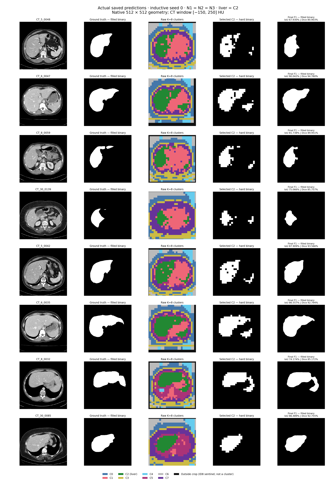
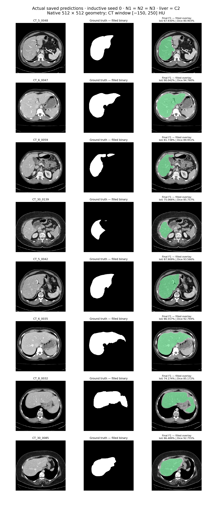

# Actual prediction arrays and visualizations

Inductive seed0, N1=N2=N3, selected liver cluster **C2**. No PDF was read. No masks were reconstructed. All42 StageA hashes remain unchanged.

Source cluster grids: /Users/navneetbavineni/STEGO/audit/naming/inductive_s0_grids.npy; shape2341×28×28. Saved masks: /Users/navneetbavineni/STEGO/audit/naming/inductive_s0_figure_masks.npz; keys N1_hard_<index> and N1_F1_<index> (N2/N3 identical). Each selected grid also matches argmin squared-distance to the existing centres; each saved mask matches an unchanged predict_features call from existing frozen features.

Native geometry uses the original inverse_grid crop metadata with nearest interpolation for hard cluster IDs. Outside-crop ID8 is a sentinel, not another cluster. All masks are filled native512×512 arrays. Overlay alpha.4 is for display only. NPY arrays are in the exact eight-slice order listed below; per-slice PNGs have no resizing.

| Slice | Global index | F1 native IoU % | F1 native Dice % | Absolute error vs StageB |
|---|---:|---:|---:|---:|
| CT_5_0048 | 1916 | 67.929777 | 80.902599 | 0 / 0 |
| CT_6_0047 | 2005 | 90.042152 | 94.760190 | 0 / 0 |
| CT_8_0059 | 2095 | 81.737867 | 89.951388 | 0 / 0 |
| CT_30_0139 | 2242 | 75.066074 | 85.757420 | 0 / 0 |
| CT_5_0042 | 1922 | 87.909390 | 93.565723 | 0 / 0 |
| CT_6_0035 | 2017 | 86.557423 | 92.794403 | 0 / 0 |
| CT_8_0032 | 2122 | 74.174193 | 85.172426 | 0 / 0 |
| CT_30_0085 | 2296 | 86.489209 | 92.755189 | 0 / 0 |

All TP/FP/FN, IoU and Dice match both the original StageB and its later reproduction exactly at512 and224; verification.json stores the numbers and file hashes. Labels were used only for display and scoring.

## Array paths

- cluster_grid_28: [cluster_grid_28.npy](/Users/navneetbavineni/STEGO/audit/naming/actual_predictions/cluster_grid_28.npy)
- cluster_assignments_native_512: [cluster_assignments_native_512.npy](/Users/navneetbavineni/STEGO/audit/naming/actual_predictions/cluster_assignments_native_512.npy)
- selected_liver_hard_512: [selected_liver_hard_512.npy](/Users/navneetbavineni/STEGO/audit/naming/actual_predictions/selected_liver_hard_512.npy)
- final_F1_512: [final_F1_512.npy](/Users/navneetbavineni/STEGO/audit/naming/actual_predictions/final_F1_512.npy)
- ground_truth_512: [ground_truth_512.npy](/Users/navneetbavineni/STEGO/audit/naming/actual_predictions/ground_truth_512.npy)

## Figures

