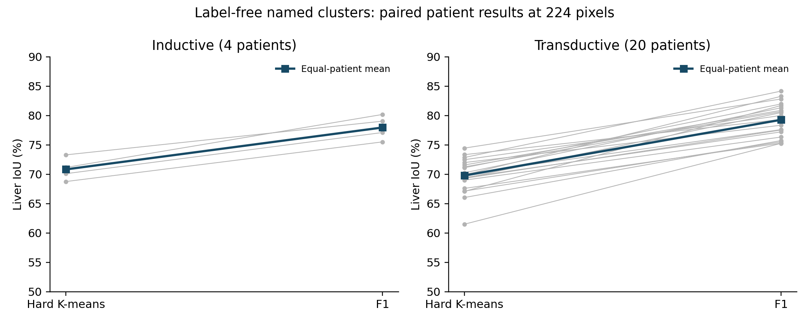
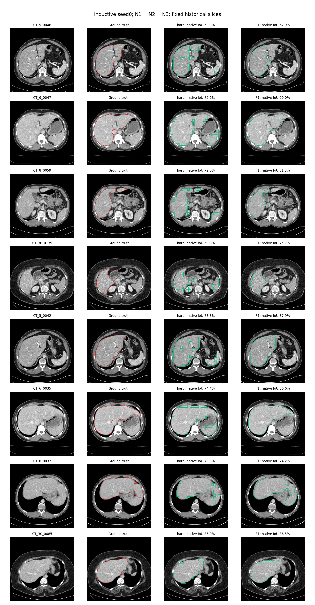

# Frozen BiomedCLIP CT liver segmentation: final label-free naming results

## Result and scope

All six sealed fits were re-evaluated on CPU with the existing scoring/prediction code. Every numerical result, per-slice score, diagnostic ranking and reference agreement reproduced exactly (elapsed time excluded). No fitting, training, parameter change, source edit or replacement of a sealed artifact was performed. N1, N2 and N3 select the same cluster within every fit, and all selections agree with both saved label-assisted reference mappings. Naming removes the need for patient annotations at the current naming/inference stage; it does not change the masks relative to those references.

Across seeds, the four-patient inductive F1 estimate is **IoU 77.963 ± 2.068 [75.514–80.185]% and Dice 87.605 ± 1.308 [86.049–89.003]%**. The twenty-patient transductive estimate is **IoU 79.272 ± 2.849 [75.263–84.156]% and Dice 88.409 ± 1.774 [85.885–91.394]%**. These are primary224, patient-pooled metrics; SD is across patients after averaging each patient's seed scores, not a confidence interval or three independent cohorts.

## Fixed method and statistical definitions

Frozen BiomedCLIP ViT-B/16, final LayerNorm patch tokens then L2 normalization, no centering, body-cropped448 input and 28×28 patch grid; K=8 saved centres for seeds 0/1/2. CT[-150,250] HU window, grayscale replicated to3 channels, BiomedCLIP normalization once. Inductive centres use 16 training patients/1869 slices; only the four validation patients/472 slices are scored. Transductive centres use all 20 patients/2341 slices and those same 20 are scored. No refit was required.

N1 uses 200 nearest eligible body patches per centre without requiring prior hard-cluster membership, 112-pixel native crops resized to 224, joint-space BiomedCLIP image/text embeddings, fixed 15 prompts, and maximum liver z-score. N2 uses rawHU>-500, disk 5 opening, largest component and hole filling; x<.5,y<.6,mean HU 40..180 candidates ranked by body-patch area. N3 accepts exact N1/N2 agreement only. Full operational parameters are in the sealed ../PARAMETERS.json and ../stageA_manifest.json.

Hard predictions use the inherited nearest-grid inverse crop. F1 uses existing per-fit softmax distance temperature, bilinear inverse crop, guided filter radius 8/epsilon .01, threshold .5, largest 2D component, hole filling and disk 3 closing. F1 is not merely soft assignment: these post-processing steps are part of its fixed definition. No F2 median filter is used. Stored per-fit temperatures are listed in audit_verification.json.

Per-patient pooled IoU = sum(TP)/(sum(TP)+sum(FP)+sum(FN)); Dice =2sum(TP)/(2sum(TP)+sum(FP)+sum(FN)). Cohort summaries weight patients equally. Mean-slice aggregation averages slice scores within each patient, then summarizes patients equally. The inherited scorer assigns 0 to empty-prediction/empty-truth slices; both aggregations preserve that convention. SD uses ddof=1. No pixel/slice count is treated as the number of independent patients. No significance test or confidence interval is claimed.

## Main results: primary224, patient-pooled percentages

Agreement is exact equality of the named singleton with the majority / optimal reference subset for each scored patient. All three rules are shown; none was selected by score. Inductive reference mappings use train16 labels; transductive reference mappings use other19 labels in LOPO. These references never enter StageA.

| Protocol | Seed | Rule | Cluster | Agreement M/O | Hard IoU | Hard Dice | F1 IoU | F1 Dice |
|---|---|---|---|---|---|---|---|---|
| inductive | 0 | N1 | 2 | 4/4 / 4/4 | 70.831 ± 1.918 [68.759–73.303] | 82.914 ± 1.311 [81.488–84.595] | 77.962 ± 2.068 [75.514–80.185] | 87.605 ± 1.308 [86.049–89.003] |
| inductive | 0 | N2 | 2 | 4/4 / 4/4 | 70.831 ± 1.918 [68.759–73.303] | 82.914 ± 1.311 [81.488–84.595] | 77.962 ± 2.068 [75.514–80.185] | 87.605 ± 1.308 [86.049–89.003] |
| inductive | 0 | N3 | 2 | 4/4 / 4/4 | 70.831 ± 1.918 [68.759–73.303] | 82.914 ± 1.311 [81.488–84.595] | 77.962 ± 2.068 [75.514–80.185] | 87.605 ± 1.308 [86.049–89.003] |
| inductive | 1 | N1 | 3 | 4/4 / 4/4 | 70.831 ± 1.918 [68.759–73.303] | 82.914 ± 1.311 [81.488–84.595] | 77.963 ± 2.068 [75.514–80.185] | 87.605 ± 1.308 [86.049–89.003] |
| inductive | 1 | N2 | 3 | 4/4 / 4/4 | 70.831 ± 1.918 [68.759–73.303] | 82.914 ± 1.311 [81.488–84.595] | 77.963 ± 2.068 [75.514–80.185] | 87.605 ± 1.308 [86.049–89.003] |
| inductive | 1 | N3 | 3 | 4/4 / 4/4 | 70.831 ± 1.918 [68.759–73.303] | 82.914 ± 1.311 [81.488–84.595] | 77.963 ± 2.068 [75.514–80.185] | 87.605 ± 1.308 [86.049–89.003] |
| inductive | 2 | N1 | 4 | 4/4 / 4/4 | 70.831 ± 1.918 [68.759–73.303] | 82.914 ± 1.311 [81.488–84.595] | 77.963 ± 2.068 [75.514–80.186] | 87.605 ± 1.308 [86.049–89.003] |
| inductive | 2 | N2 | 4 | 4/4 / 4/4 | 70.831 ± 1.918 [68.759–73.303] | 82.914 ± 1.311 [81.488–84.595] | 77.963 ± 2.068 [75.514–80.186] | 87.605 ± 1.308 [86.049–89.003] |
| inductive | 2 | N3 | 4 | 4/4 / 4/4 | 70.831 ± 1.918 [68.759–73.303] | 82.914 ± 1.311 [81.488–84.595] | 77.963 ± 2.068 [75.514–80.186] | 87.605 ± 1.308 [86.049–89.003] |
| transductive | 0 | N1 | 6 | 20/20 / 20/20 | 69.768 ± 2.975 [61.493–74.489] | 82.157 ± 2.100 [76.156–85.380] | 78.809 ± 2.936 [74.800–83.574] | 88.120 ± 1.837 [85.584–91.052] |
| transductive | 0 | N2 | 6 | 20/20 / 20/20 | 69.768 ± 2.975 [61.493–74.489] | 82.157 ± 2.100 [76.156–85.380] | 78.809 ± 2.936 [74.800–83.574] | 88.120 ± 1.837 [85.584–91.052] |
| transductive | 0 | N3 | 6 | 20/20 / 20/20 | 69.768 ± 2.975 [61.493–74.489] | 82.157 ± 2.100 [76.156–85.380] | 78.809 ± 2.936 [74.800–83.574] | 88.120 ± 1.837 [85.584–91.052] |
| transductive | 1 | N1 | 3 | 20/20 / 20/20 | 69.813 ± 2.945 [61.496–74.378] | 82.189 ± 2.080 [76.158–85.306] | 80.199 ± 2.731 [75.759–85.320] | 88.987 ± 1.684 [86.208–92.078] |
| transductive | 1 | N2 | 3 | 20/20 / 20/20 | 69.813 ± 2.945 [61.496–74.378] | 82.189 ± 2.080 [76.158–85.306] | 80.199 ± 2.731 [75.759–85.320] | 88.987 ± 1.684 [86.208–92.078] |
| transductive | 1 | N3 | 3 | 20/20 / 20/20 | 69.813 ± 2.945 [61.496–74.378] | 82.189 ± 2.080 [76.158–85.306] | 80.199 ± 2.731 [75.759–85.320] | 88.987 ± 1.684 [86.208–92.078] |
| transductive | 2 | N1 | 3 | 20/20 / 20/20 | 69.770 ± 2.973 [61.504–74.489] | 82.159 ± 2.099 [76.164–85.380] | 78.809 ± 2.936 [74.801–83.575] | 88.120 ± 1.837 [85.585–91.053] |
| transductive | 2 | N2 | 3 | 20/20 / 20/20 | 69.770 ± 2.973 [61.504–74.489] | 82.159 ± 2.099 [76.164–85.380] | 78.809 ± 2.936 [74.801–83.575] | 88.120 ± 1.837 [85.585–91.053] |
| transductive | 2 | N3 | 3 | 20/20 / 20/20 | 69.770 ± 2.973 [61.504–74.489] | 82.159 ± 2.099 [76.164–85.380] | 78.809 ± 2.936 [74.801–83.575] | 88.120 ± 1.837 [85.585–91.053] |

All three rules abstain in 0/3 inductive fits and0/3 transductive fits; N3 has 0/6 abstentions overall. No abstaining case occurred, so performance of the abstention mechanism on failure cases is NOT VERIFIED.

## Mean across seeds, both scales and both aggregations

Average each patient's three seed scores first, then calculate mean/sampleSD/range across patients. This is not an ensemble mask. Identical N1/N2/N3 and reference-majority/reference-optimal results are represented once here; every row is retained in all_configurations.csv and the supplementary tables.

| Protocol | Scale | Aggregation | Prediction | IoU mean ± SD [min–max] | Dice mean ± SD [min–max] |
|---|---|---|---|---|---|
| inductive | 224 | pooled | hard | 70.831 ± 1.918 [68.759–73.303] | 82.914 ± 1.311 [81.488–84.595] |
| inductive | 224 | pooled | F1 | 77.963 ± 2.068 [75.514–80.185] | 87.605 ± 1.308 [86.049–89.003] |
| inductive | 224 | mean_slice | hard | 61.637 ± 6.577 [55.178–68.014] | 73.409 ± 6.834 [66.395–79.999] |
| inductive | 224 | mean_slice | F1 | 66.003 ± 7.821 [57.493–73.897] | 75.252 ± 8.133 [66.461–82.798] |
| inductive | 512 | pooled | hard | 70.897 ± 1.842 [68.927–73.294] | 82.960 ± 1.257 [81.606–84.589] |
| inductive | 512 | pooled | F1 | 77.943 ± 2.048 [75.525–80.151] | 87.593 ± 1.296 [86.056–88.982] |
| inductive | 512 | mean_slice | hard | 61.724 ± 6.555 [55.313–68.133] | 73.486 ± 6.813 [66.528–80.109] |
| inductive | 512 | mean_slice | F1 | 65.972 ± 7.845 [57.458–73.859] | 75.232 ± 8.157 [66.435–82.766] |
| transductive | 224 | pooled | hard | 69.784 ± 2.959 [61.498–74.452] | 82.168 ± 2.089 [76.159–85.355] |
| transductive | 224 | pooled | F1 | 79.272 ± 2.849 [75.263–84.156] | 88.409 ± 1.774 [85.885–91.394] |
| transductive | 224 | mean_slice | hard | 59.924 ± 4.959 [49.148–68.087] | 71.714 ± 5.334 [60.166–80.049] |
| transductive | 224 | mean_slice | F1 | 65.472 ± 5.740 [54.444–74.565] | 74.252 ± 6.196 [62.481–83.402] |
| transductive | 512 | pooled | hard | 69.801 ± 2.956 [61.565–74.539] | 82.180 ± 2.087 [76.211–85.412] |
| transductive | 512 | pooled | F1 | 79.274 ± 2.856 [75.315–84.184] | 88.410 ± 1.778 [85.918–91.411] |
| transductive | 512 | mean_slice | hard | 59.950 ± 4.987 [49.039–68.211] | 71.743 ± 5.354 [60.088–80.163] |
| transductive | 512 | mean_slice | F1 | 65.470 ± 5.762 [54.396–74.529] | 74.249 ± 6.212 [62.445–83.376] |

## Descriptive maxima: explicitly label-informed, not selected configurations

- Inductive: seed2, F1 IoU 77.963 ± 2.068 [75.514–80.186]%, Dice 87.605 ± 1.308 [86.049–89.003]%. This retrospective maximum uses evaluation labels. It is not a recommended seed, a confirmatory estimate, or permission to tune. N1/N2/N3 tie exactly.
- Transductive: seed1, F1 IoU 80.199 ± 2.731 [75.759–85.320]%, Dice 88.987 ± 1.684 [86.208–92.078]%. This retrospective maximum uses evaluation labels. It is not a recommended seed, a confirmatory estimate, or permission to tune. N1/N2/N3 tie exactly.

## Seed stability: IDs versus actual masks

Cluster IDs have no shared meaning across fits. We align complete 8-cluster partitions with label-free Hungarian matching of patch co-occurrence, and separately compare the actual named binary hard/F1 masks on all evaluated slices. Thus permutation equivalence is tested rather than inferred from similar IoU. Inter-seed Dice below compares predictions with predictions and uses no ground truth.

| Protocol | Seeds | Aligned partition agreement % | Named IDs correspond | Hard inter-seed Dice % | F1 inter-seed Dice % | Identical hard slices | Identical F1 slices | Hard pixel disagreement % | F1 pixel disagreement % |
|---|---|---|---|---|---|---|---|---|---|
| inductive | [0, 1] | 99.993785 | True | 100.000000 | 99.999884 | 472/472 | 455/472 | 0.000000 | 0.000015 |
| inductive | [0, 2] | 99.993514 | True | 100.000000 | 99.999871 | 472/472 | 453/472 | 0.000000 | 0.000016 |
| inductive | [1, 2] | 99.999730 | True | 100.000000 | 99.999987 | 472/472 | 470/472 | 0.000000 | 0.000002 |
| transductive | [0, 1] | 87.442572 | True | 98.025035 | 98.382265 | 903/2341 | 200/2341 | 0.298850 | 0.211291 |
| transductive | [0, 2] | 99.992426 | True | 99.997959 | 99.999186 | 2335/2341 | 1979/2341 | 0.000305 | 0.000105 |
| transductive | [1, 2] | 87.438486 | True | 98.024413 | 98.382971 | 903/2341 | 200/2341 | 0.298950 | 0.211201 |

Inductive seeds produce exactly identical hard liver masks on all 472 validation slices; native F1 differs by only 2–20 pixels per seed pair across the entire evaluation set. Their selected IDs (2,3,4) denote the same liver region, although the complete 8-cluster partition is not bit-identical after permutation. Transductive seed1 is not merely an ID permutation of seeds 0/2: aligned partition agreement is about 87.44%, hard liver-mask inter-seed Dice about 98.02%, and F1 inter-seed Dice about 98.38%. Seeds0/2 are much closer. Thus semantic naming is stable, but all transductive masks are not equivalent. A partition agreement below 100% rules out an exact global relabeling. Different selected IDs can still correspond to the same liver-like region, but mask equality is asserted only when differing-pixel counts are zero. F1 may amplify small centre/temperature differences through connected-component decisions. No seed was chosen to improve these comparisons.

| Protocol | Prediction | Metric | Seed0 /1 /2 means % | SD of seed means | Range pp |
|---|---|---|---|---|---|
| inductive | hard | iou | 70.830779 / 70.830779 / 70.830779 | 0.000000 | 0.000000 |
| inductive | hard | dice | 82.914038 / 82.914038 / 82.914038 | 0.000000 | 0.000000 |
| inductive | F1 | iou | 77.962442 / 77.962501 / 77.962610 | 0.000085 | 0.000168 |
| inductive | F1 | dice | 87.605341 / 87.605377 / 87.605445 | 0.000053 | 0.000105 |
| transductive | hard | iou | 69.767679 / 69.813260 / 69.770278 | 0.025599 | 0.045581 |
| transductive | hard | dice | 82.156987 / 82.189316 / 82.158839 | 0.018154 | 0.032329 |
| transductive | F1 | iou | 78.808796 / 80.198770 / 78.809497 | 0.802300 | 1.389974 |
| transductive | F1 | dice | 88.120018 / 88.987214 / 88.120459 | 0.500548 | 0.867196 |

## Baseline comparison: separate matched and historical comparisons

**Exactly matched448 baseline:** reference-majority and reference-optimal yield exactly the same masks/scores as label-free naming on these fits. The naming gain in IoU is 0 percentage points; the gain is avoiding annotation-based semantic assignment. F1 versus hard K-means changes post-processing, not naming.

| Protocol | Direct448 hard IoU | F1 IoU | F1 minus hard IoU pp | Direct448 hard Dice | F1 Dice |
|---|---|---|---|---|---|
| inductive | 70.831 | 77.963 | 7.132 | 82.914 | 87.605 |
| transductive | 69.784 | 79.272 | 9.489 | 82.168 | 88.409 |

**Historical224-input baseline and STEGO heads:** the table below uses the same four validation patients,224 scoring masks and equal-patient pooled-pixel definitions. Historical mapping is optimal LOPO over the other three validation patients. Current names are label-free from train images; grid/crop/upsampling/post-processing differ. This is a descriptive pipeline comparison, not a controlled attribution of gains to naming or to one component. The full batch600 checkpoint was selected using labels; that selection remains optimistic.

| Method | Patient-mean IoU ± SD [range] | Patient-mean Dice ± SD [range] | Global majority IoU/Dice | Global optimal IoU/Dice |
|---|---|---|---|---|
| Frozen direct K=8 224, seed0 | 64.020 ± 2.317 [60.903–66.505] | 78.045 ± 1.733 [75.701–79.884] | 64.135 / 78.149 | 64.135 / 78.149 |
| Frozen direct K=8 224, seed1 | 64.020 ± 2.317 [60.903–66.505] | 78.045 ± 1.733 [75.701–79.884] | 64.135 / 78.149 | 64.135 / 78.149 |
| Frozen direct K=8 224, seed2 | 64.020 ± 2.317 [60.903–66.505] | 78.045 ± 1.733 [75.701–79.884] | 64.135 / 78.149 | 64.135 / 78.149 |
| seed0 | 43.842 ± 8.078 [33.076–51.697] | 60.620 ± 8.042 [49.709–68.158] | 43.749 / 60.869 | 43.749 / 60.869 |
| seed1 | 32.549 ± 6.597 [25.526–41.417] | 48.837 ± 7.392 [40.670–58.575] | 0.000 / 0.000 | 32.853 / 49.457 |
| seed2 | 30.722 ± 4.912 [25.194–36.567] | 46.841 ± 5.745 [40.248–53.552] | 0.000 / 0.000 | 31.948 / 48.425 |
| best600 | 44.180 ± 3.614 [41.686–49.469] | 61.220 ± 3.405 [58.842–66.193] | 44.400 / 61.496 | 44.400 / 61.496 |
| final | 30.074 ± 3.982 [26.161–35.545] | 46.135 ± 4.638 [41.472–52.447] | 0.000 / 0.000 | 29.807 / 45.925 |

Historical all 20 transductive direct224-input K=8 baseline: IoU 62.872 ± 2.604 [59.044–68.096]%, Dice 77.172 ± 1.959 [74.246–81.020]%, other19 LOPO mapping. Current448 hard improves the reported patient mean by 6.912 IoU points; F1 by 16.401 points. These are combined historical pipeline changes on a reused cohort, not an untouched-test effect or an isolated naming improvement.

Saved STEGO scores are reused, not retrained or newly inferred. Checkpoint existence and source paths are in results.json; a missing file would not erase the saved result but would prevent independent checkpoint rerunning. New224/native mean-slice results for historical STEGO are NOT VERIFIED here; no false equivalence with current F1 is implied.

## Label-use and leakage audit

| Stage | Labels accessed? | Purpose / evidence |
|---|---|---|
| Original StageA | NO, in the recorded guarded process | Images, raw DICOM HU, frozen features/centres, crop/image/text embeddings and body statistics; no masks or saved semantic mappings. Metadata contained unused mask filenames/hashes. |
| Current stability/naming recheck | NO | Saved embeddings/statistics rederive names; actual prediction comparisons and partition alignment; no scoring labels. |
| Original and repeated StageB | YES | IoU/Dice, cluster ranking, overlays, reference agreement; inductive stored train-label references and transductive other19 LOPO references are comparisons only. |
| Historical research/development | YES | K=8,448 resolution, CT window and F1 parent selection were previously informed by these patients' labels. |
| Descriptive best-seed summary | YES | Retrospective reporting only; no seed/configuration chosen for deployment or new evaluation. |

Manifest SHA256 `ceb1f5e236980247444416469c03c86339348d4e73e51c2208de39f2d430416b`; all42 sealed files match. Initial seal 2026-10-02T09:33:59.711902+00:00; final seal 2026-10-02T09:34:17.225361+00:00; StageB started 2026-10-02T09:34:34.940073+00:00 — 17.714712 seconds after the final seal. Timestamps are quoted in UTC as stored.

The failed first attempt stopped because an extra hard-assignment restriction left only 13 eligible patches for one cluster. The correction removed that unintended restriction to implement the declared all-body-patches rule. The successful log restarts GEOMETRY at 0 and traverses the dataset, then repeats nearest-patch selection, embeddings and naming before sealing. The frozen code recomputes those body statistics directly from raw DICOM. No corrected parameters were chosen by a score sweep.

**Historical evidentiary limit:** logs, frozen code, the read guard, the zero-label-read ledger and execution notes support pre-scoring correction and label-free StageA. They are local self-generated records, not an independent OS-level audit. A complete access ledger for the failed first attempt and proof of absence of any external/cognitive score influence are **NOT VERIFIED**. No claim is made that historical labels were never seen. After sealing, all 42 artifact hashes still match and rederived selections equal the sealed ones; no subsequent change to those naming outputs was found.

Label-free inference means new image predictions need no masks. Label-free naming means these cluster IDs were assigned using text/anatomy without masks. Neither phrase means the pretrained vision-language model had no image-text supervision, nor that the historical research process was fully unsupervised.

## Failure modes and limits

Native-resolution diagnostics below use labels only to describe errors. Tiny nonempty slices have fewer than 2000 liver pixels; empty slices are reported separately. The threshold is a reporting stratum from the prior protocol, not a pipeline parameter.

| Protocol | Seed | Prediction | Empty slices | Empty with any FP | Mean FP pixels/empty slice | Tiny slices | Tiny mean-slice IoU % | Other nonempty slices | Other mean-slice IoU % |
|---|---|---|---|---|---|---|---|---|---|
| inductive | 0 | hard | 0 | 0 | N/A | 30 | 2.731 | 442 | 64.073 |
| inductive | 0 | F1 | 0 | 0 | N/A | 30 | 0.093 | 442 | 68.215 |
| inductive | 1 | hard | 0 | 0 | N/A | 30 | 2.731 | 442 | 64.073 |
| inductive | 1 | F1 | 0 | 0 | N/A | 30 | 0.093 | 442 | 68.215 |
| inductive | 2 | hard | 0 | 0 | N/A | 30 | 2.731 | 442 | 64.073 |
| inductive | 2 | F1 | 0 | 0 | N/A | 30 | 0.093 | 442 | 68.215 |
| transductive | 0 | hard | 0 | 0 | N/A | 155 | 2.459 | 2186 | 63.390 |
| transductive | 0 | F1 | 0 | 0 | N/A | 155 | 0.017 | 2186 | 69.138 |
| transductive | 1 | hard | 0 | 0 | N/A | 155 | 2.380 | 2186 | 63.387 |
| transductive | 1 | F1 | 0 | 0 | N/A | 155 | 0.009 | 2186 | 70.402 |
| transductive | 2 | hard | 0 | 0 | N/A | 155 | 2.459 | 2186 | 63.395 |
| transductive | 2 | F1 | 0 | 0 | N/A | 155 | 0.017 | 2186 | 69.139 |

There are no empty-ground-truth slices in either evaluated set; the empty-slice false-positive statistic is N/A, not zero false positives. Specificity on liver-absent slices is NOT VERIFIED. Tiny-liver failures are severe: for inductive seed0, native mean-slice IoU falls from 2.731% hard to 0.093% F1 on 30 slices with 1–1999 liver pixels. The pooled-pixel improvement is therefore not a uniform improvement on all anatomy sizes. The hard liver-like cluster still spills into other organs and has28×28-grid boundary artifacts. F1 often removes disconnected spill and fills holes, but largest-component filtering can discard genuine disconnected liver and morphological closing cannot restore missing information. N2 assumes the documented native axial orientation. N1 margins are descriptive scores, not calibrated uncertainty. N3 was never tested on a disagreement case in these six fits. Twenty CT patients from one acquisition cohort, only four in the inductive evaluation, and repeated label-informed development limit generalization. Independent-cohort performance, clinical suitability, and significance of small seed differences are NOT VERIFIED.

## Figures and reproducibility

Figure1. Primary224 pooled-per-patient IoU, each patient averaged across seeds. Grey lines are patients; blue is the equal-patient mean. No confidence interval implied. [Vector PDF](patient_results.pdf).

Figure2. The eight previously fixed validation slices; inductive seed0 is displayed by a fixed illustrative convention, not because it scored highest. Ground truth red; named hard/F1 contours green. All three rules are identical here. Slice selection was historically label-informed. [Vector PDF](fixed_slices.pdf).

Producers: reproduce.py re-executes the sealed scorer with only output destinations redirected; audit_record.py verifies seals and rederives names without labels; stability.py compares actual predictions without labels; report_results.py computes all aggregates, tables and figures. Outputs: reproduction_verification.json, audit_verification.json, stability.json, results.json, all_configurations.csv, per_patient.csv, failure_diagnostics.csv and SUPPLEMENTARY_TABLES.md. Original evidence: ../NAMING.md, ../EXECUTION_NOTES.md, ../stageA_manifest.json, ../stageA_ledger.json and the sealed outputs. All source/data/cache/checkpoint files are read-only in this workflow.

## Publication-ready interpretation

On this repeatedly studied CHAOS CT cohort, frozen BiomedCLIP features with K=8 clustering support annotation-free semantic cluster naming using either fixed text prompts or a fixed anatomical/HU prior. Both rules and their agreement rule identify the same liver-like cluster in all six saved fits and reproduce the label-assisted reference predictions. With the fixed F1 post-processing, the seed-averaged inductive result is 77.96% liver IoU and 87.61% Dice across four patients; the transductive result is 79.27% IoU and 88.41% Dice across 20 patients. This pooled-pixel estimate coexists with severe failure on tiny-liver slices and untested liver-absent-slice specificity. The scientific advance over the saved label-assisted448 pipeline is removal of label-based cluster naming, with no loss of its recorded segmentation scores—not an additional accuracy gain from naming. F1 improves the direct hard-clustering scores on this cohort. These results do not establish fully unsupervised historical development, independence from pretrained text supervision, performance on an untouched test cohort, or clinical robustness. Historical K/resolution/window/post-processing choices and retrospective best-seed reporting remain label-informed; no further tuning or head training was performed.
