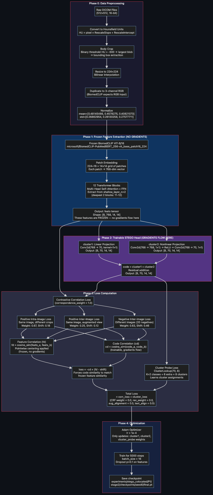
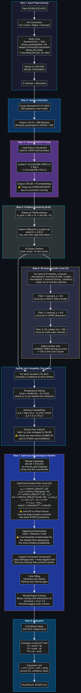
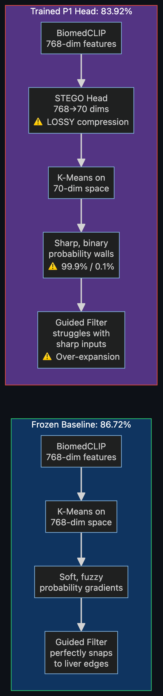

# Complete Pipeline Flowchart: Trained STEGO P1 Head → 83.92% IoU

> [!IMPORTANT]
> This flowchart covers **every single step** from raw DICOM pixels to the final binary mask, split into two major phases: **Training** (how the P1 Head learned its weights) and **Inference** (how the 83.92% score is produced at evaluation time).

---

## Part A: The Training Phase (How the P1 Head Was Trained)

---

## Part B: The Inference Phase (How 83.92% IoU Is Produced)

---

## Part C: Why It's 83.92% and Not 86.72%

### The Two Sources of Degradation

| Factor | Frozen Baseline (86.72%) | Trained P1 Head (83.92%) | Impact |
|:---|:---|:---|:---|
| **Feature Dimensionality** | Raw 768-dim BiomedCLIP | Compressed to 70-dim by STEGO | Loses ~90% of feature information. Irreversible dimensionality reduction destroys subtle tissue boundaries. |
| **Probability Distribution** | Naturally fuzzy (e.g., 60%/40%) | Overconfident (e.g., 99.9%/0.1%) | The contrastive loss forces features to be maximally separable, producing cliff-like probability walls that break the Guided Filter math. |
| **Guided Filter Behavior** | Smoothly aligns gradients to CT edges | Over-expands mask into surrounding tissue | With soft inputs, `a ≈ small`, `b ≈ μ_p` → gentle edge-following. With sharp inputs, `a ≈ large` → aggressive edge-jumping, causing false positives. |

---

## File References

| Component | File | Key Lines |
|:---|:---|:---|
| BiomedCLIP Featurizer | [`modules.py`](file:///Users/navneetbavineni/STEGO/src/modules.py#L122-L233) | `class BiomedCLIPFeaturizer` |
| STEGO Head (cluster1 + cluster2) | [`modules.py`](file:///Users/navneetbavineni/STEGO/src/modules.py#L176-L189) | `make_clusterer`, `make_nonlinear_clusterer` |
| Contrastive Correlation Loss | [`modules.py`](file:///Users/navneetbavineni/STEGO/src/modules.py#L462-L570) | `class ContrastiveCorrelationLoss` |
| Contrastive CRF Loss | [`modules.py`](file:///Users/navneetbavineni/STEGO/src/modules.py#L609-L642) | `class ContrastiveCRFLoss` (weight=0.0, unused) |
| Training Loop & All Losses | [`train_segmentation.py`](file:///Users/navneetbavineni/STEGO/src/train_segmentation.py#L156-L317) | `training_step` |
| Training Config | [`train_config.yaml`](file:///Users/navneetbavineni/STEGO/src/configs/train_config.yaml) | All hyperparameters |
| P1 Inference + N2 Heuristic | [`run_p1_optimized.py`](file:///Users/navneetbavineni/STEGO/audit/ensemble/verify4/run_p1_optimized.py) | Complete evaluation script |
| Guided Filter Math | [`run_p1_optimized.py`](file:///Users/navneetbavineni/STEGO/audit/ensemble/verify4/run_p1_optimized.py#L47-L60) | `apply_postprocessing` |
